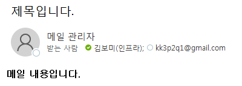
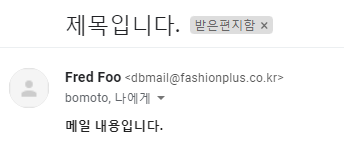

프로젝트에서 메일 전송 기능을 구현해야 했다.

관련 라이브러리를 찾아봤는데 nodemailer가 가장 많이 사용되고 있고 공식 문서에 정리도 잘 되어 있어서 이걸 선택했다.

사용 방법은 예제에 잘 나와있다.

[https://nodemailer.com/about/](https://nodemailer.com/about/)

[Nodemailer :: Nodemailer](https://nodemailer.com/about/)

```javascript
  const nodemailer = require('nodemailer');

  const sendMail = async () => {
    // 메일 보낼 계정 설정
    let transporter = nodemailer.createTransport({
      host: 'smtp.office365.com',
      port: 25,  // 포트번호 입력
      secure: false,
      auth: {
        user: 'test@address.com', // 로그인할 마스터 계정
        pass: 'password!@', // 계정의 비밀번호
      },
    });

    // send mail with defined transport object
    let info = await transporter.sendMail({
      from: '"Fred Foo" <test@address.com>', // 보내는 사람 정보
      to: 'bomoto@fashionplus.co.kr, kk3p2q1@gmail.com', // 받는 사람 정보
      subject: '제목입니다.', // 제목
      html: '<b>메일 내용입니다.</b>', // 내용
      //text: '메일 내용입니다.', // 내용을 text 형식으로 보낼때 사용
    });

  };

// sendMail실행
  sendMail()
    .then(() => {
      console.log('send mail success');
    })
    .catch(console.error);
```

&lt;outlook>



&lt;gmail>



아웃룩 계정과 지메일 계정 둘 다 메일이 잘 도착했다.
