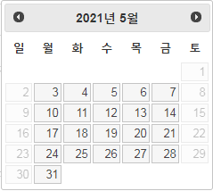
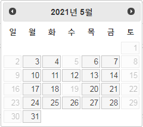

일요일, 토요일을 선택 불가하도록 막을 것이다.



```javascript
$("#datePicker").datepicker({
        beforeShowDay: function(date) {
            var day = date.getDay();
            return [(day != 0 && day != 6)];
        }
    })
    .on("change", function(e) {
    });
```

beforeShowDay옵션을 이용해 특정일 비활성화 처리를 해줄 수 있다.
자바스크립트의 요일을 숫자로 반환해주는 getDay() 메서드를 이용해 요일들을 0~6 사이의 숫자로 가져온다.
요일이 일요일(0)이거나 토요일(6)이면 false를 리턴해 비활성화 처리가 된다.

여기서 추가로 공휴일 선택도 막아보자.



```javascript
//선택불가능 날짜
var cantPickDates = ["-01-01", "-03-01", "-05-05", "-05-19", "-06-06", "-08-15", "-10-03", "-10-09", "-12-25"];

function isWorkdays(date) {
    var nowYear = date.getFullYear();
    var nowMonth = date.getMonth() + 1;
    var nowDate = date.getDate();
    var day = date.getDay();

    if (cantPickDates[0] == "-01-01") {
        for (var i = 0; i < cantPickDates.length; i++) {
            cantPickDates[i] = nowYear + cantPickDates[i]
        }
    }
    if (nowMonth < 10) {
        nowMonth = "0" + nowMonth;
    }
    if (nowDate < 10) {
        nowDate = "0" + nowDate;
    }

    now = nowYear + "-" + nowMonth + "-" + nowDay;

    if ($.inArray(now, cantPickDates) >= 0) {
        return false
    } else {
        if (day == 0 || day == 6) {
            return false
        };
        return [true, "", ""];
    };
};

$("#datePicker").datepicker({
        beforeShowDay: isWorkdays
    })
    .on("change", function(e) {
    });
```

코드가 길어져서 beforeShowDay옵션을 isWorkdays함수로 만들어 설정했다.

비활성화 처리할 날짜들을 cantPickDates배열에 넣어 처리해 준다.

매년 비활성화 처리할 것이라서 일단 년 부분은 제외하고 배열에 저장해준 뒤 반복문으로 올해 연도를 붙여준다.

inArray()로 포함 여부를 체크해서 비활성화할 날짜 목록에 포함되면 false를 리턴한다.

추가로 datePicker로 추가로 달력에 뿌려질 날짜 month에 +1을 해줬기 때문에 datePicker로 선택한 날짜 value를 가져올 때는 month에 1을 빼줘야 원하는 값이 나온다.
