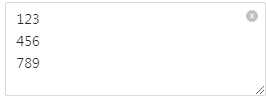

인풋 창에 여러 가지 값을 동시에 검색하는 기능을 구현하려고 한다.
각 값의 구분을 해줘야 하기 때문에 구분자를 먼저 정한다.
만약 구분자를 콤마(,)로 정했다면 엔터에 해당하는 정규식을 콤마로 대체해주면 된다.



위와 같이 입력해서 123의 검색 결과, 456의 검색 결과, 789의 검색 결과를 모두 한 번에 조회하려면 아래와 같이 사용한다.

```javascript
const toComma = value.replace(/(?:\r\n|\r|\n)/g, ',');  //엔터를 콤마(,)로 바꿈
console.log(toComma);  // 123,456,789
```

이렇게 하면 123,456,789의 형태로 바꿀 수 있다.

이 값을 콤마로 잘라서 하나씩 DB로 보내 조회하면 된다.
