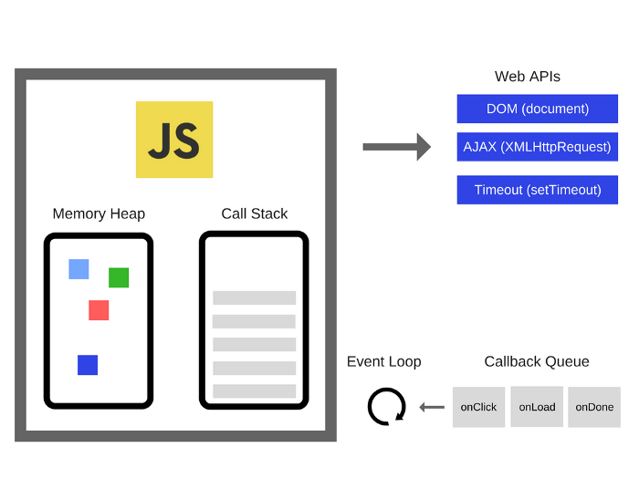

자바스크립트하면 떠오르는 이미지 중 대표적인 것 중 하나가 '비동기'일 것이다.

하지만 자바스크립트는 싱글 스레드로 동작하는 언어라고 말하던데 어떻게 싱글 스레드이면서 비동기적일 수가 있는 걸까?

먼저 노드의 특징인 이벤트 기반에 대한 내용을 알아야 한다.

> 이벤트 기반 시스템에서는 특정 이벤트가 발생할 때 미리 지정해둔 콜백 함수가 실행된다.
> 이벤트가 발생하면 이벤트 리스너에 등록해둔 콜백 함수를 호출하고 이벤트가 없거나 이미 다 처리했다면 노드는 대기 상태에 들어간다.

여기서 이벤트 루프라는 개념이 등장한다.

이벤트 루프는 여러 이벤트가 동시에 발생할 때 어떤 순서로 콜백 함수를 호출할지 결정해준다.

\*이벤트 루프: 이벤트 발생 시 호출할 콜백 함수들을 관리, 순서를 결정한다. 노드가 종료될 때까지 작업을 반복한다.


*자바스크립트 엔진*

이벤트 발생 시 호출 스택(Call Stack)에 작업들이 쌓이게 된다.

그 후 스택이라는 이름에서 알 수 있듯이 나중에 쌓인 작업 먼저 실행되게 된다.

```javascript
    function first() {
      second();
      console.log('first');
    }
    function second() {
      third();
      console.log('second');
    }
    function third() {
      console.log('third');
    }
    first();
```

위의 코드를 실행해보면 아래의 순서와 같다.

third
second
first

제일 처음에 호출된 first()가 제일 나중에 실행되고 제일 나중에 호출된 third()가 가장 먼저 실행되는 것이다.

그렇다면 설정된 시간 이후에 코드를 실행하는 setTimeout을 사용하면 어떻게 될까?

```javascript
     function run() {
      console.log('run 3 second later');
    }
    console.log('start');
    setTimeout(run, 3000);
    console.log('end');
```

결과는 아래와 같다.

start
end
run 3 second later

이 결과는 예상했던 결과일 수 있다.

그렇다면 이번엔 3초 딜레이가 아닌 0초 딜레이를 설정하면 어떻게 될까?

```javascript
     function run() {
      console.log('run 0 second later');
    }
    console.log('start');
    setTimeout(run, 0);
    console.log('end');
```

그 결과는 이렇다.

start
end
run 0 second later

왜 run함수가 가장 늦게 실행된 건지 알기 위해선 호출 스택에 대한 이해가 필요하다.



그림에서 보이듯이 Call Stack과 Web APIs와 Callback Queue

1\. 가장 먼저 콜 스택에 console.log('start') 작업이 쌓인다.

2\. 콜 스택에 쌓인 작업이 바로 실행되어 'start'가 출력되고 콜 스택은 비워진다.

3\. 다음으로 setTimeout이 콜 스택에 쌓이고 마찬가지로 바로 실행되어 비워진다.

4\. Web API인 setTimeout은 설정된 초만큼 대기한 후 이벤트 루프가 run()을 콜백 큐로 이동시킨다.

5\. 그다음 console.log('end'가 콜 스택에 들어가고 바로 실행되어 'end'를 출력한다.

6\. 호출 스택 실행이 끝나서 비워지면 이벤트 루프가 콜백 큐에 있는 목록을 콜 스택으로 올려 보낸다.

7\. 마지막으로 run함수의 내용이 실행되고 끝난다.

이벤트 루프는 콜 스택이 비어 있을 때만 콜백 큐에 있는 작업을 가져오기 때문에 콜 스택에 실행 목록이 아주 많다면 setTimeout으로 설정한 시간에 정확히 run함수가 실행되지 않을 수 있다.

그렇다면 이벤트 루프를 이용했을 때 얻을 수 있는 이점은 무엇일까?

이벤트 루프는 오래 걸리는 함수를 대기열로 보내서 다음 코드가 먼저 실행되게 하고 대기열로 보낸 함수는 콜백 큐를 거쳐 호출 스택으로 올라오도록 한다.

이 방식이 노드의 특징 중 하나인 논블로킹 I/O이다.

이 방식이 여러 작업이 있을 때 블로킹 방식보다 더 짧은 시간 동안 처리할 수 있다.

위의 이벤트 루프 방식을 활용해서 작업들의 호출 순서를 조절하면 효과적인 처리가 가능하다.

아래 링크에서 이벤트 루프의 동작 과정을 시각적으로 확인할 수 있다.

[http://latentflip.com/loupe/?code=ZnVuY3Rpb24gcnVuKCkgew0KICAgICAgY29uc29sZS5sb2coJ3J1biAwIHNlY29uZCBsYXRlcicpOw0KICAgIH0NCiAgICBjb25zb2xlLmxvZygnc3RhcnQnKTsNCiAgICBzZXRUaW1lb3V0KHJ1biwgMCk7DQogICAgY29uc29sZS5sb2coJ2VuZCcpOw%3D%3D!!!PGJ1dHRvbj5DbGljayBtZSE8L2J1dHRvbj4%3D](http://latentflip.com/loupe/?code=ZnVuY3Rpb24gcnVuKCkgew0KICAgICAgY29uc29sZS5sb2coJ3J1biAwIHNlY29uZCBsYXRlcicpOw0KICAgIH0NCiAgICBjb25zb2xlLmxvZygnc3RhcnQnKTsNCiAgICBzZXRUaW1lb3V0KHJ1biwgMCk7DQogICAgY29uc29sZS5sb2coJ2VuZCcpOw%3D%3D!!!PGJ1dHRvbj5DbGljayBtZSE8L2J1dHRvbj4%3D)

[http://latentflip.com/loupe/?code=ZnVuY3Rpb24gcnVuKCkgew0KICAgICAgY29uc29sZS5sb2coJ3J1biAwIHNlY29uZCBsYXRlcicpOw0KICAgIH0NCiAgICBjb25zb2xlLmxvZygnc3RhcnQnKTsNCiAgICBzZXRUaW1lb3V0KHJ1biwgMCk7DQogICAgY29uc29sZS5sb2coJ2VuZCcpOw%3D%3D!!!PGJ1dHRvbj5DbGljayBtZSE8L2J1dHRvbj4%3D](http://latentflip.com/loupe/?code=ZnVuY3Rpb24gcnVuKCkgew0KICAgICAgY29uc29sZS5sb2coJ3J1biAwIHNlY29uZCBsYXRlcicpOw0KICAgIH0NCiAgICBjb25zb2xlLmxvZygnc3RhcnQnKTsNCiAgICBzZXRUaW1lb3V0KHJ1biwgMCk7DQogICAgY29uc29sZS5sb2coJ2VuZCcpOw%3D%3D!!!PGJ1dHRvbj5DbGljayBtZSE8L2J1dHRvbj4%3D)
