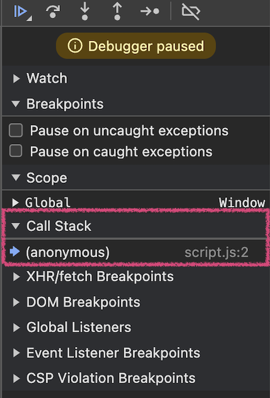
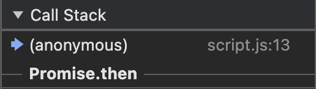
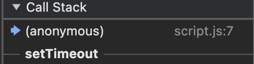
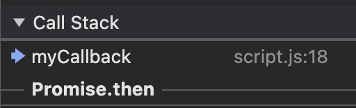

어느 날 문득 ‘이벤트 루프가 실행되는 과정을 시작적으로 확인해 볼 수 있는 방법이 있을까?’ 하는 궁금증이 들었다.

물론 `console.log()`를 코드 곳곳에 넣어서 출력을 확인하거나 `console.trace()`로 콜스택을 살펴볼 수도 있지만, 뭔가 더 간편하게 보여주는 방법이 있을 것 같았다.

이 글에서는 `debugger`를 이용해 **콜스택(Call Stack)과 마이크로태스크 큐(Microtask Queue)의 실행 과정**을 직접 눈으로 확인하는 방법을 알아보겠다.

* * *

## 1\. 이벤트 루프 실행 순서 확인하기

프론트엔드 면접에서 자주 등장하는 문제 중 하나가 다음 코드의 실행 순서를 예상하는 것이다.

```typescript
console.log("1");

setTimeout(() => {
  console.log("2");
}, 0);

Promise.resolve().then(() => {
  console.log("3");
});

console.log("4");
```

이 코드의 실행 결과는 다음과 같다.

```angelscript
1
4
3
2
```

이를 브라우저 개발자 도구에서 직접 확인해 보자.

* * *

## 2.debugger를 이용한 콜스택 분석

백엔드를 다뤘을 때는 디버깅할 때 console로 출력해 보기보다는 break-point를 찍어서 디버깅을 했었는데, 프론트 디버깅을 할 때는 아무래도 브라우저 상에 코드 결과가 시각적으로 보이다 보니 어느 지점이 문제인지 보이기 때문에 break-point의 필요성이 든 적이 없었던 것 같다. (이 얘기를 왜 쓰냐면.. 이번에 debugger 라는걸 처음 알았기 때문에 변명을 좀 해보고자..)

이벤트 루프 순서를 맞히는 문제 코드에 `debugger`를 추가해 주자.

```typescript
console.log("1");
debugger;

setTimeout(() => {
  console.log("2");
  debugger;
}, 0);

Promise.resolve().then(() => {
  console.log("3");
  debugger;
});

console.log("4");
debugger;
```

이제 크롬 개발자 도구를 열고 **Sources 탭**으로 이동한 후, `Pause on debugger statement`를 활성화한다.


*"Pause on debugger statement" 활성화*

각 `debugger`위치에서 코드 실행이 일시 정지되며, 현재의 **콜스택(Call Stack)**을 확인할 수 있다.



script.js 파일의 2번째 줄의 익명 함수라는 정보도 확인할 수 있다.

이를 통해 예상대로 1 → 4 → 3 → 2 순서로 코드가 실행되는 걸 볼 수 있다.

* * *

## 3\. 익명 함수와 기명 함수의 콜스택 차이

콜스택을 보다 보면 (anonymous)라고 표시되는 경우가 있다.

여기에서 드는 궁금증이 ‘기명 함수를 실행하면 저 (anonymous) 부분에 함수 이름이 나올까?’ 하는 점이다.

이를 확인하기 위해 익명 함수와 기명 함수를 각각 실행해 보자.

```delphi
// 익명 함수
(function() {
  debugger;
})();

// 기명 함수
function namedFunction() {
  debugger;
}

namedFunction(); // 기명 함수 호출
```

#### 실행 결과:

익명 함수 콜스택: (`anonymous`)로 표시됨


*익명 함수 콜스택*

기명 함수 콜스택: 함수 이름(`namedFunction`)이 표시됨


*기명 함수 콜스택*

\* 참고로 34번 줄은 debugger의 위치, 37번 줄은 기명함수를 실행한 namedFunction();의 위치이다.

즉, 콜스택에서 (`anonymous`)가 보인다면 해당 위치에 **익명 함수가 실행 중**이라는 뜻이다.

* * *

## 4.Promise.then()의 콜스택 표시 방식

이번엔 `Promise`의 콜스택을 보자. `Promise`는 콜스택에 아래같이 나온다.



`setTimeout`도 동일한 형식이었는데, (anonymous) 아래에 `Promise.then`이라고 나와있다.



일단 (`anonymous`) 부분부터 살펴보자.

이는 위 3번에서 기명 함수를 호출했을 때처럼 `Promise.then()`에 익명함수가 전달되기 때문이다.

테스트를 위해 `.then()`에 기명 함수를 전달해 보자.

```delphi
function myCallback() {
  debugger;
}

Promise.resolve().then(myCallback);
```

**결과:**



예상대로 `myCallback` 이라는 함수 이름이 잘 찍힌다.

그럼 `Promise.then` 콜스택에서 함수 이름 아래에 `Promise.then`이 찍히는 이유는 뭘까? 🤔🤔

이벤트 루프가 비동기 실행을 위해 태스크 큐로 이동시키는 작업들은 이렇게 표시가 된다.

브라우저가 마이크로태스크 큐에서 `Promise.then`을 실행할 때 내부적으로 `Promise.then` 핸들러를 호출하는데, 이 과정이 콜스택에 기록된다.

비슷한 방식으로 `setTimeout()`의 콜백도 태스크 큐(Task Queue)에서 실행되므로, 실행될 때 `setTimeout` 아래에 해당 콜백이 표시된다.

* * *

## 5\. 정리

-   이벤트 루프는 콜스택, 마이크로태스크 큐, 태스크 큐를 조율하며 실행된다.
-   debugger를 사용하면 콜스택과 실행 흐름을 시각적으로 확인할 수 있다.
-   Promise.then과 setTimeout의 콜백은 각자의 큐에서 실행될 때 콜스택에 기록된다.
