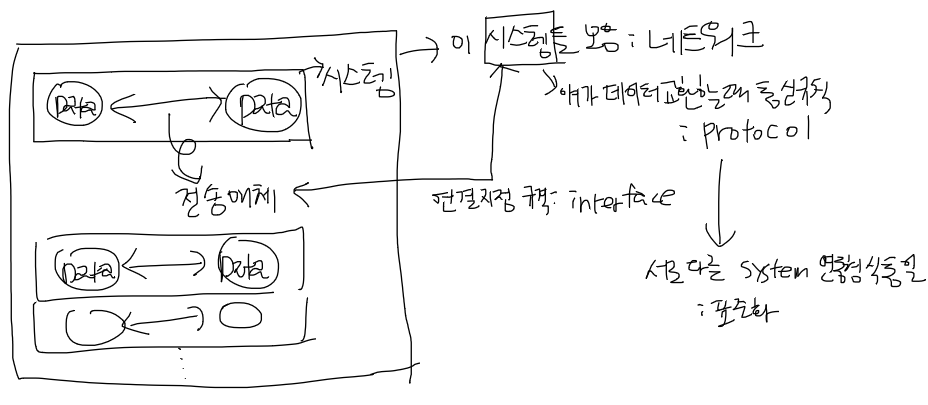
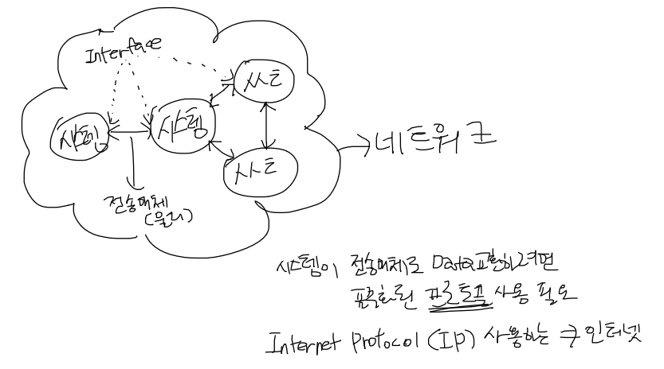
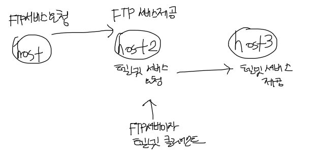
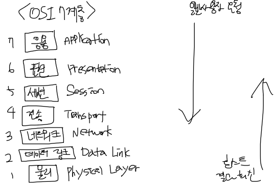
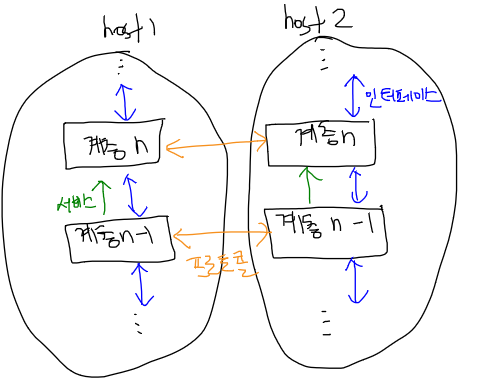
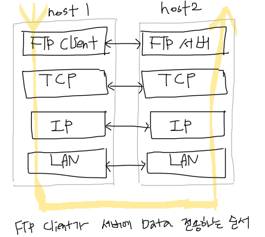
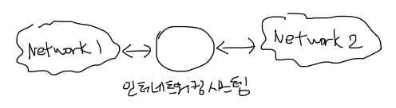
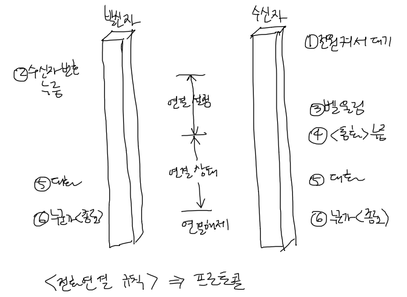
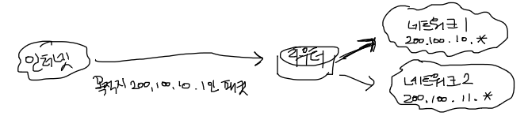
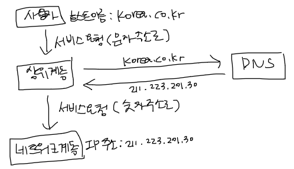

01 네트워크 관련 기초 용어

  1. 네트워크 기초 용어

1.  시스템 : 내부 규칙에 따라 동작하는 대상 ex)자동차, 자판기, 컴퓨터, 교통제어 신호등, 운영체제 ….
2.  Interface : 시스템-시스템 연결하는 표준화된 방법 ex)컴터-키보드 연결할 때 정해진 위치에 잭 꽂음
3.  전송매체(Transmission Media) : 물리적 전송수단 ex)동축케이블, 공기, 무선 신호 …
4.  Protocol : 시스템이 전송매체로 데이터 교환할 때 따르는 규칙
5.  네트워크 : 여러 시스템이 프로토콜로 데이터 주고받는 것을 하나로 묶은 것. 네트워크끼리 라우터로 연결
6.  인터넷 : 전 세계 네트워크가 연결된 통합 네트워크. 각 네트워크 종류 다르지만 데이터 전달할 땐 IP프로토콜 사용
7.  표준화 : 서로 다른 시스템 연동 형식 ex)용지-프린터기 회사 다르지만 A4라는 규격 사용

  2. 시스템 기초 용어

-   노드 : 인터넷에 연결된 시스템
-   호스트 : 컴퓨팅 기능이 있는 시스템. 사용자가 네트워크에 접속하는 창구 역할
-   클라이언트 : 서비스를 이용하는 시스템
-   서버 : 서비스를 제공하는 시스템

▷ 클라이언트 & 서버 : 이용 서비스에 따라 클라이언트 될 수도 서버 될 수도

02 네트워크의 기능

  1\. 계층 모델

- 특징이 다른 호스트 서로 연결하려면 연결방식 표준화 필요

▷ 프로토콜과 인터페이스

호스트끼리 통신 과정에서 각 계층 모듈이 상대 호스트의 동일 계층과 개별적으로 통신 수행해야 함

각 계층은 정해진 방식, 절차에 따라 통신 규칙 있음 -> **프로토콜**

상하위 계층 간 규칙 -> **인터페이스**

하위 계층이 상위 계층에 제공하는 인터페이스 -> **서비스**

▷ 인터넷 계층 구조

   2. 인터네트워킹 : 네트워크 + 네트워크 연결

▷ 게이트웨이 : 인터네트워킹 기능을 수행하는 시스템

- 리피터 : 물리 계층. 물리 신호는 거리 멀수록 감쇄되기 때문에 리피터가 증폭해줌

- 브리지 : 리피터 기능에 데이터 링크 계층 기능 추가된 것. 물리 계층의 오류 해결

- 라우터 : 물리, 데이터 링크, 네트워크 계층의 기능 지원.

어느 경로가 빠른지 판단해줌. 라우팅 테이블에 네트워크랑 호스트 정보 보관

   3. 프로토콜

:통신 시스템이 데이터 교환 위해 사용하는 통신 규칙. 계층 1 끼리, 계층 2 끼리.. 통신하는 프로토콜 존재

우편 보낼 때 정해진 규격 봉투 사용하듯이 데이터 교환할 때 특정 형태로 데이터 규격화 필요

봉투에 발신 주소, 수신 주소 적듯이 데이터를 프로토콜에 맞춰줘야 함

OSI7계층의 규격화된 데이터는 고유 명칭 있음. 전부 말할 때는 PDU(Protocol Data Unit)

응용: APDU / 표현: PPDU / 세션: SPDU / 전송: TPDU(세그먼트-TCP, 데이터그램-UDP) / 네트워크: NPDU(패킷) / 데이터 링크: DPDU(프레임)

03 네트워크 주소의 표현

 - 구분자 : 시스템에는 고유의 구분자 필요. (디지털화된 컴퓨터에서는 구분자는 숫자임. 어려우니 보통은 문자 주소 사용)

 - 특징 : 유일성, 확장성, 편리성, 정보의 함축

  1. 주소와 이름

       숫자 기반 **주소** -> 기호로 된 **이름**

      ▷ IP주소 : 네트워크 계층 IP 프로토콜이 호스트 구분하기 위하여 사용하는 주소 체계. 8비트X4=32비트로 구성

IPv6는 128비트로 확장함

▷ 호스트 이름 : 숫자로 된 호스트의 IP주소 외우기 힘듦. -> 문자로 된 호스트 이름 사용

사용자가 사용한 문자 호스트 이름을 숫자로 변환 : DNS (Domain Name System)

  2. 주소 정보의 관리

   \* 호스트 파일 : 호스트 이름과 IP주소를 변환하는 방법은 특정 파일에 호스트 이름과 IP주소 조합을 기록, 관리하는 것

   \* DNS

호스트 파일로 주소와 이름을 관리하는 것은 간단 but 수동 작업임.

특히 인터넷 같은 전 세계 컴퓨터 연결된 경우는 호스트 파일로는 사실상 불가능

그래서 DNS사용. 주소와 이름 정보를 자동으로 유지, 관리하는 분산 데이터베이스 시스템

네임서버라는 관리 호스트가 주소랑 이름 정보 유지. 주소 변환 필요? 클라이언트가 네임 서버에 요청해서 IP주소 얻음

   \* 기타 주소 - OSI 7 계층에서 목적에 따라 여러 형태 주소 사용됨.

- MAC 주소 : 계층 2의 MAC 계층에서. LAN 카드 내장됨. 물리 계층 통해 데이터 전송할 때 MAC 주소 이용해 호스트 구분함

네트워크 계층 -> 데이터 링크 계층 데이터 전송할 때 : IP주소 -> MAC 주소로 변환 필요

- IP 주소 : 네트워크 계층 기능 수행하는 IP 프로토콜에서 사용. 라우팅(IP패킷이 지나가는 경로 결정)의 기준이 됨

- 포트 주소(포트 번호, 소켓 주소) : 전송 계층. TCP와 UDP가 독립적으로 포트 주소 관리

- 메일 주소 : 응용 계층. 사용자 구분 용도
