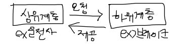
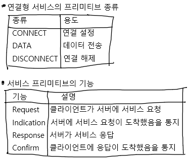
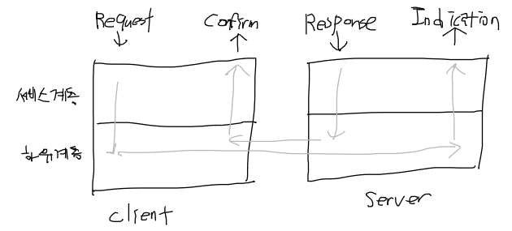

01 계층 구조의 개념

  1. 계층적 모듈 구조

     - 모듈화 : 시스템을 \[A모듈-B모듈-C모듈\]로 관리하는 게 편함. 중간 B모듈만 갈아 끼우기 가능

     - 계층 구조

  2\. 프로토콜 설계 시 고려 사항

1.  주소 표현 : 호스트를 유일하게 구분하는 용도 ex) 브로드캐스팅, 멀티캐스팅
2.  오류 제어 : 전송 과정에서 데이터 분실, 변형 등의 오류 -> 복구
3.  흐름 제어 : 송신자가 데이터를 너무 빨리 보내서 수신자가 미처 처리x -> 해결
4.  데이터 전달 방식 : 단방향, 전이중, 반이중 있음

  3. 서비스 프리미티브

       - 연결형 서비스(통화 절차와 유사)

1단계:데이터 전달 경로 설정(연결 설정) -> 2단계:데이터 전송 -> 3단계:연결 해제

- 비연결형 서비스(우편 시스템과 비슷) : 연결 설정&해제 불필요. 전송할 데이터 있으면 보내면 됨

  \* 전화 시스템과 비교

발신자가 전화번호 누름(Request) -> 해당하는 전화 울리게(Indication)-> 통화 버튼(Response) -> 발신음 끊김(Confirm)

02 OSI 참조 모델

  1. OSI 7계층 모델

      - 상대 호스트의 계층 n모듈과 통신할 때 사용하는 규칙을 계층 n 프로토콜이라고 함

      - 동료 프로세스 : 다른 호스트 동일 계층이면 같은 프로토콜 사용하기 때문에 동료 프로세스라고 함

      - 모듈 사이에는 인터페이스로 둘 사이의 접근 방법 제한

          \* 데이터 전달할 때 동료 프로세스에 직접 전달하는 게 아니라 하위 계층을 통해 간접 전달.

그래서 결국 최하위에 있는 물리 계층을 통해 전송됨

▷ 헤더 정보 : 상위 계층 -> 하위 계층 갈 때 (데이터)+(자신의 프로토콜에서 정의한 헤더 정보)를 보냄.

그래서 최하위인 물리 계층에는 위의 헤더에 모든 계층 헤더 정보가 담겨 있음

수신 호스트에서는 물리에서부터 올라오기 때문에 헤더가 점점 줄어듦. 나중엔 데이터만 남음

▷ 중개 기능 : 송신 호스트 -> 수신 호스트로 데이터 전달할 때

경로 배정 기능을 수행하는 네트워크 계층의 프로토콜이 동작함 => **라우팅**

  2. 계층별 기능

1.  물리 : 데이터 전송 속도, 클록 동기화, 물리적 연결 형태
2.  데이터 링크 : 물리의 물리적 전송 오류 해결/네트워크에 신뢰성 있는 패킷 전송 보장. 이 계층을 이용해 전송되는 데이터 : 프레임
3.  네트워크 : 라우팅 문제 처리, 네트워크 트래픽 증가 문제 조절하는 혼잡 제어 (패킷)
4.  전송 : 송신 프로세스-수신 프로세스 직접 연결하는 단대단(End-to-End) 통신 기능 제공.
    전송 오류율, 전송 속도, 흐름 제어 기능
5.  세션 : 원격 전송, 원격 로그인, 토큰 제어, 일시적 전송 장애 해결하기 위한 동기 기능
6.  표현 : 데이터의 의미와 표현 방법 처리, 데이터 암호화, 대용량 데이터 압축
7.  응용 : FTP부터 시작된 파일 공유(텔넷이 제공하는 가상 터미널, 전자 메일 - 대표적 인터넷 서비스)

03 TCP/IP 모델

  1. 구현 환경

      - 시스템 공간 : TCP와 UDP는 시스템 운영체제인 커널 내부에 구현

-> 일반 사용자가 직접 이용 불가 -> 소켓 인터페이스라는 전송 계층의 프리미티브 이용해야 함

- 사용자 공간 : 세션 계층부터 응용 계층까지 기능은 사용자 프로그램으로 구현됨

  2\. 프로토콜

▷TCP/IP 계층 구조

- ARP와 RARP : 상대방 호스트의 IP주소는 알 수 있지만 MAC 주소는 얻을 수 없다.

-> 상대방 IP주소 이용해 MAC 주소 구하는 기능이 필요 : **ARP**

-> 자신의 MAC 주소는 알지만 IP주소 모름. MAC 주소를 IP주소로 변환 : **RARP**

   - ICMP : 오류 발생 시 송신자에게 회신해 복구 작업해야 함 : **ICMP**
