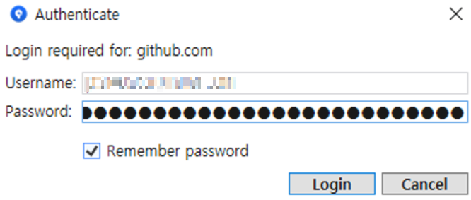
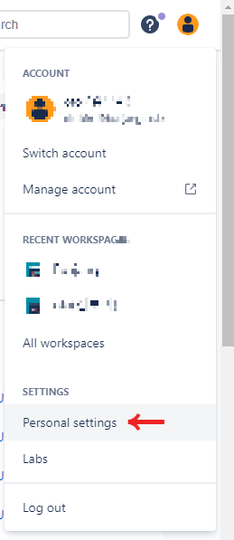
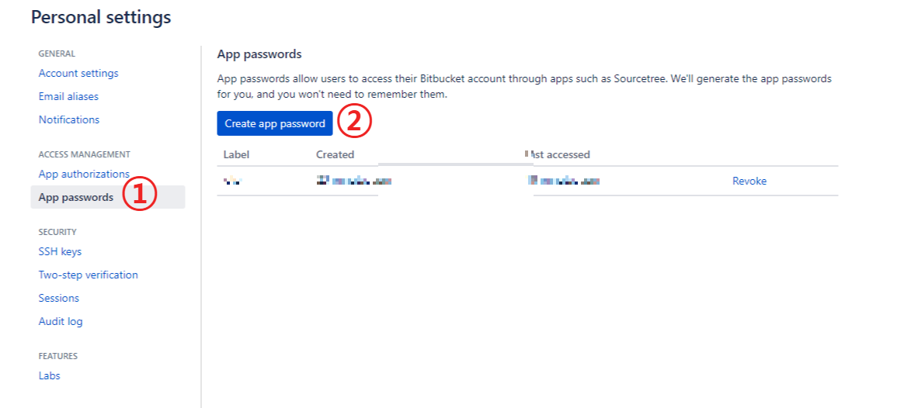
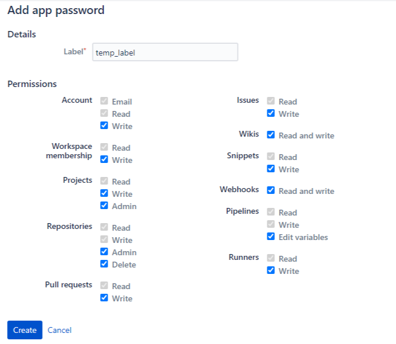
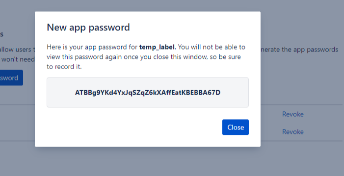

### 에러 원인

소스트리에서 깃 저장소 코드를 가져올 때 최초 한 번 비밀번호 입력 창을 띄운다.

이때 비밀번호를 한 번 잘못 입력하면 다시 입력할 수 있도록 창이 뜨거나 하지 않고 계속 비밀번호가 잘못되었다는 에러나게된다.

에러 내용을 확인해보면 핵심은 아래 내용이다.

Bitbucket Cloud recently stopped supporting account passwords for Git authentication.

그래서 비밀번호를 다시 입력하기 위해서는 비밀번호가 저장된 파일을 삭제해주어야 한다.

## 잘못된 비밀번호 삭제 방법

> C:\\Users\\\[UserName\]\\AppData\\Local\\Atlassian\\SourceTree\\passwd

위 경로에서 passwd 파일을 삭제해준다.

이렇게하면 일단 저장된 비밀번호는 삭제된다.

비밀번호를 알고 있다면 다시 입력하면 되지만 애초에 비밀번호를 까먹은 경우는 다시 비밀번호 설정을 해주어야 한다.

## 비밀번호 재발급

① 깃 저장소에 들어가서 로그인 후 Personal settings에 들어간다.

② 이미지에 나온 순서대로 클릭해서 비밀번호 생성 페이지로 넘어간다.

③ 자유롭게 라벨을 지정해주고 권한을 설정한다음 Create로 비밀번호를 생성한다.

④ 그럼 이렇게 비밀번호가 생성된다.

이 코드는 단 한번만 볼 수 있으니 복사해서 다른곳에 저장해두거나 하면 된다.

⑤ 소스트리에서 패스워드를 요구할 때 이 코드를 입력해주면 된다.

