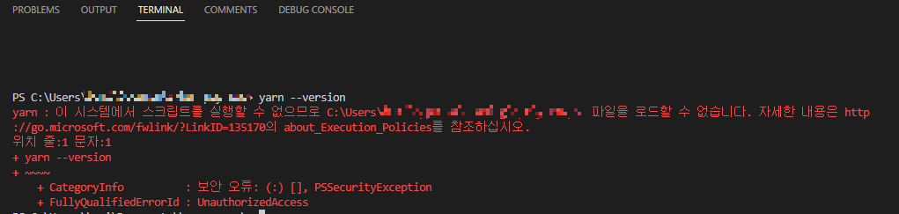
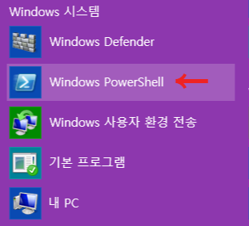
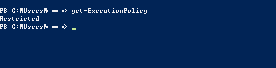
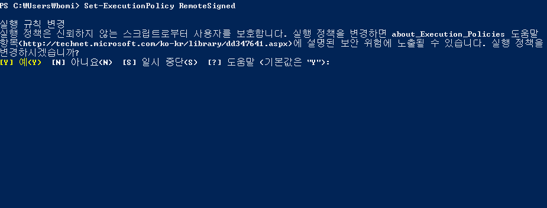
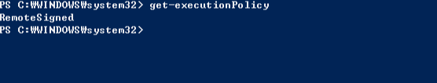
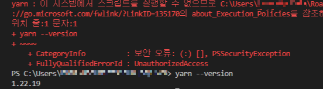

### **에러 내용**



yarn : 이 시스템에서 스크립트를 실행할 수 없으므로 C:\\Users\\~~~~~~~~ 파일을 로드할 수 없습니다. 자세한 내용은 http
://go.microsoft.com/fwlink/?LinkID=135170의 about\_Execution\_Policies를 참조하십시오.
위치 줄:1 문자:1
+ yarn --version
+ ~~~~
    + CategoryInfo          : 보안 오류: (:) \[\], PSSecurityException
    + FullyQualifiedErrorId : UnauthorizedAccess

### **원인**

시스템에서 스크립트를 실행할 수 있는 권한이 없음

### **해결방법**

#### **1\. Windows PowerShell 실행**



#### **2\. 현재 권한 상태 확인**

```shell
get-ExecutionPolicy
```

위 명령어를 파워셀에서 실행해보면 권한 상태가 Restricted로 되어있는 걸 확인할 수 있다.



설정해줘야 하는 권한은 RemoteSigned이다.

\*참고

 Restricted : default설정값으로, 스크립트 파일을 실행할 수 없습니다.

 AllSigned : 신뢰할 수 있는(서명된) 스크립트 파일만 실행할 수 있습니다.

 RemoteSigned : 로컬에서 본인이 생성한 스크립트와, 신뢰할 수 있는(서명된) 스크립트 파일 실행할 수 있습니다.

 Unrestricted : 모든 스크립트 실행 가능

 ByPass : 경고/차단 없이 모든 것을 실행 가능하도록 함

 Undefined : 권한을 설정하지 않겠음

#### **3\. 권한 상태 변경**

```shell
Set-ExecutionPolicy RemoteSigned
```

위 명령어로 권한을 **RemoteSigned**로 변경을 시도하면



이와 같은 화면이 나오는데

```shell
Y
```

파워셀에 Y를 입력해서 권한 변경을 완료해준다.

#### **4\. 권한이 정상적으로 변경되었는지 확인**

```shell
get-ExecutionPolicy
```



이와 같이 정상적으로 변경되었다.

### **결과**

이제 스크립트가 정상적으로 실행된다.


