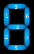

## 컴퓨터의 숫자 표현 방법

인류는 10진수를 사용하고 컴퓨터는 2진수를 사용한다.

컴퓨터도 같이 10진수를 사용하면 기계어를 다룰 때 더 편할 텐데 왜 그렇게 되었을까?

숫자를 디지털로 변환할 때 전기 신호의 On, Off로 데이터를 표현한다.

이때 10진수의 각 자릿수마다 램프를 할당하는 방식은 자원이 많이 소모되었다.

예를 들어 세 자리 숫자 593은 100의 자리 5, 10의 자리 9, 1의 자리 3 세 가지 숫자를 표현해야 한다.

그럼 각 자릿수 별로 0~9의 램프가 필요하니 총 27개의 램프가 있으면 0~999까지를 나타낼 수 있다.

이걸 더 줄이기 위한 방안으로 처음에 '**7 세그먼트 디스플레이**' 방법이 발명되었다.

사실 컴퓨터가 탄생하기 전에 발명된 방법으로 이 방법은 디지털시계의 숫자처럼 한 숫자를 표현하기 위해 7개의 램프가 필요하다.

위 그림처럼 각 램프의 순서를 정해 숫자를 표현한다.

5는 ●○●●●○●  7은 ○○●○○●● 3은 ○○●●●●● 같은 식이다.

7 세그먼트 디스플레이를 사용하면 세 자리 숫자를 표현하는데 7X3 = 21개의 램프만 사용하면 된다.

10진수 표현 방법보다 6개의 램프를 줄일 수 있다.

이것보다 더 줄여서 표현하는 방법은 **주판**이다.

주판은 5개로 하나의 숫자를 표현한다.

4개의 구슬이 0~4를 나타내고 남은 하나로는 여기에 5가 더해지는지의 여부를 표현한다.

2는 ○●●○○으로 7은 ●●●○○로 표현한다.

이렇게 하면 3 자릿수를 표현하는데 6개가 더 적은 15개의 램프가 필요하다.

이것보다 더 줄일 수 있지 않을까?

경우의 수를 계산해보면 한 램프로 2가지 상태를 표현할 수 있으니 두 개의 램프는 2X2 = 4개의 상태를 표현할 수 있다.

3개의 램프는 8개의 상태를 나타낼 수 있는데 0~9까지는 나타낼 수 없다.

UNIVAC I 등 초기 컴퓨터에서는 **Excess-3**이라고 부르는 이 방식으로 사용해 수치를 표현했다.

주판과 이진수의 중간 단계라고 볼 수 있다. 0은 ○○●● 1은 ○●○○ 8는 ●○●● 같이 표현했다.

0~9를 표현하려면 최소 4개의 램프가 필요하다.

0~999까지는 12개의 램프만 있으면 된다.

**Excess-3**은 램프 4개로 16가지를 표현할 수 있지만 10가지만 사용한다.

6가지를 더 표현할 수 있는데 10가지만 표현하는 게 아깝다고 생각하여 찾은 것이 **2진수**이다.

램프 하나가 2가지 상태를 표현할 수 있으니 각 램프를 0과 1로만 표현하자는 발상이다.

12개의 램프로 4096가지의 숫자를 표현할 수 있다.

## 실수의 표현

그렇다면 정수가 아닌 1.5나 0.001 같은 실수는 어떻게 표현할까?

**고정 소수점**은 소수점을 어디에 붙일지 미리 정해두는 것이다.

만약 '4자리 이하를 소수부'라고 정했다면 1은 0.0001이 되고 100은 0.0100이 된다.

이 방법의 문제점은 0.0001보다 작은 숫자를 표현하지 못한다는 것이다.

**부동 소수점**은 데이터에 어디서부터가 소수부인지를 함께 저장한다.

예를 들어 16개 램프가 있다면 그중 10개 램프로 0~1,023까지를 표현하고 나머지 6개 램프로 소수점 위치 표현에 사용한다.

6개 램프로 표현할 수 있는 0~63을 -33~30으로 범위를 이동시킨다고 해보자.

\-1은 소수점을 왼쪽으로 하나 이동한다는 뜻이고(=10으로 나눈다) +1은 소수점을 오른쪽으로 하나 움직인다(=10을 곱한다)는 뜻이다.

부동 소수점의 여러 가지 규칙이 있었지만 현재는 IEEE 754가 적용되고 있다.

○ ○○○○○○○○ ○○○○○○○○○○○○○○○○○○○○○○○와 같이 순서대로 부호, 지수부, 가수부 세 부분으로 나눠 저장한다.

부호가 0이면 양, 1이면 음의 값이고 지수부는 -126~127 범위를 표현한다. -126은 소수점을 왼쪽으로 126자리 이동시키는 것을 뜻한다.

나머지 23개 램프라 가수부인데 소수점 이하 부분을 표현한다.

여기까지만 보면 유연한 부동 소수점이 고정 소수점보다 더 나은 방법 같다. 하지만 단점이 있다.

0.3을 부동소수점으로 표현하면 무한 소수가 되어버린다. 그래서 0.3을 10번 더한 후 소수 자리를 버리면 2가 되어버리는 현상이 발생한다.

은행 같이 돈을 다루는 분야에서는 이런 계산 법이 용납되지 않기 때문에 고정 소수점이나 10진수 계산법을 사용한다.

## 타입이 존재하는 이유

사람에겐 정수 7과 소수 0.7이 비슷해 보여도 컴퓨터에겐 전혀 다른 수다.

컴퓨터는 비트만으로는 이 숫자를 정수로 해석해야 할지 소수점으로 해석해야 할지 알 수 없다.

그래서 이 값이 어떤 종류인지를 알려줘야 하고 이게 바로 '타입'이다.

만약 3.0 + 7.0을 계산하는데 이 두 숫자를 소수점끼리의 덧셈을 하지 않고 정수끼리의 덧셈을 한다면 부동 소수점의 소수점 자리를 나타내는 지수부가 값으로 인식되어서 매우 큰 수가 나온다.

이 때문에 int x나 float y 같이 타입을 지정한 변수를 선언해 처리계가 정수를 덧셈할지 부동 소수점을 덧셈할지 판단하도록 한다.

여기서 문제점이 있는데 x/2라는 코드는 x가 정수인지 소수점인지에 따라 계산 결과가 달라지게 된다는 것이다.

프로그래머가 x의 타입을 기억해두지 않으면 원하는 결과를 얻기 어렵다.

하지만 사람이 타입을 따로 기억하고 있어야만 한다면 타입을 지정해서 변수를 선언할 이유가 없어진다.

## 타입의 발전

▶ 언어의 기본 타입을 조합해서 새로운 타입을 만드는 기능 => 클래스

▶ 구조체나 클래스를 구성하는 타입을 최소한만 공개하겠다 => c++이나 Java의 public / private

▶ 구체적인 구현 방법을 가지고 있니 않은 타입 => 인터페이스

▶ 다양한 타입을 조합해 만든 새로운 유형이 타입이 사용되면서 일부의 타입만을 바꾸고 싶은데 전부 다시 정의해야 한다 => 총칭형(구성 요소의 타입을 일부만 바꿈) ex) C++의 템플릿, Java의 제네릭, Haskell의 형 생성자 등

## 동적 타입

지금까지의 내용처럼 '변수명', '값이 저장된 메모리 위치', '저장된 값이 어떤 종류인지'를 한 세트로 저장하고 있는 것을 동적 타입이라고 한다.

이 방법은 실행 시에 형이 바뀌는 것이 가능하기 때문에 유연한 처리가 가능하다는 장점이 있다.

하지만 이것은 단점이기도 한데, 버그가 있다면 실행 전에 찾아내지 못하기 때문이다.

그래서 컴파일 시에 타입 체크는 하지만 타입 선언을 하지 않아도 컴퓨터가 타입을 추론하는 기능이 추가된 언어가 늘고 있다.
