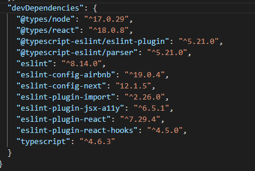

1\. 프로젝트 폴더를 생성한 뒤 해당 경로로 이동한다.

2\. 명령어를 이용해 package.json을 생성한다.

> npm init -y

3\. 넥스트를 설치해준다.

> npm add next react react-dom

4\. 타입스크립트를 설치해준다.

> npm add -D typescript @types/react @types/node

이 과정까지 완료하면 package.json의 디펜던시에 타입스크립트가 추가된다.

5\. 프로젝트에 js로 되어있는 파일을 타입스크립트 파일로 변경해준다.

index.js를 index.tsx로 변경해준 뒤 프로젝트를 실행하면 tsconfig.json파일이 생겨난다.

\+ ESLint를 설정해주려면 터미널에서 프로젝트 경로로 이동한 뒤

> eslint --init

위 명령어로 설정을 해준다.

선택지 중간에 나오는 Does your project use TypeScript 질문에 Yes를 선택해주자.

설정 과정이 끝나면 프로젝트에 .eslintrxc.js파일이 생겨난다.
