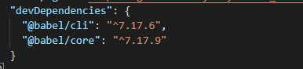
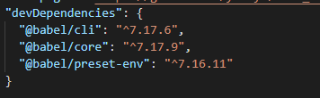
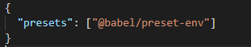
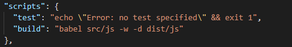
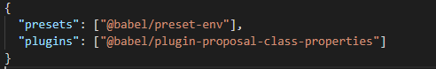

먼저 Babel, Webpack, Polyfill이 무엇인지 간략하게 알아보자.

\[Babel\]

대부분의 브라우저가 ES6의 사양을 거의 모두 지원하는데 IE 11의 ES6 지원율은 상당히 낮은 편이다.

때문에 구형 브라우저에서 ES6의 최신 사양으로 문제없이 동작시켜야 하는데 이때 ES5로 트랜스파일링 해주기 위해 Babel을 사용한다.

\[Webpack\]

의존 관계에 있는 자바스크립트, CSS, 이미지 등의 리소스들을 하나의 파일로 번들링 하는 모듈 번들러다.

\[Polyfill\]

Babel을 사용하여 ES6 사양의 코드를 ES5로 트랜스파일링 해도 브라우저가 지원하지 않는 코드가 존재한다.

대표적 예시로 Promise는 ES5에 대체할 수 있는 기능이 아니기 때문에 트랜스파일링 되지 못하는데 이 때문에 Polyfill을 사용한다.

프로젝트 세팅

1\. Babel 설치

프로젝트 폴더를 만든 후 터미널에서 명령어를 사용해 Babel을 설치하고 package.json파일을 만들어준다.

&amp;lt;package.json생성>

```bash
npm init -y
```

&amp;lt;babel-core, babel-cli설치>

```bash
npm install --save-dev @babel/core @babel/cli
```

package.json 디펜던시에 잘 추가가 되었다.



*package.json*

2\. Babel 프리셋 설치

Babel을 사용하기 위해 Babel플러그인을 모아둔 Babel 프리셋을 설치해준다.

```bash
npm install --save-dev @babel/preset-env
```

설치해주면 package.json에 프리셋이 추가되었다.



*package.json*

다음으로 babel.config.json 설정 파일을 생성하고 아래와 같이 작성하여 프리셋을 사용하겠다고 설정한다.



*babel.config.json*

3\. 트랜스파일링 스크립트 추가

ES5사양의 코드로 트랜스파일링 하려면 명령어를 사용해주어야 하는데 매번 명령어를 입력하여 트랜스파일링 하긴 번거로우니 npm script에 명령어를 등록해준다.



*package.json*

\-w: 모든 파일을 자동으로 트랜스파일링 한다는 의미

\-d: 트랜스파일링 된 파일이 저장될 폴더 지정. 존재하지 않으면 자동 생성

4\. Babel 플러그인 설치

여기까지 진행했다면 대부분의 설치는 끝난 상태다.

하지만 바벨 프리셋이 현재 사양에 대한 플러그인을 지원하지 않아서 에러가 발생할 수도 있다.

에러 내용에 따라 별도의 플러그인을 설치해준다.

클래스 필드를 지원하는 플러그인을 설치한다.

```bash
npm install --save-dev @babel/plugin-proposal-class-properties
```

설치한 플러그인은 설정 파일에 추가해주어야 한다.

아까 바벨 프리셋을 설정해주었던 파일 babel.config.json에 내용을 추가해준다.​



*babel.config.json*

여기까지 끝냈다면 트랜스파일링은 성공적으로 진행될 것이다.

npm run build 명령어를 입력해주면 js파일이 트랜스파일링 되어 ES6이상의 문법이 실행된다.

하지만 이 코드를 브라우저 상에서 실행하려고 하면 문제가 발생한다.

Node.js는 CommonJS방식 모듈 시스템을 지원하기 때문에 로컬에서 실행하면 정상 실행되지만 브라우저에선 CommonJS방식을 지원하지 않아 에러가 발생하는 것이다.

이때 Webpack이 필요해진다.
