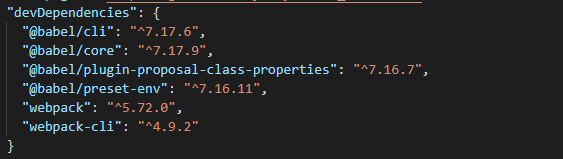
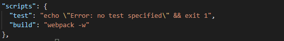
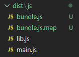
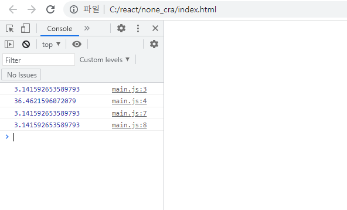
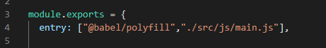

[2022.04.29 - \[React\] - \[React\] CRA없이 프로젝트 세팅(Babel, Webpack, Polyfill) #1](https://bomoto.tistory.com/157)

[React CRA없이 프로젝트 세팅(Babel, Webpack, Polyfill) #1: Babel](https://bomoto.tistory.com/157)

Babel세팅에 이어서 Webpack과 Polyfill을 세팅해주자.

1\. Webpack설치

아래 명령어를 사용하여 웹팩을 설치해준다.

```bash
npm install --save-dev webpack webpack-cli
```

설치가 끝나면 package.json에 잘 추가되었다.



*pakage.json*

2\. babel-loder 설치

웹팩이 모듈을 번들링 할 때 Babel을 사용하여 ES6이상의 코드를 ES5로 트랜스파일링하도록 babel-loader를 설치해준다.

```bash
npm install --save-dev babel-loader
```

그리고 npm script를 수정하여 Babel이 아닌 Webpack을 실행하도록 수정한다.



*pakage.json*

3\. webpack.config.js 설정

Webpack이 실행될 때 설정 파일을 참조할 수 있도록 설정 파일을 작성해준다.

&lt;webpack.config.js>

```javascript
const path = require("path");

module.exports = {
  entry: "./src/js/main.js",

  // 번들링된 js 파일 이름과 저장경로 지정
  output: { path: path.resolve(__dirname, "dist/js"), filename: "bundle.js" },
  module: {
    rules: [
      {
        test: /\.js$/,
        include: [path.resolve(__dirname, "src/js")],
        exclude: /node_modules/,
        use: {
          loader: "babel-loader",
          options: {
            presets: ["@babel/preset-env"],
            plugins: ["@babel/plugin-proposal-class-properties"],
          },
        },
      },
    ],
  },
  devtool: "source-map",
  mode: "development",
};
```

설정 파일을 작성한 뒤 npm run build로 Webpack을 실행하며 트랜스파일링과 번들링을 해주면 아래와 같이 dist/js폴더에 번들 파일이 생겨난다.

작성해준 lib.js와 main.js파일이 번들링 된 결과물이다.



\---확인---

이제 루트 디렉터리에 index.html 파일을 만들고 bundle파일을 불러와서 실행하면 된다.

```html
<!DOCTYPE html>
<html>
  <body>
    <script src="./dist/js/bundle.js"></script>
  </body>
</html>
```

위와 같이 작성 후 브라우저에서 실행하면 정상적으로 동작한다.



4\. babel-polyfill 설치

ES5에 대체할 기능이 없는 Promise 같은 코드를 실행할 수 있도록 해주기 위해 Polyfill을 설치해준다.

```bash
npm install @babel/polyfill
```

babel-polyfill은 운영 환경에서도 사용해주기 때문에 --save-dev 옵션을 적용하지 않는다.

폴리필을 사용하려면 webpack.config.js파일의 entry에 폴리필을 추가해준다.



*webpack.config.js*

이렇게 Polyfill까지 설치해주면 프로젝트의 기본 설정이 완료되었다.

npm run build를 해준 뒤 bundle.js파일을 확인해보면 polyfill까지 추가된 것을 확인할 수 있다.
