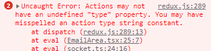

리듀서에 delete 하는 액션을 추가로 정의했는데 위와 같은 에러 메시지가 떴다.

아무리 살펴봐도 타이핑은 제대로 되어있었고 전혀 에러 날 부분이 없는데 왜 자꾸 misspelled 했다는 에러가 뜨는 건지 이해가 안 되었다.

&lt;actionTypes.tsx>

```javascript
(...)
export const DELETE_EMAIL = "DELETE_EMAIL";
```

&lt;actions.tsx>

```javascript
(...)
export const deleteEmail = (data) => ({
  type: types.DELETE_EMAIL,
  data,
});
```

&lt;reducer.tsx>

```javascript
const emailReducer = (state = email, action) => {
  switch (action.type) {
    (...)
    case types.ADD_EMAIL:
      return [...state, action.data];
    (...)
  }
};
```

위처럼 스토어 쪽에 전혀 문제가 없었는데

```javascript
dispatch(actions.deleteEmail(email));  // 에러

dispatch({ type: "DELETE_EMAIL", data:email });  // 에러안남
```

위 코드처럼 계속 써오던 첫 번째 방식으로는 에러가 났고 두 번째 방식으로 변경하니까 에러가 안 났다.

그렇다면 액션 타입을 정의하는 쪽에서 문제가 생겼다는 건데..

혹시나 해서 터미널에 찍히는 내용을 보니까 내가 새롭게 정의한 delete액션이 actionTypes.tsx에 없는 것이었다.

그래서 프로젝트를 종료 후 재실행하니까 문제 해결....

하... 내 시간 ㅠㅠ

그렇지만 지금이라도 해결해서 다행이다!
