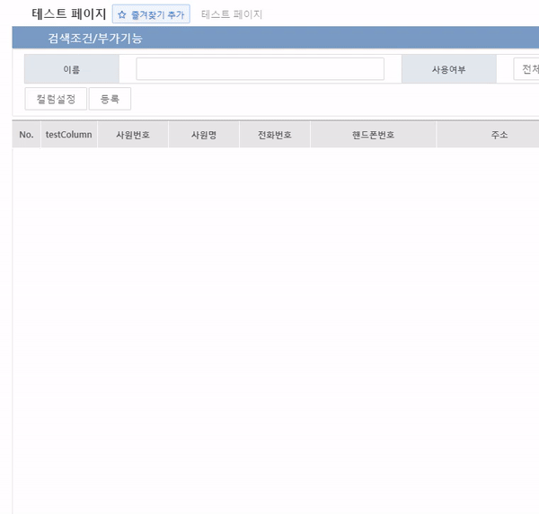

tost ui grid의 컬럼을 설정하는 팝업을 만들었다.



주요 기능으로는 두 가지가 있다.

1.  체크 박스로 노출/비노출 설정
2.  왼쪽 화살표 아이콘으로 컬럼의 순서를 조정


*함수 구조 설계서*


*화살표 아이콘 클릭 함수 순서도*

화살표 아이콘 클릭 시의 알고리즘을 간략하게 설명하자면 이렇다.

  클릭한 게 ▲인지 ▼인지(isUpIcon) 판단

└ ▲클릭 시 조정하려는 컬럼이

맨 윗 컬럼이면 :         ▲아이콘 스타일을 회색으로 변경(▲을 disabled처리)

맨 윗 컬럼이 아니면 :  바로 윗 컬럼과 위치를 바꿈(순서 변경)

  (※ ▼일 때는 반대로 진행)

SortColumnPopup.tsx

```javascript
import React from 'react';

interface IColumn {
  colIdx: number; //컬럼순서
  name: string; //컬럼명(키값으로 사용)
  header: string; //컬럼명
  hidden: boolean;
  align?: string;
  width?: number;
  sortable?: boolean;
  renderer?: any;
}

interface IPropsData {
  propsColumnList: any; //IColumn[]
  open: boolean;
  onClose: Function;
}

const SortColumnsPopup = (props: IPropsData) => {
  const { propsColumnList, open, onClose } = props;

  const [modalOpen, setModalOpen] = React.useState<boolean>(props.open);
  const [columnList, setColumnList] = React.useState<IColumn[]>([]); //모든컬럼
  const [selectedColumn, setSelectedColumn] = React.useState<IColumn | null>(null); //선택한컬럼
  const [upIconDisable, setUpIconDisable] = React.useState<boolean>(false); //false:파란화살표 / true:회색화살표
  const [downIconDisable, setDownIconDisable] = React.useState<boolean>(false);

  const selectedStyle = {
    background: '#e6e6e6',
    borderTop: '1px solid lightgray',
    borderBottom: '1px solid lightgray',
    fontWeight: 'bold',
    height: 47,
  };

  const notSelectedStyle = {
    background: 'white',
    height: 47,
  };

  const iconStyle = {
    fontSize: 50,
    marginLeft: 10,
    marginTop: 20,
    marginBottom: 20,
  };

  React.useEffect(() => {
    setModalOpen(open);
    const propsColData = [] as any;

    propsColumnList.forEach((item: any, index: number) => {
      const data: IColumn = {
        colIdx: index,
        name: item.name,
        header: item.header,
        hidden: item.hidden,
        align: item?.align,
        width: item?.width,
        sortable: item?.sortable,
        renderer: item?.renderer,
      };
      propsColData.push(data);
    });
    setColumnList(propsColData);
  }, [open]);

  const handleOnClose = (isOk: boolean) => {
    if (isOk) {
      onClose(columnList);
    } else {
      onClose();
    }
    setSelectedColumn(null); //선택컬럼 초기화
  };

  //컬럼리스트의 체크박스 클릭 (컬럼의 hidden바꿈)
  const handleCheckBoxOnClick = (value: IColumn) => (e: any) => {
    e.stopPropagation();

    const checked: boolean = e.target.checked;
    const idx = value.colIdx;

    const colList = [] as any;
    columnList.forEach((item: any) => {
      const data: IColumn = {
        ...item,
        hidden: idx === item.colIdx ? !checked : item.hidden,
      };
      colList.push(data);
    });
    setColumnList(colList);
  };

  //순서바꿀 컬럼을 선택하면 selectedCol에 해당 컬럼정보 넣음
  const handleSelectCoulmn = (value: IColumn, index: number) => () => {
    if (index === selectedColumn?.colIdx) {
      setSelectedColumn(null);
    } else {
      if (index === 0) {
        setUpIconDisable(true);
        setDownIconDisable(false);
      } else if (index === columnList.length - 1) {
        setUpIconDisable(false);
        setDownIconDisable(true);
      } else {
        setUpIconDisable(false);
        setDownIconDisable(false);
      }
      setSelectedColumn(value);
    }
  };

  //순서화살표 클릭시
  const handleSortIconOnClick = (isUpIcon: boolean) => () => {
    let temp: IColumn;
    let thisIdx: number;
    let beforeIdx: number;
    let afterIdx: number;
    const colList = [] as any;

    if (!selectedColumn) return;

    if (isUpIcon) {
      //upIcon일경우
      if (selectedColumn && selectedColumn.colIdx !== 0) {
        beforeIdx = selectedColumn.colIdx - 1;
        thisIdx = selectedColumn.colIdx;

        //선택컬럼과 윗 컬럼 위치를 바꿔줌
        temp = columnList[thisIdx];
        columnList[thisIdx] = columnList[beforeIdx];
        columnList[beforeIdx] = temp;

        //두 컬럼의 colIdx값을 바꿔줌
        columnList[beforeIdx].colIdx = beforeIdx;
        columnList[thisIdx].colIdx = thisIdx;

        columnList.forEach((item: IColumn) => {
          colList.push(item);
        });
        setColumnList(colList);
        setSelectedColumn(columnList[beforeIdx]);
        setUpIconDisable(beforeIdx === 0 ? true : false);
        setDownIconDisable(thisIdx === columnList.length - 1 ? false : downIconDisable);
      }
    } else {
      //down일 경우
      if (selectedColumn && selectedColumn?.colIdx !== columnList.length - 1) {
        afterIdx = selectedColumn.colIdx + 1;
        thisIdx = selectedColumn.colIdx;

        //선택컬럼과 아래 컬럼 위치를 바꿔줌
        temp = columnList[thisIdx];
        columnList[thisIdx] = columnList[afterIdx];
        columnList[afterIdx] = temp;

        //두 컬럼의 colIdx값을 바꿔줌
        columnList[afterIdx].colIdx = afterIdx;
        columnList[thisIdx].colIdx = thisIdx;

        columnList.forEach((item: IColumn) => {
          colList.push(item);
        });
        setColumnList(colList);
        setSelectedColumn(columnList[afterIdx]);
        setDownIconDisable(afterIdx === columnList.length - 1 ? true : false);
        setUpIconDisable(thisIdx === 0 ? false : upIconDisable);
      }
    }
  };

  return (
    <Modal
      title="컬럼 환경설정"
      centered
      visible={modalOpen}
      // visible={true}
      onOk={() => handleOnClose(true)}
      onCancel={() => handleOnClose(false)}
      maskClosable={false}
      bodyStyle={{
        height: 600,
        // overflowY: 'auto',
        alignItems: 'center',
      }}
    >

      <Row>
        <Col span={24}>
          <Text>
            ■ 컬럼의 노출/비노출은 체크박스 선택해주세요.<br />
            ■ 위치이동을 원하시면 해당컬럼 선택 후 화살표버튼으로 조정해주세요.
          </Text>
        </Col>
      </Row>
      <br />

      <Row>
        <div style={{ position: 'absolute', marginTop: 150, border: '0px solid lightgray' }}>
          <Row justify="space-around" align="middle">
            <Col span={16} hidden={upIconDisable}>
              <UpCircleTwoTone onClick={handleSortIconOnClick(true)} style={iconStyle} />
            </Col>
            <Col span={16} hidden={!upIconDisable}>
              <UpCircleTwoTone style={iconStyle} twoToneColor="#a8c8e6" />
            </Col>

            <Col span={16} hidden={downIconDisable}>
              <Row>
                <DownCircleTwoTone onClick={handleSortIconOnClick(false)} style={iconStyle} />
              </Row>
            </Col>
            <Col span={16} hidden={!downIconDisable}>
              <DownCircleTwoTone style={iconStyle} twoToneColor="#a8c8e6" />
            </Col>
          </Row>
        </div>

        <Col offset={6} span={18}>
          <div style={{ overflowY: 'scroll', height: 500, border: '1px solid #e6e6e6' }}>
            <List
              bordered
              dataSource={columnList}
              renderItem={(item: IColumn, index: number) => {
                return (
                  <List.Item
                    key={index}
                    style={index === selectedColumn?.colIdx ? selectedStyle : notSelectedStyle}
                    onClick={handleSelectCoulmn(item, index)}
                  >
                    <Col span={2}>
                      <Checkbox checked={!item.hidden} onClick={handleCheckBoxOnClick(item)} />
                    </Col>
                    <Col span={20}>{item.header}</Col>
                    <Col span={1} style={{ fontSize: 8 }}>
                      <Row>
                        <Col>
                          <UpOutlined />
                        </Col>
                      </Row>
                      <Row>
                        <Col>
                          <DownOutlined />
                        </Col>
                      </Row>
                    </Col>
                  </List.Item>
                );
              }}
            />
          </div>
        </Col>
      </Row>
    </Modal>
  );
};

export default SortColumnsPopup;
```

부모 컴포넌트에서 사용

```javascript
  //컬럼정렬
  const [tableColumns, setTableColumns] = React.useState<any[]>(columns);
  const [openSortColumns, setOpenSortColumns] = React.useState<boolean>(false);

  const handleSortColumnsOnClick = () => {
    setOpenSortColumns(true);
  };
  const handleSortColumnsOnClose = (param: any) => {
    if (param !== undefined) {
      setTableColumns(param);
    }
    setOpenSortColumns(false);
  };
```

```html
 <Button onClick={handleSortColumnsOnClick}>컬럼설정</Button>

 <SortColumnsPopup open={openSortColumns} onClose={handleSortColumnsOnClose} propsColumnList={tableColumns} />
```
