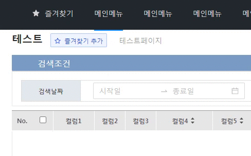
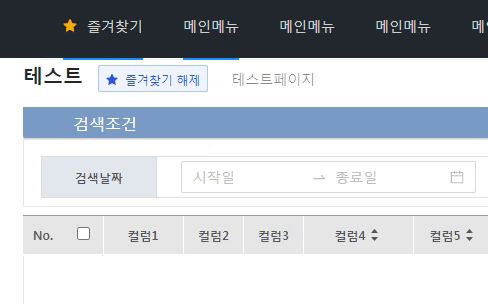
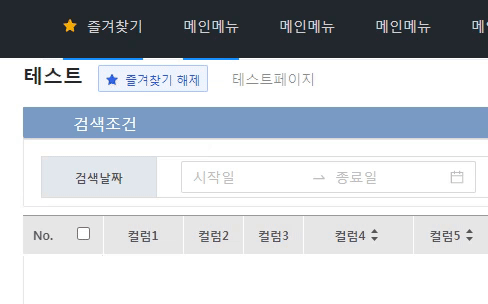

즐겨찾기 메뉴와 메인 메뉴로 이루어진 상단 내비게이션 바를 만드는 도중 문제가 생겼다.

메인메뉴(하위메뉴)에서 별 아이콘을 클릭하면 즐겨찾기 추가/삭제가 정상 동작 한다.



하지만 즐겨찾기 메뉴에서 별 아이콘을 클릭하면 메인메뉴에 변경 내용이 즉각 반영이 안 되는 것.



새로 고침을 하면 그제야 변경한 내용이 적용되는 걸 보고 프론트의 문제란 걸 알았다.

즐겨찾기와 메인 메뉴 둘 다 빌드될 때 DB에서 한번 불러오고 mobX로 store에서 관리하고 있다.

별 아이콘은 FavIcon 컴포넌트를 만들어서 메뉴마다 넣어주고 있다.

store.tsx

```javascript
 //메인메뉴
  @observable mainMenus: IMainMenus[] = [];

  //즐겨찾기메뉴
  @observable favMenus: IFavMenus[] = [];
```

FavIcon.tsx

```javascript
const { favMenus } = store;

//true, false값에 따라 노란별 아이콘, 회색별 아이콘 구분
const [isFavorite, setIsFavorite] = React.useState<boolean>(false);

React.useEffect(() => {
	//favMenus에 subMenuCode가 있으면 true, 없으면 false
    setIsFavorite(_.some(favMenus, ['subMenuCode', subMenuCode]));
  }, [favMenus]);
```

위 코드처럼 useEffect 두 번째 인자에 favMenus를 넣어서 즐겨찾기메뉴가 변경될 때 hook이 실행되도록 하였다.

store에 observable도 붙였고, 메뉴 컴포넌트에 observer도 썼고, useEffect도 제대로 쓴 거 같은데

왜 즐겨찾기에서 아이콘을 클릭하면 이벤트가 실행되지 않는 건지 이유를 생각해보았다.

메인메뉴에서 아이콘을 클릭했을 때는 즐겨찾기 리스트가 변경되는 거니까 store에서 @observable로 변경이 감지되어서 useEffect가 실행되는데

즐겨찾기에서 아이콘을 클릭했을 때는 메인메뉴 리스트에 변경이 일어난 건 아니니 store에서 변경 감지가 안되기 때문에 hook이 실행되지 않는구나 싶었다.

그렇다면 즐겨찾기를 해제할 때마다 메인메뉴 리스트에도 변경이 일어나게 해줘야 한다는 건데, 그때마다 메인메뉴를 다시 불러오는건 비효율적인 것 같아 어떻게 해야 하나 고민에 빠졌다.

그렇게 고민을 하던 중 문제는 예상치 못한 곳에 있었다는 사실을 발견했다.

useEffect를 사용할 때 favMenus가 변경되면 이벤트가 일어나도록 했었는데

리스트의 구성이 변한다고해서 favMenus가 저장되어있는 주솟값이 변경된 게 아니기 때문에 hook이 실행되지 않았던 것.

FavIcon.tsx

```javascript
 React.useEffect(() => {
    setIsFavorite(_.some(favMenus, ['subMenuCode', subMenuCode]));
  }, [favMenus.length]);
```



이처럼 즐겨찾기 리스트의 length가 변경될 때 hook이 실행되도록 하였더니 내가 원하는 대로 정상 작동하였다.
