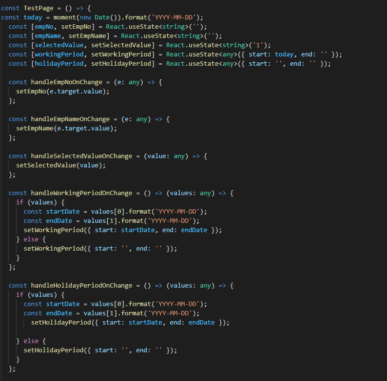
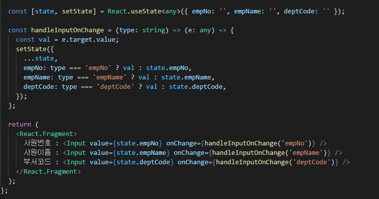
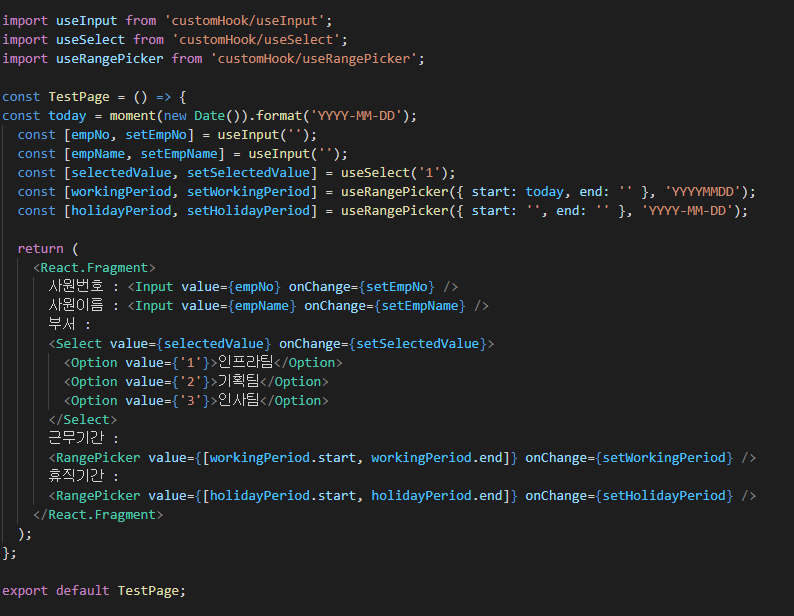

핸들러와 관리해야 할 상태 값이 많아질수록 반복적인 코드들로 핸들러와 관리해야 할 상태 값이 많아지면 반복되는 코드들이 자리를 차지하게 된다.



컴포넌트를 5개 썼을 뿐인데도 벌써 코드가 저만큼이다.
비효율적인 작업을 하고 있다는 생각이 들어서 공통되는 부분을 하나로 묶기로 했다.

처음엔 useState와 핸들러를 하나만 사용하는 방식을 이용했는데



최적화를 생각하다 보니 이것도 좋은 방법이 아니었다.

그래서 커스텀 훅을 만들었다.

useInput.tsx

```javascript
const useInput = (initValue: any) => {
  const [value, setValue] = React.useState(initValue);
  const onChange = (e: any) => {
    setValue(e.target.value);
  };
  return [value, onChange];
};

export default useInput;
```

useSelect.tsx

```javascript
const useSelect = (initValue: any) => {
  const [value, setValue] = React.useState(initValue);
  const onChange = (value: any) => {
    setValue(value);
  };
  return [value, onChange];
};

export default useSelect;
```

useRangePicker.tsx

```javascript
const useRangePicker = (initValues: any, formmat: string) => {
  const [value, setValue] = React.useState(initValues);
  const onChange = (values: any) => {
    if (values) {
      const sdate = values[0].format(formmat);
      const edate = values[1].format(formmat);
      setValue({ start: sdate, end: edate });
    } else {
      setValue({ start: '', end: '' });
    }
  };
  return [value, onChange];
};

export default useRangePicker;
```

datePicker는 날짜 형식도 지정할 수 있게 했다.

사용방법 :

```javascript
import useInput from 'customHook/useInput';

const TestPage = () => {
  const [name, setName] = useInput('');

  return <Input value={name} onChange={setName} />;
};
```

컴포넌트의 onChange이벤트로 setName함수를 넘겨주면 useInput.tsx에서 바뀐 값을 setValue 해서 돌려준다.

만약 useInput('val')같이 초기값을 넣어주면 커스텀 훅에서 initValue로 받아온 값을 useState가 초기 값으로 설정해준다.

커스텀 훅을 사용하니 코드가 훨씬 간결해졌다.



자주 사용하는 input, select, datePicker 세 개만 만들었는데 ckeckBox나 다른 컴포넌트도 사용 빈도가 높아지면 커스텀 훅을 만들어서 사용할 것이다.
