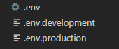
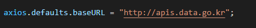
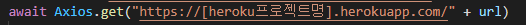

토이 프로젝트가 마무리 단계에 다다라서 배포 단계를 앞두고 있었다.

저번처럼 간단하게 깃페이지를 이용해 배포하려는데 로컬 환경에서는 공공데이터 API를 잘 불러오더니 배포하고 나니 통신 에러가 나는 것이었다.

*콘솔에 찍힌 에러*

*콘솔의 Network탭을 확인했을때*

콘솔을 보기 전에도 UI는 0.1초 정도 잘 나오다 흰 화면만 나오길래 'axios에서 뭔가 문제가 발생했나 보군' 했다.

그제야 생각해보니 로컬에서 개발할 때 cors에러 때문에 package.json에 proxy설정을 해줬었는데 이게 배포 시에는 적용이 안되어서 따로 무슨 처리를 해줘야 한다고 봤었던 기억이 났다.

처음에는 이 상황을 제대로 이해를 못 했는데 그래서 더 많이 헤맸다.

첫 번째로 시도해본 방법은 일단 .env 설정을 추가해주는 것이었다.

development와 production 설정 파일을 만들고 axios호출 시 process.env로 호출하도록 해줬는데 이것 역시 안되었다.

설정 파일을 못 찾아서 안 되는 건가 싶어서 npm에서 env-cmd를 설치해서 build시에 .env.production파일을 찾도록 해주었다.

하지만 이 문제가 아니었기 때문에 역시 안되었다.

두 번째로 시도한 방법은 axios base url을 설정해주는 것이었다.

앞에 붙는 기본 url을 설정해주어서 해당 주소로 api요청을 하는 방법이었는데 이 방법 역시 안되었다.

이 문제를 해결하느라 거의 하루 내내 새벽에 잠도 안 자고 계속 방법을 찾아보았는데 도저히 안되길래 1차 시도는 초기하였다.

다음날 다시 생각해보니 내가 문제점이 뭔지 잘 파악하지 못하고 있단 걸 깨달았다.

내가 서버까지 개발한 상황이었으면 클라이언트 -요청-> 서버 -요청-> 외부 API 가 가능해서 브라우저에서 외부 API로 바로 호출하지 않지만

서버 없이 클라이언트만 개발해서 브라우저를 통해 api를 ​바로 호출하는데 이 때문에 문제가 발생한 것이다.

개발할 때에는 로컬에서 돌아가는 node서버가 있으니 proxy설정을 해줘서 해결할 수 있었는데 빌드된 파일은 그게 불가능한 것이다.

서버를 개발하려면 할 수는 있겠지만 딱 한 개의 API를 받아오는 것 때문에 서버까지 개발하는 건 비효율적이란 생각이 들었다.

더 찾아보니 heroku를 통해 배포하면 헤로쿠에서 제공하는 프록시 관련 기능을 이용해 문제를 해결할 수 있다는 걸 알게 되었다.

깃페이지는 이미 써보기도 했고 다른 호스팅 서비스를 이용해 보고 싶은 생각도 있어서 바로 heroku를 사용하기로 결정했다.

구글링으로 헤로쿠에서 cors-anywhere 기능을 사용하는 방법을 찾아서 프록시 설정을 해주었더니 깃페이지에 올렸던 프로젝트가 데이터를 잘 불러온다ㅜㅜ 이것 때문에 거의 3일을 삽질했는데 감격...

cors-anywhere를 설정하는 방법을 간략하게 정리하자면

1\. 헤로쿠 가입해서 프로젝트 생성

2\. 내 깃헙에 cors-anywhere를 포크 해와서 헤로쿠에 만든 프로젝트에 연결

3\. 프로젝트를 배포하고나면 일단 cors-anywher프록시는 설정 완료!

4\. 내 리액트 프로젝트 axios에 url설정해주기

아래처럼 url에 **https://\[cors-anywhere를 설정한 프로젝트\].herokuapp.com/** 을 적어주고 뒤에는 호출할 api주소를 적어주면 된다.

나의 경우는 공공데이터를 이용했기 때문에 전체 url은

https://\[cors-anywhere를 설정한 프로젝트\].herokuapp.com/http://apis.data.go.kr/~~~(나머지)~~

이렇게 설정하였다.

진짜 cors에러는 날 너무 힘들게 해...
