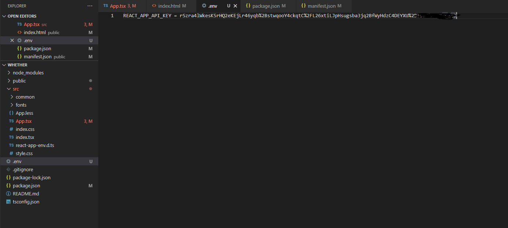
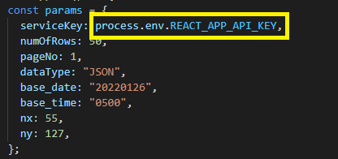
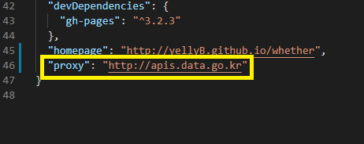
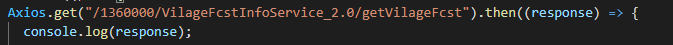
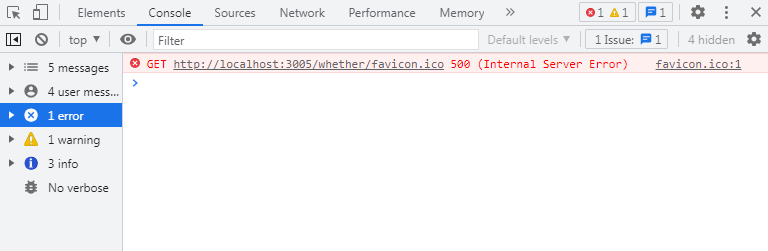
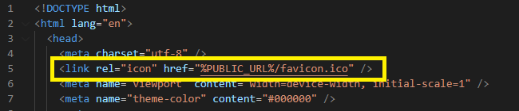
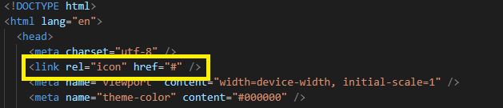

API 인증키 노출 방지

깃에 public으로 소스를 올릴 것이기 때문에 내 인증키가 노출되지 않도록 설정해야 한다.

전역 폴더에 .env파일을 생성해서 아래처럼 파일에 내 인증키를 저장한다.

저장한 인증키를 사용할때는 아래와 같이 파일에서 인증키를 가져오면 된다.

CORS에러

파이썬으로 토이 프로젝트를 했을 때에는 내가 직접 백엔드를 개발했었기 때문에 백에서 cors처리를 해주면 되었다.

그런데 이번에는 제공되는 API에서 데이터를 가져와야 하기 때문에 그 방법을 사용할 수 없었다.

그래서 package.json에서 proxy설정을 해주어 해결했다.

그러면 URL부분에 proxy에서 설정한 다음의 주소만 써주면 된다.

favicon을 못찾는 에러

초기에 리액트 프로젝트가 생성될 때 같이 딸려오는 아이콘들을 삭제했더니 그 아이콘을 못 찾는다는 에러가 콘솔에 떴다.

다른 동작에는 문제가 없긴 하지만 에러가 상당히 거슬린다.

public -> index.html 파일에서

위의 부분을

이 처럼 고쳐주면 에러는 사라진다.

혹시 그래도 에러가 사라지지 않는다면 강력 새로고침(ctrl + shift + R)을 해준다.
