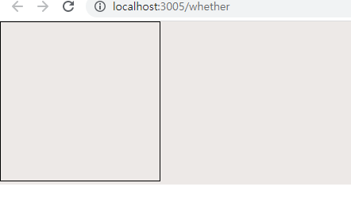
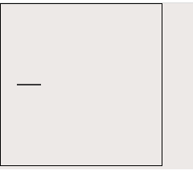
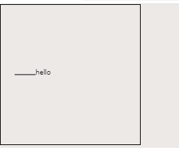
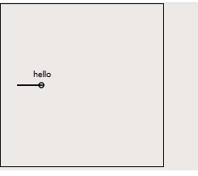
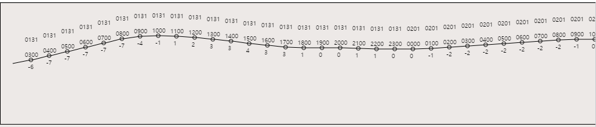

공공데이터를 활용하여 기온 정보를 뿌려주는 서비스를 개발 중이다.

시간별 기온 정보를 뿌려주기 위해 차트가 필요했는데 라이브러리를 쓰려고 찾아보았는데

나는 아주 기본적인 기능만 필요한 상황이라 굳이 라이브러리를 설치해서 차트를 그릴 필요는 없을 것 같다는 생각이 들었다.

그래서 공부도 할 겸 차트를 직접 그리기로 결정했다.

다행히 MDN에 canvas를 친절히 설명해주는 문서가 있었다.

[https://developer.mozilla.org/ko/docs/Web/API/Canvas\_API/Tutorial/Drawing\_shapes](https://developer.mozilla.org/ko/docs/Web/API/Canvas_API/Tutorial/Drawing_shapes)

[캔버스(canvas)를 이용한 도형 그리기 - Web API | MDN](https://developer.mozilla.org/ko/docs/Web/API/Canvas_API/Tutorial/Drawing_shapes)

**\[canvas 그리기\]**

먼저, 받아온 데이터가 있으면 차트를 그리는 함수를 실행시켜 줄 것이다.

```javascript
  useEffect(() => {
    if (data.length > 0) {
      draw();
    }
  }, [data]);
```

API로 받아온 데이터를 data에 저장하기 때문에 data의 변경이 있으면 차트를 그려주는 방식으로 진행했다.

API 통신 에러로 데이터가 없을 경우는 차트를 그리지 않는다.

\[html부분\]

```html
  <canvas
    id="chart"
    width="1000"
    height="200"
    style={{ border: "1px solid black" }}
  ></canvas>
```

이렇게 작성하면 일단 canvas는 잘 나온다.



\[draw함수\]

```javascript
  const draw = () => {
    const canvas = document.getElementById("chart");
    if (canvas.getContext) {
      const ctx = canvas.getContext("2d");
    }
  };
```

canvas를 지원하지 않는 환경에서 실행했을 경우를 대비하여 if(canvas.getContext) 부분을 넣어준다.

**\[선 그리기\]**

이제 선을 그려볼 건데 시작 위치를 설정해주고 path를 어떤 좌표로 이동시킬 건지 알려준다.

\*여기서 x와 y는 왼쪽 상단 모서리부터의 거리라고 생각하면 된다.

```javascript
  const draw = () => {
    const canvas = document.getElementById("chart");
    if (canvas.getContext) {
      const ctx = canvas.getContext("2d");

      let x = 20;
      let y = 100;

      ctx.font = "10px";
      ctx.beginPath();
      ctx.moveTo(x, y);  // 해당 좌표로 path이동
      x = 50;  // x를 20에서 50으로 변경
      ctx.lineTo(x, y);  // 변경한 좌표로 이동
      ctx.stroke();  // 선 그리기
    }
  };
```



그러면 시작 위치인 (20, 100)부터 (50, 100)까지의 선이 그려진다.

**\[텍스트 그리기\]**

또 시간별 기온을 표시해주어야 하기 때문에 차트 위에 날짜, 시간이 표시되어야 한다.

텍스트는 fillText를 이용해서 표시할 수 있다.

```javascript
  const draw = () => {
    const canvas = document.getElementById("chart");
    if (canvas.getContext) {
      (...)
      ctx.fillText("hello", x, y); // 텍스트 추가
    }
  };
```



현재 path가 있는 위치 (50, 100)에 지정한 텍스트가 그려진다.

**\[원 그리기\]**

차트에 필요한 또 한 가지, 매 시 정각을 구분해주기 위해 path가 이동한 지점마다 점을 찍어줄 필요가 있다.

원은 arc를 이용해 역시 간단하게 구현할 수 있다.

```javascript
  const draw = () => {
    const canvas = document.getElementById("chart");
    if (canvas.getContext) {
      (...)
      ctx.fillText("hello", x - 10, y - 10); // 텍스트 추가

      const radius = 3; // 반지름
      const startAngle = 0; // 원의 시작위치
      const endAngle = Math.PI + (Math.PI * 2) / 2; // 원의 끝위치
      const anticlockwise = true; // 시계방향/반시계방향

      ctx.arc(x, y, radius, startAngle, endAngle, anticlockwise);  // 원 그리기
      ctx.stroke(); // 선 그리기
    }
  };
```



이렇게 작게 원을 그렸다.

텍스트는 겹치지 않게 위치를 조정했다.

**\[차트 그리기\]**

지금까지의 방법을 이용해서 시간별 기온 차트를 만들었다.

```javascript
  const draw = () => {
    const canvas = document.getElementById("chart");
    if (canvas.getContext) {
      const ctx = canvas.getContext("2d");

      let x = 20;
      let y = 100;

      ctx.font = "10px";  // 폰트 사이즈
      ctx.beginPath();
      ctx.moveTo(x, y);

      const radius = 3; // 반지름
      const startAngle = 0; // 원의 시작위치
      const endAngle = Math.PI + (Math.PI * 2) / 2; // 원의 끝위치
      const anticlockwise = true; // 시계방향/반시계방향

      data.forEach((item) => {
        x = x + 30;  // 시간별로 30씩 이동
        y = y + Number(item.fcstValue);  // 받아온 기온으로 높이 결정
        ctx.lineTo(x, y);  // 선
        ctx.arc(x, y, radius, startAngle, endAngle, anticlockwise);  // 원
        ctx.fillText(item.fcstDate.substring(4, 8), x - 10, y - 30); // 텍스트 - 날짜
        ctx.fillText(item.fcstTime, x - 10, y - 5); // 텍스트 - 시간
        ctx.fillText(item.fcstValue, x - 5, y + 15); //텍스트 - 기온
      });

      ctx.stroke();  // 최종 선 그리기
    }
  };
```



데이터와 차트는 잘 나온다.

다음은 차트에 스타일을 입히는 단계가 남았다.
