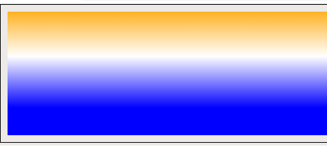
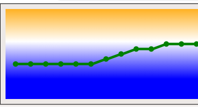
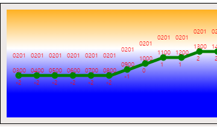

이번에는 차트에 색상을 적용해야 한다.

색상 적용 예제도 MDN에 잘 나와있다.

[https://developer.mozilla.org/ko/docs/Web/API/Canvas\_API/Tutorial/Applying\_styles\_and\_colors#a\_createlineargradient\_example](https://developer.mozilla.org/ko/docs/Web/API/Canvas_API/Tutorial/Applying_styles_and_colors#a_createlineargradient_example)

[스타일과 색 적용하기 - Web API | MDN](https://developer.mozilla.org/ko/docs/Web/API/Canvas_API/Tutorial/Applying_styles_and_colors)

스타일을 적용할 곳은 총 세 가지이다.

1\. 따뜻한 색 - 차가운 색으로 배경 입히기

2\. 차트의 라인에 색상과 굵기 주기

3\. 폰트에 스타일 주기

**\[배경 그라디언트\]**

먼저 배경은 그라디언트 오브젝트를 사용했다.

기존의 차트와 다른 레이어로 관리할 것이기 때문에 차트를 그리는 함수와 배경을 그리는 함수를 분리했다.

&amp;lt;background함수 만들어서 useEffect에서 실행>

```javascript
  const background = () => {
    const canvas = document.getElementById("chart");
    if (canvas.getContext) {
      const ctx = canvas.getContext("2d");
      // 그레이디언트를 생성한다
      var lingrad = ctx.createLinearGradient(0, 0, 0, 150);
      lingrad.addColorStop(0, "orange");
      lingrad.addColorStop(0.5, "white");
      lingrad.addColorStop(1, "blue");

      // 외곽선과 채움 스타일에 그레이디언트를 적용한다
      ctx.fillStyle = lingrad;

      // 도형을 그린다
      ctx.fillRect(10, 10, 1000, 180);
    }
  };
```

일단 만들어둔 차트는 잠깐 주석 처리하고 배경만 확인하면 그라디언트가 잘 나온다.



**\[차트 라인 스타일\]**

이번엔 다시 차트를 그리는 draw()로 돌아와서 차트 라인에 색상을 준다.

```javascript
      ctx.strokeStyle = "green";
      ctx.lineWidth = 5;
```

일단 랜덤으로 초록색 선을 주고 두께는 5px로 설정하였다.



결과물을 보니 아직 예쁘진 않지만 원하는 대로 나오긴 한다.

**\[차트 라인 스타일\]**

폰트도 선 스타일과 비슷하게 설정할 수 있다.

```javascript
      ctx.font = "10px";
      ctx.fillStyle = "red";
```



다음번에는 폰트를 날짜/시간/기온 별로 다르게 주면 될 것 같다.
