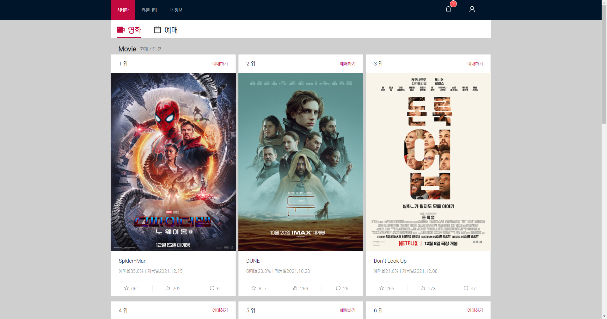
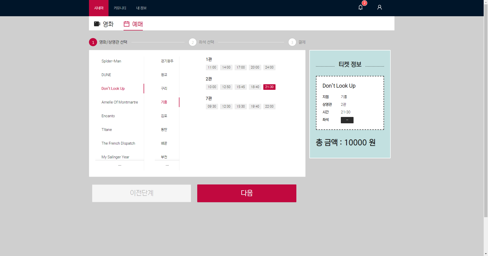
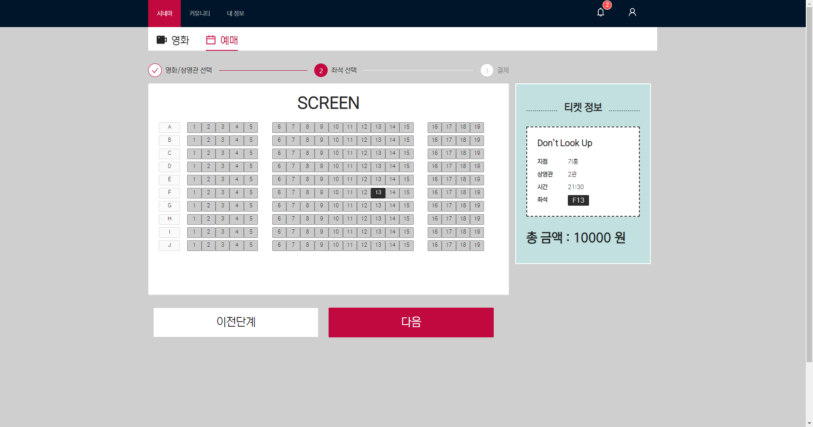
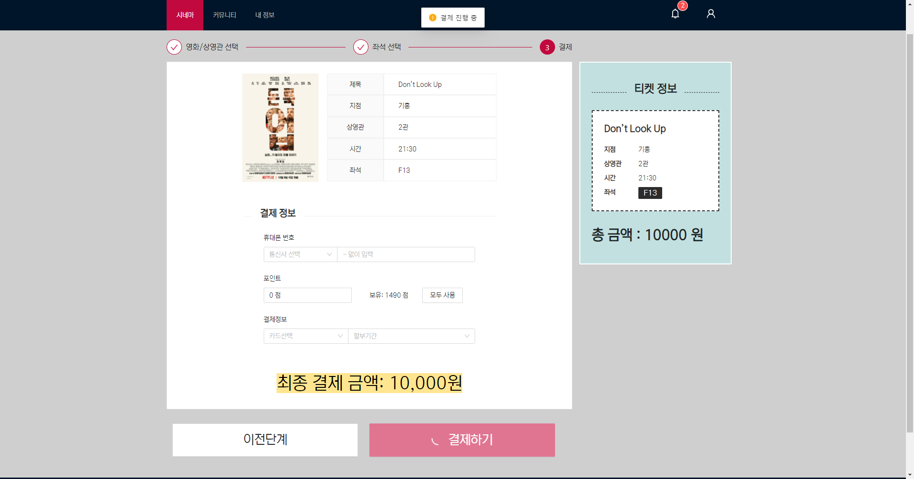
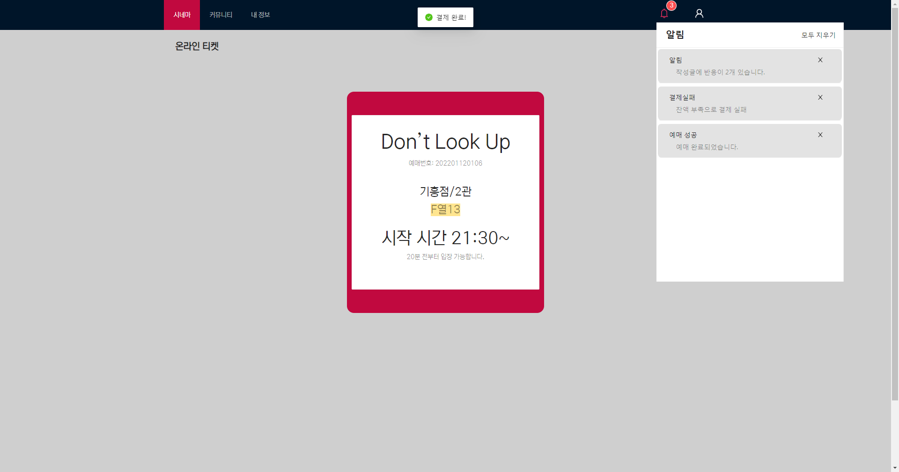
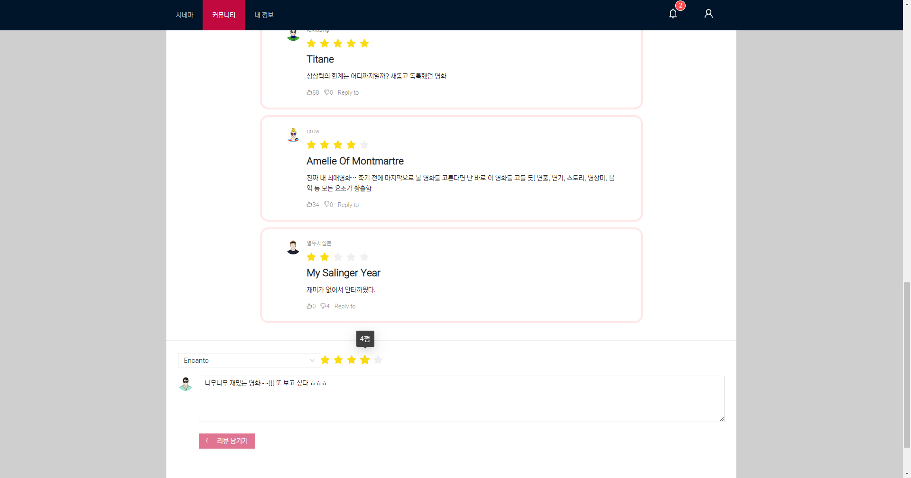
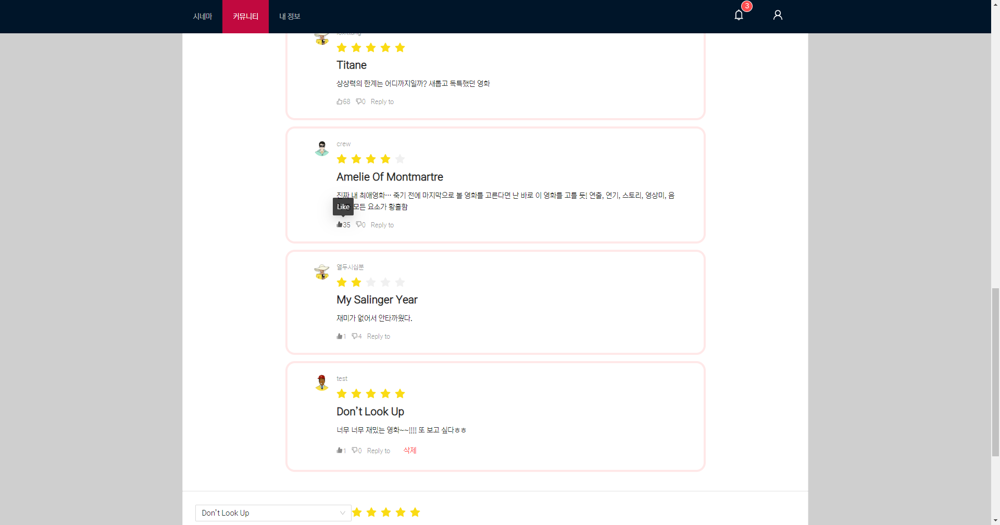
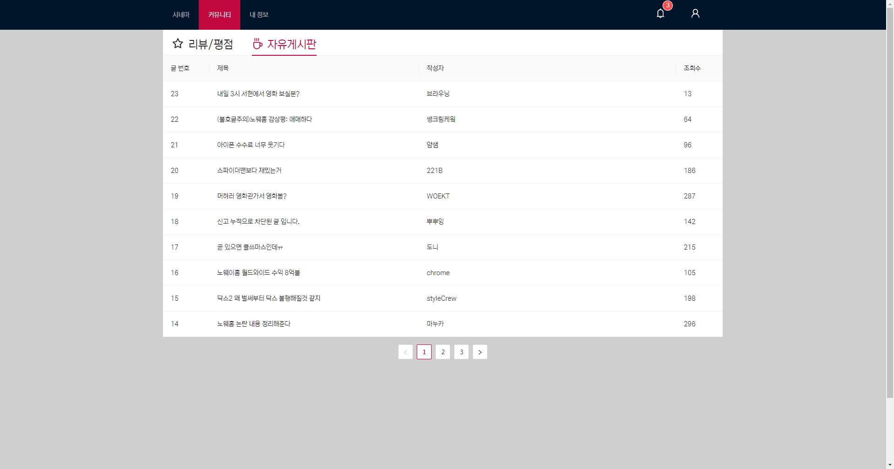
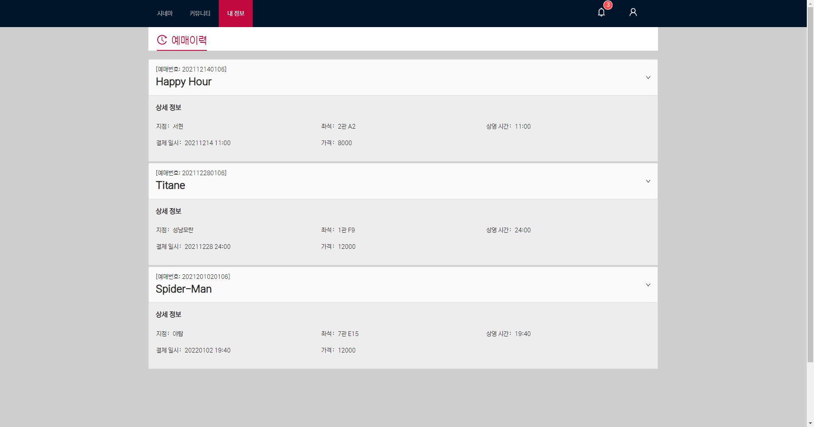
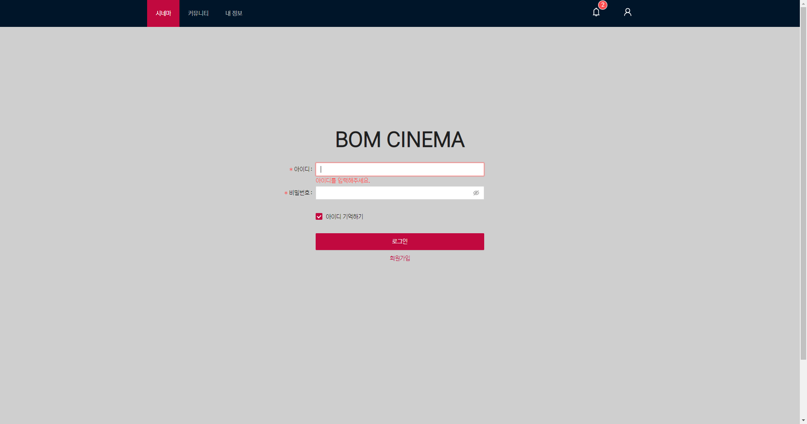

개발 전에 계획한 기능은 전부 개발 완료되었다.

개발을 하면서 이런 기능도 추가하면 좋겠다 하는 기능들이 몇 가지 있었는데 그 기능들은 2차로 개발할 생각이다.

그전에 일단 컴포넌트 최적화라든지 프로젝트 내부적으로 좀 더 개선할 점을 개선하고서 업그레이드 버전을 만들 것이다.

그런데 사실 그 시기는 언제가 될지는 모르겠다.

다른 주제의 새로운 프로젝트를 해보고 싶은 마음이 크기 때문!!

완료된 기능과 추가할 기능

**영화 리스트**

완료 기능

\- 영화 리스트

\- 예매하기 -> 예매 창

추가할 기능

\- 즐겨찾기, 좋아요 기능

\- 각 영화 카드의 리뷰 클릭 시 영화에 해당하는 리뷰만 보여주기

\- 예매하기 클릭 시 단순히 예매 창으로만 넘어가는 것이 아닌 해당 영화 선택된 채로 넘어가기

**영화 예매**

완료 기능

\- store로 관리하는 선택 정보 사이드로 보여주기

\- 결제 완료 시 온라인 티켓 창으로

\- 결제 완료 시 store로 관리하는 알람 목록에 추가

**리뷰**

완료 기능

\- 리뷰 목록

\- 리뷰 작성(영화 선택, 별점 선택)

\- 리뷰 작성자에 로그인했다면 로그인 정보를, 미 로그인이면 guest로 표시

\- 각 리뷰에 좋아요/싫어요

추가할 기능

\- 1 depth 답글

\- 내가 작성한 리뷰는 삭제 가능

\- 리뷰 영화별 필터

\- 리뷰 별점 순 정렬

**게시판**

완료 기능

\- 글 목록(페이징)

\- row클릭 시 상세 내용 팝업

추가할 기능

\- 글 신고하기(신고가 일정 숫자 이상일 시 글 차단)

\- 조회 수 증가(중복 조회 무시)

\- 작성자에게 쪽지 보내기

\- 작성자의 작성 글

**내 정보**

완료 기능

\- 예매 히스토리(collapse)

추가할 기능

\- 내 정보 페이지

\- 내 정보 수정

**로그인**

완료 기능

\- 로그인/로그아웃 - storage관리

추가할 기능

\- 회원가입

\- 비회원 로그인

\- 회원/비회원에 따라 접근 범위 구별
