9월 초에 프로젝트를 계획하고 3개월이 지났다.

처음의 계획과는 프로젝트 내용이 아주 많이 달라졌다.

처음에는 개발적으로 무슨 기능을 넣고 싶은지를 생각하지 않고 계획했어서 진행하다 보니 방향이 많이 수정되었다.

현재 프로젝트는 보이는 것보다는 내가 무슨 기능을 써서 개발하고 싶은지를 더 중점적으로 고려해서 진행하고 있다.

내가 이 프로젝트를 통해 얻고 싶은 것은 크게 세 가지였다.

1.  프로젝트를 처음부터 끝까지 혼자 개발해보는 것
2.  라우팅 라이브러리를 사용하지 않고 개발하는 것
3.  mobX만 사용해봐서 비교를 위해 redux를 사용해보는 것

'이 기능이 있으면 재밌겠다' 하는 것을 제외한 '적어도 이 기능은 들어가야 한다'하는 사항만 고려했을 때 65% 정도 완성된 것 같다.

개발 마감 기한을 1월 중순으로 잡았었으니까 그때까지 끝내려면 부지런히 개발해야 할 듯!

개발 완료 사항과 개발해야 할 사항을 정리해보겠다. (중요도는 ★로 표시)

**영화 리스트**

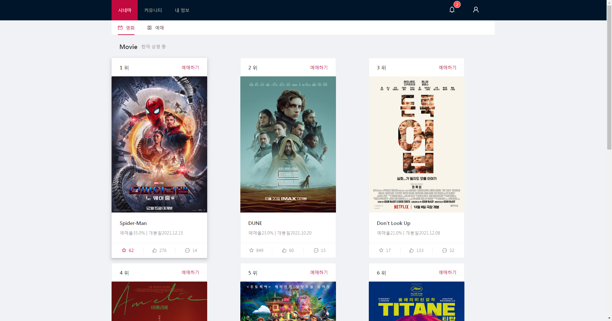

~★★★ 영화 리스트 가져오기~

★☆☆ 예매 클릭 시 예매 창으로 이동

★☆☆ 영화별 즐겨찾기, 좋아요, 리뷰 고정 데이터로 -> 현재는 랜덤 숫자

**영화 예매**

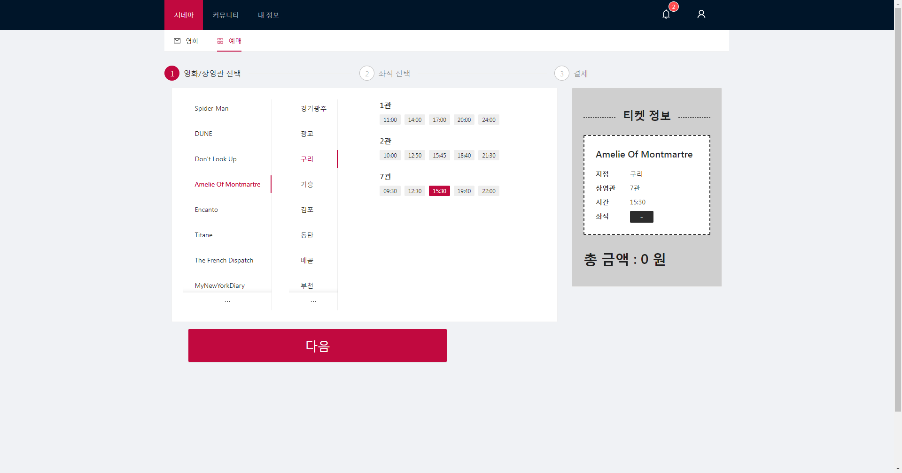

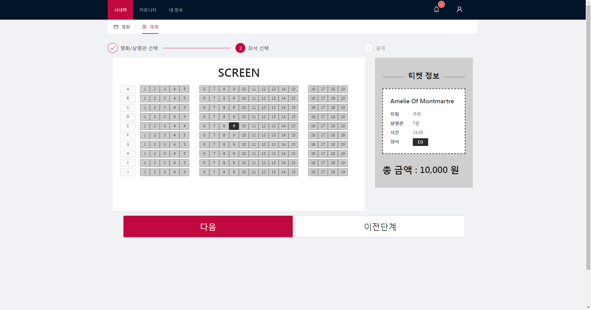

~★★★ 각 step별 선택한 데이터 사이드에서 보여주기~

~★★★ step1. 영화, 극장, 시간 선택~

~★★★ step2. 좌석 선택~

★★☆ step3. 결제

**리뷰**

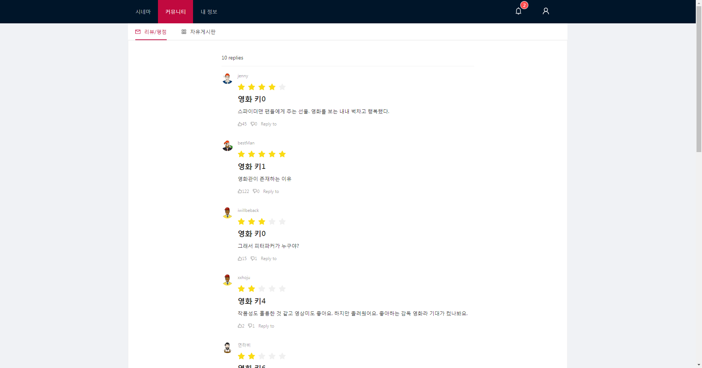

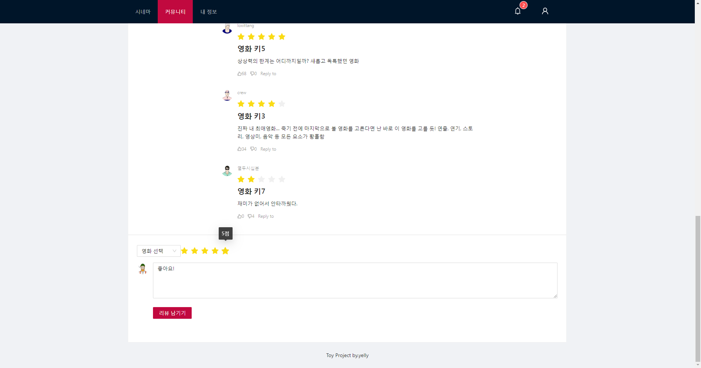

~★★★ 리뷰 목록 가져오기~

~★★★ 리뷰(+별점) 작성~

★★★ 영화 목록-리뷰 데이터 연결

~★★☆ 리뷰의 좋아요/싫어요 클릭 기능~

★☆☆ 1 dept의 답글

★☆☆ 내가 작성한 리뷰일 경우 삭제 가능

**게시판**

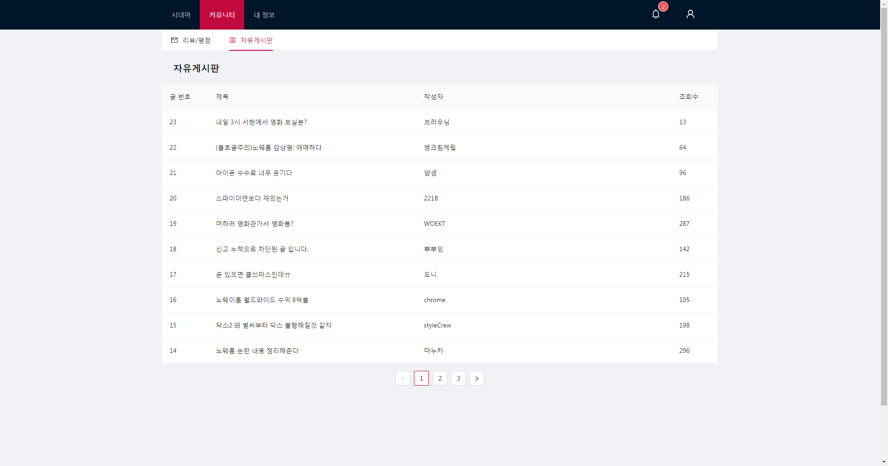

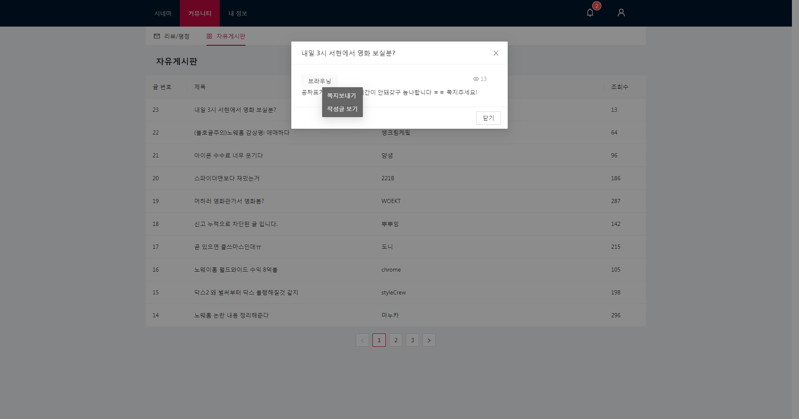

~★★★ 게시판 목록 가져오기(10개 단위 페이징)~

~★★★ 클릭 시 상세 내용 팝업~

★★☆ 차단된 글일 경우 리스트에서만 확인 가능, 상세 내용 확인 불가

★☆☆ 조회 시 조회수 올리기(한번 조회한 글은 다시 조회해도 안 올라야 함)

★☆☆ 작성자와 쪽지 주고받기 기능

★☆☆ 작성자의 작성글 보기

**내 정보**

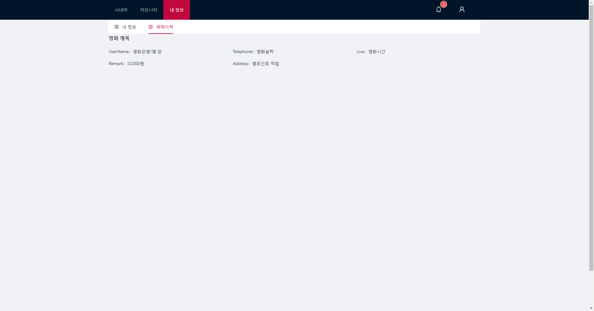

★★★ 지금껏 예매한 모든 히스토리 조회

★★☆ 내 정보 확인 & 수정

**로그인**

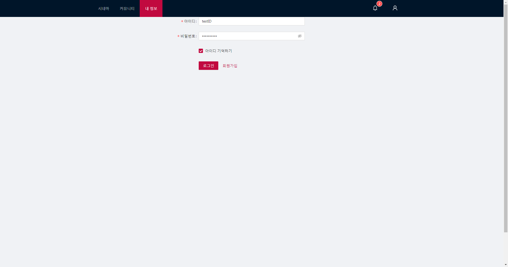

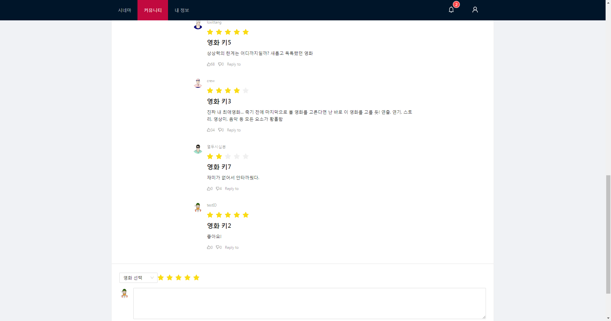

~★★★ 로그인 정보 로컬 스토리지 저장~

★★★ 로그인/미 로그인에 따라 권한 제어(미 로그인 시 내 정보 확인 불가 등)

~★★☆ 리뷰 작성 시 로그인한 아이디로 등록 / 미 로그인 시 guest로 등록~

**알림**

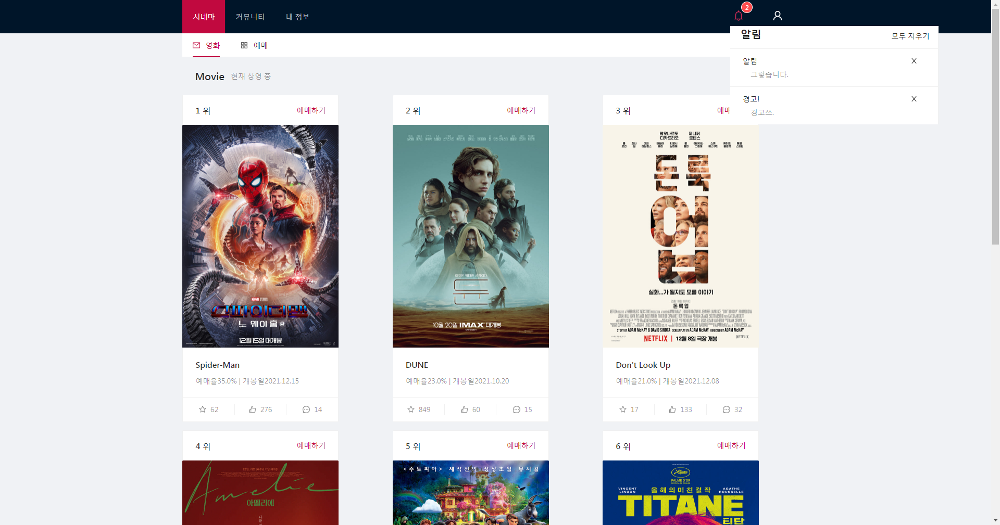

~★★★ 알림 조회~

★★★ 삭제/모두 삭제

★★★ 예매한 영화 시간 임박하면 알림

**온라인 티켓**

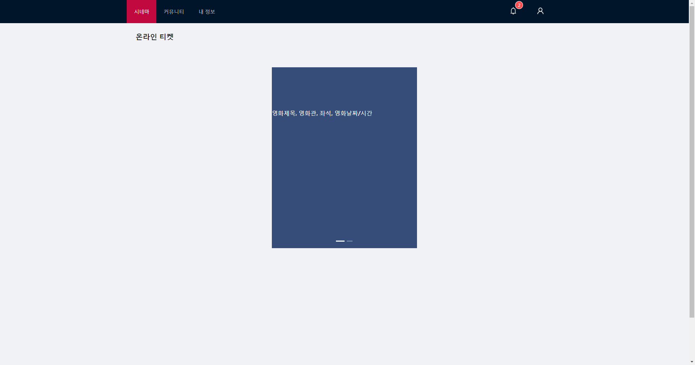

★★★ 예매내역 중 현재 시간에 맞는 영화티켓 보여줌
