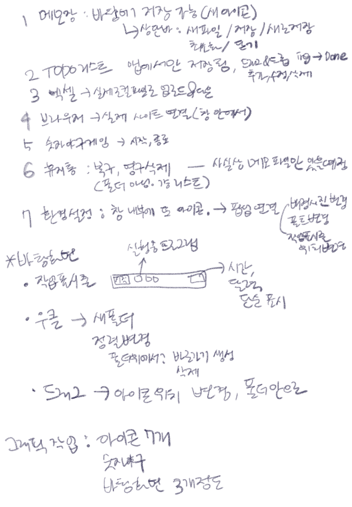

컨셉 : 웹 OS

  - 운영체제를 웹 버전으로 만들어보기

  - 대부분의 작업은 응용 프로그램을 웹으로 옮기는 작업이 될 예정

필요 작업 목록

-   메모장 - 새 아이콘으로 저장됨 / 앱 내 기능 : 상단바 - new, save, save as, 최소화, 닫기)
-   TODO 리스트 - 앱 내에 저장 / 앱 내 기능 : 리스트 dnd (ing->done), add, delete
-   엑셀 - 로컬 파일을 업로드 & 다운로드
-   브라우저 - 앱 내에서 원하는 사이트 연결
-   숫자야구 - 미니게임(알고리즘)
-   휴지통 - 삭제한 파일 리스트 / 앱 내 기능 : 복구, 영구삭제
-   환경설정 - 열면 아이콘 목록 나옴(배경변경, 폰트변경, 작업표시줄 위치 변경 3가지) -> 아이콘 클릭시 팝업

-   작업표시줄 - 실행중 프로그램 표시, 시간&달력 표시
-   우클릭 - (context mune) 새폴더, 정렬 변경 / 폴더위에서 우클시 -> 바로가기, 삭제
-   드래그 - 아이콘 위치 변경, 폴더 안에 넣기

-   그래픽 작업 - 아이콘 7개 + 환경설정 앱 아이콘 3개 + 숫자야구 일러 + 바탕화면 이미지 약 3개

개발기간

  - 시작일 : 2021.09.06

  - 기능 하나당 대략 1.5주

  - 순수 개발기간 약 5개월 (2022년 1월 중순까지)

  - CSS, 그래픽 등의 작업 약 2주

  - 최종 테스트 &  배포 2주

\*타이트하게 잡은 일정임

[웹OS.pdf](./웹OS.pdf)
