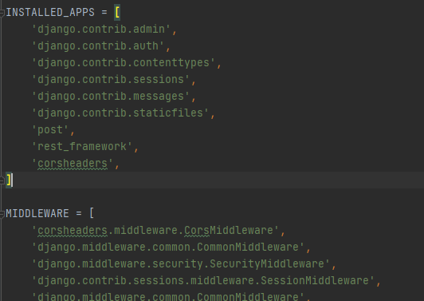
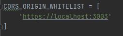
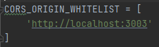

장고와 리액트를 사용하는 프로젝트를 새롭게 시작했다.

장고 프로젝트의 포트번호는 8000, 리액트의 포트번호는 3003에서 돌아가기 때문에 프론트에서 데이터를 요청하려면 CORS문제를 해결해야 한다.

다행히도 파이썬에서는 아주 쉽게 이 문제를 해결할 수 있다.

```shell
pip install django-cors-headers
```

위의 패키지를 설치해주고 settings.py의 INSTALLED\_APPS과 MIDDLEWARE에 각각 corsheaders와 corsheaders.middleware.CorsMiddleware를 추가해준다.



그리고 리소스 요청을 허용할 도메인을 추가해준다.



그런데 이렇게 전부 추가를 해줬는데 프론트에서 여전히 CORS에러가 떴다.

오타가 있는지 확인하는 것부터 패키지를 다시 설치해보고 갖은 방법을 다 써봤는데도 에러가 해결되지 않았다.

그렇게 1시간을 허튼짓을 하다가 에러 내용을 자세히 보니 아예 요청하는 api주소를 못 찾는다는 내용이었다.

혹시나 해서 url을 자세히 확인해보는데...

리소스 허용 도메인이 http가 아닌 https로 되어있었다!!

평소에 https로 주소를 적던 습관 때문에 아무 생각 없이 저렇게 적었던 거 같다.

그래서 http로 변경해주니 api호출이 정상적으로 실행되었다.



어이없는 실수 때문에 시간을 날리긴 했지만 앞으로 꼼꼼하게 확인해야겠다는 교훈을 얻었다.
