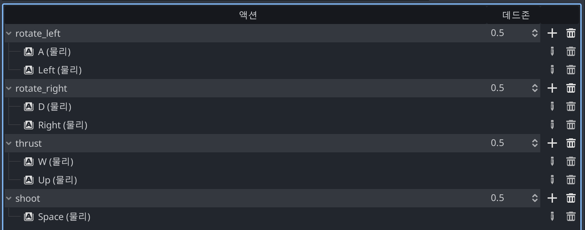
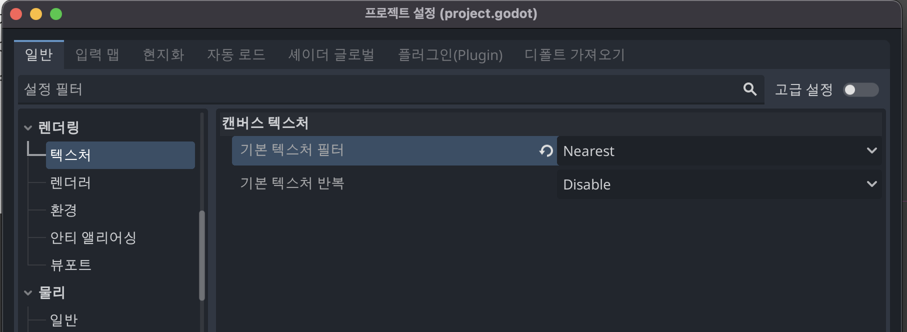
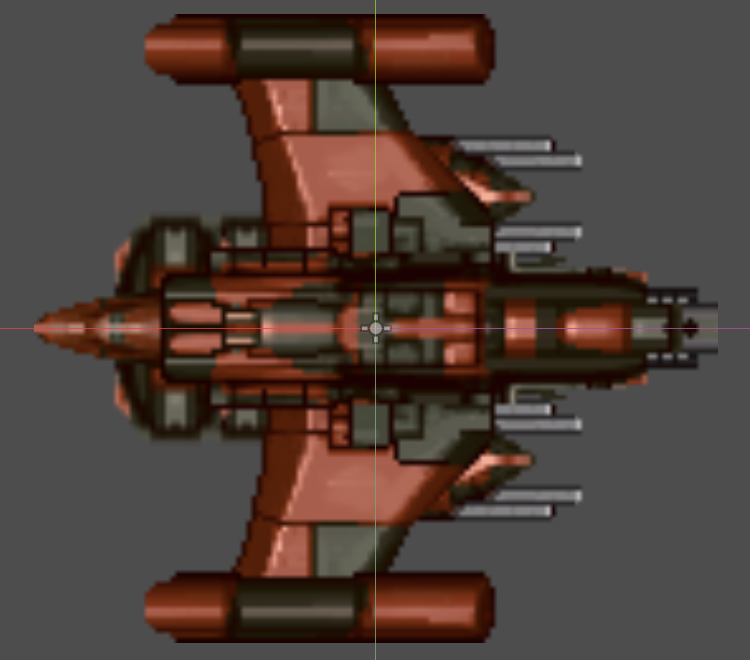
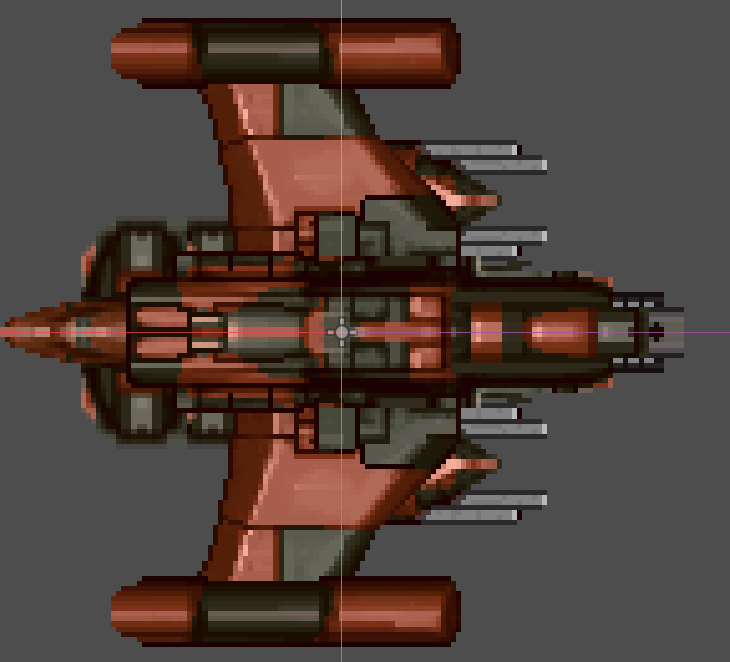
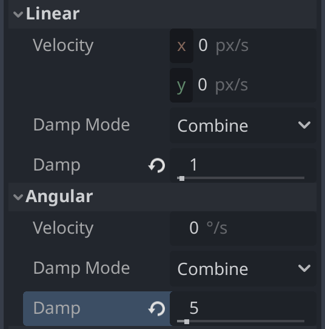
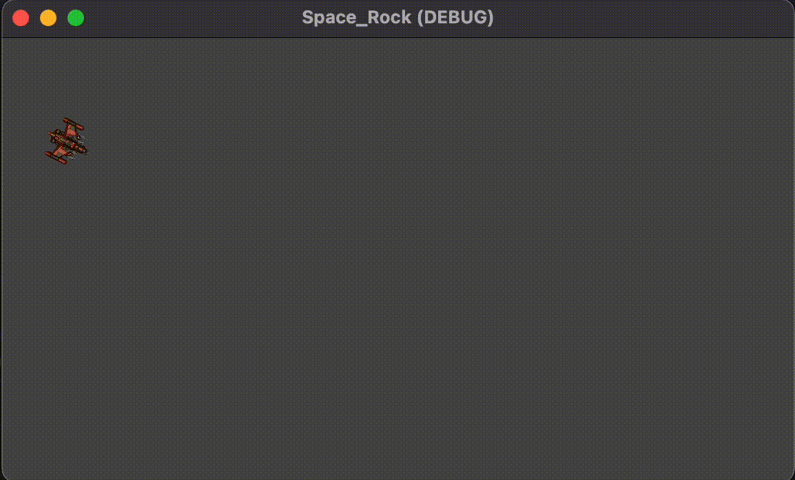

## \[프로젝트 설정\]

새 프로젝트를 생성한다.

커스텀 입력 액션을 설정할건데, 사용자가 어떤 키, 마우스 혹은 어떤 디바이스로 게임을 하는지 알 필요 없이 '점프' 입력에 반응하도록 설정할 수 있다.

그리고 사용자가 게임 설정에서 키 입력을 커스터마이징 할 수 있는 옵션을 제공할 수 있게 된다.

상단 메뉴의 `[프로젝트]` -> `[프로젝트 설정]` 에서 `[입력 맵]` 탭으로 이동한다.

다음의 입력 액션 4가지를 생성해준다.

-   rotate\_left
-   rotate\_right
-   trust
-   shoot

그 후 리스트 오른쪽의 + 를 클릭 해 어떤 입력이 있을때 액션으로 간주할 지 설정한다.

다음과 같이 WASD와 방향키를 둘 다 입력으로 설정할수도 있다.



## \[물리엔진\]

고도는 3가지 physics body 를 제공한다.

-   StaticBody2D: 정적 바디. 물리 엔진에 의해 움직이지 않는 바디다. 충돌 감지에는 관여하지만 여기에 반응하지는 않는다. 예를들면 벽, 지면같이 환경의 일부이거나 움직임이 필요 없는 오브젝트에 사용된다.
-   RigidBody2D: 물리 시뮬레이션이 적용되는 바디. 개발자가 직접 제어하지 않는다. 고도에 내장된 물리엔진이 충돌, 튕김, 회전 같은 결과 움직임을 계산해준다.
-   CharacterBody2D: 충돌 감지는 하지만 물리는 제공하지 않는다. 충돌 반응을 포함해 모든 움직임은 코드로 구현해야 한다.

이 게임에서는 `RigidBody2D` 노드를 사용할 것이다.

RigidBody 는 글로벌 속성 영향을 받는다.

다시 `[프로젝트 설정]`창을 띄워보면 '물리' 에서 구체적인 값을 설정할 수 있다.


*기본 설정*

2D의 기본 세팅값은 지구 중력 가속도인 9.8m/s2 값이며 방향은 (0, 1)로 아래로 되어있다.

만약 중력을 변경하고 싶다면 여기에서 변경하면 된다.

그리고 오른쪽 위에 '고급 설정' 토글을 켤 수 있는데 이를 켜면 더 구체적인 설정을 할 수 있다.


*고급 설정 토글을 켰을 때*

이 중 눈여겨볼만한 설정은 기본 선형 댐핑(Default Linear Damp)과 기본 각도 댐핑(Default Angular Damp) 인데, 각각 바디의 전진 혹은 회전 속도가 얼마나 빨리 줄어드는지에 관여한다.

-   기본 선형 댐핑 : 바디의 전진 속도
-   기본 각도 댐핑 : 바디의 회전 속도

두 값을 낮게 설정하면 게임 월드에 마찰이 없는 듯이 느껴지고, 크게 설정하면 진흙 속을 움직이는 듯이 느껴진다.

이 슈팅 게임은 우주를 배경으로 진행될 것이기 때문에 980으로 되어있는 \[기본 중력\]을 0으로 변경한다.

## \[플레이어\]

새 씬을 생성해 `RigidBody2D`를 루트 노드로 생성하고, 이름을 Player로 변경한다.

Player 하위에 `Sprite2D`, `CollisionShape2D`를 자식으로 추가한다.

우주선으로 사용할 이미지 파일을 Sprite2D 의 Texture 로 드래그 해 넣는다.

CollisionShape2D 에서 Shape에서 히트박스를 생성해 플레이어 이미지의 크기와 모양에 맞게 설정해준다.

만약 이미지가 도트로 된 픽셀아트 이미지라면 도트가 뭉개진게 보일 것이다.

고도에서 기본 설정이 'smoothing'을 사용하게 되어있기 때문이다.

만약 게임이 여러가지 타입의 이미지를 사용한다면 스프라이트마다 (CanvasItem섹션) 개별로 설정해야 하지만, 지금은 규모가 작은 프로젝트이기 때문에 전역으로 설정해주겠다.

\[프로젝트 설정\]으로 들어가서 \[기본 텍스처 필터\]를 'Nearest' 로 바꿔준다.





*전*



*후*

## \[플레이어 상태\]

플레이어는 여러가시 상태를 전환할 수 있다.

예를들어 리스폰, 생존, 죽음, 무적 상태가 있는데 이를 전부 불리언 변수로 저장하고 있으면 착오가 생겨 두가지 상태가 모두 true 인 경우가 생길 위험이 있다.

효과적으로 상태를 관리하기 위해 state machine을 사용할 것이다.

`Player` 에 스크립트를 추가해서 다음 코드를 작성한다.

```bash
extends RigidBody2D

enum {INIT, ALIVE, INVULERABLE, DEAD}
var state = INIT

func _ready():
	change_state(ALIVE)

func change_state(new_state):
	match new_state:
		INIT:
			$CollisionShape2D.set_deferred("disabled", true)
		ALIVE:
			$CollisionShape2D.set_deferred("disabled", false)
		INVULERABLE:
			$CollisionShape2D.set_deferred("disabled", true)
		DEAD:
			$CollisionShape2D.set_deferred("disabled", true)
	state = new_state
```

생존해 있는 상태에서만 collision을 활성화 시킬 것이다.

## \[물리 엔진 설정\]

다음 코드를 상단에 추가한다.

```bash
@export var engine_power = 500
@export var spin_power = 8000

var thrust = Vector2.ZERO
var rotation_dir = 0
```

engine\_power와 spin\_power는 우주선이 얼마나 빨리 가속하고 방향을 회전하는지를 나타낸다.

thrust 는 엔진이 가하는 힘을 나타내며 초기에 (0,0)에서 엔진이 켜졌을 때 전방을 향하는 힘을 나타낼 벡터다.

rotation\_dir은 우주선이 돌고있는 방향을 나타내며 torque값(회전력)을 줄 수 있다.

물리엔진은 마찰값인 damping값을 제공한다.

`[인스펙터]` `Linear`와 `Angular` 의 damp 값을 각각 1, 5로 변경하자.

이는 우주선에 아무 입력이 없으면 서서히 멈추게 만들어 줄 것이다.



다음으로 입력을 감지해서 우주선을 이동시키는 코드를 작성한다.

```bash
func _process(delta):
	get_input()

# 키 입력 받아 우주선의 추력 켜거나 끄는 함수
func get_input():
	thrust = Vector2.ZERO
	if state in [DEAD, INIT]:
		return
	if Input.is_action_pressed("thrust"):
		# transform 은 객체의 현재 위치, 회전, 크기 정보
		thrust = transform.x * engine_power

	# -1: 왼쪽 / 1: 오른쪽 / 0: 아무입력 없음
	rotation_dir = Input.get_axis("rotate_left", "rotate_right")

func _physics_process(delta):
	constant_force = thrust
	constant_torque = rotation_dir * spin_power
```

`get_input()` 함수에서 "thrust"가 눌렸을 때 thrust 값을 업데이트 한다.

현재 우주선이 회전한 방향 값의 x 축 값을 이용해서 추력 값을 구해낸다.

또 회전 방향을 알아내기 위해 `Input.get_axis()`로 회전할 방향을 알아낸다.

> **\[transform\]**
> transform는 Godot에서 각 노드의 위치, 회전 및 스케일 정보를 포함하는 프로퍼티입니다.
> transform은 Transform2D(2D 게임) 또는 Transform(3D 게임) 객체로 표현되며, 이 정보는 노드의 현재 위치와 회전 상태를 기반으로 합니다.
> transform.x는 2D 게임의 경우 객체의 오른쪽 방향을, 3D 게임의 경우 x축 방향을 의미합니다.

> **\[Input.get\_axis\]**
> 반환되는 값은 다음과 같습니다:
> **\-1**: 첫 번째 축(예: axis\_name1)이 활성화된 경우
> **1**: 두 번째 축(예: axis\_name2)이 활성화된 경우
> **0**: 두 축 모두 비활성화된 경우

마지막으로 물리 바디를 사용할 때 항상 `_physics_process()`에서 관련 함수를 호출해야 한다.

여기에 입력된 힘으로 실제로 바디를 움직일 수 있다.

`[현재 씬 실행]`을 해보면 우주선이 입력 값에 따라 회전하면서 날아다니는 걸 확인할 수 있다.


