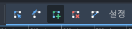
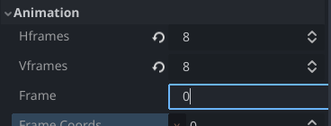
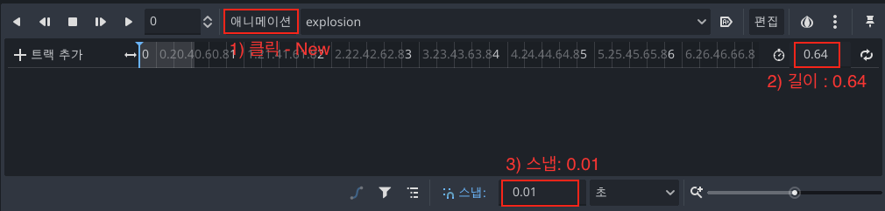
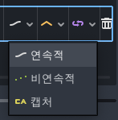
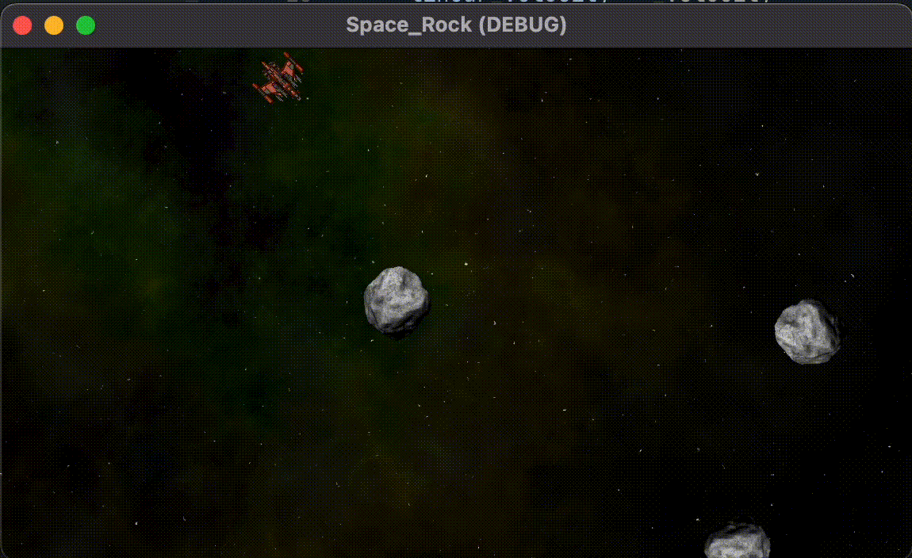
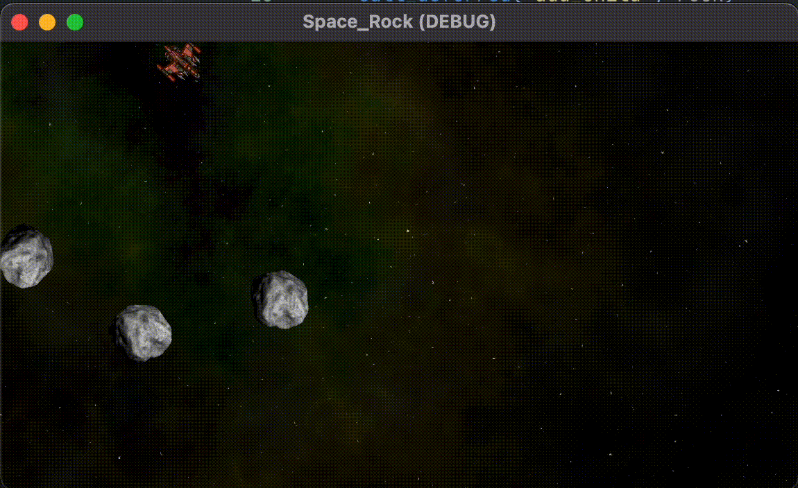

## \[바위 씬 생성\]

`RigidBody2D`로 새 씬을 생성한 후 Rock 으로 이름을 변경한다.

Rock의 자식으로 `Sprite2D`를 추가하고 **Texture** 에 바위 이미지를 추가한다.

Rock의 자식으로 `CollisionShape2D`를 추가한다. 히트박스는 생성될 바위의 모양에 맞게 동적으로 생성해 줄 것이므로 아직 설정하지 않는다.

바위는 플레이어처럼 움직이다가 멈추면 안되고 계속 날아다녀야 하니 **Linear**와 **Angular**의 **Damp**는 0으로, **Damp Mode** 는 **Replace**로 변경한다.

또 바위를 서로 튕기게 만들어야 하므로 **Physics Material Override** 에서 '새 Physics Material'을 눌러주고 상세 옵션에서 **Bounce**를 1로 설정한다.

`Rock` 에 스크립트를 붙여서 다음 코드를 작성한다.

```bash
extends RigidBody2D

var screensize = Vector2.ZERO
var size
var radius
var scale_factor = 0.2  # size를 곱해 Sprite2D 스케일, 콜리전 반지름 등 설정

func start(_position, _velocity, _size):
	position = _position
	size = _size
	mass = 1.5 * size
	$Sprite2D.scale = Vector2.ONE * scale_factor * size
	radius = int($Sprite2D.texture.get_size().x / 2 * $Sprite2D.scale.x)
	var shape = CircleShape2D.new()
	shape.radius = radius
	$CollisionShape2D.shape = shape  # 바위 size에 따라 콜리전 크기 계산
	linear_velocity = _velocity
	angular_velocity = randf_range(-PI, PI)  # 시계방향 혹은 반시계방향으로 설정

func _integrate_forces(physics_state):
	var xform = physics_state.transform
	# 최소최대값 설정 시 radius 를 포함하여 화면에서 완전히 빠져나간 후 반대편에서 나오게 됨
	xform.origin.x = wrapf(xform.origin.x, 0 - radius, screensize.x + radius)
	xform.origin.y = wrapf(xform.origin.y, 0 - radius, screensize.y + radius)
	physics_state.transform = xform
```

`start()` 에서는 바위 **size** 에 따라 콜리전 크기를 계산한다.

그리고 **angular\_velocity** 옵션에 -180 ~ 180 사이 값을 생성하여 회전 방향을 시계/반시계 방향으로 돌아갈 수 있게 한다.

또, 플레이어에서 했던 것처럼 `_integrate_forces()`에서 **wrap** 설정을 해주는데 플레이어와 다른 점은 최소,최대값에 물체의 반지름을 포함시켜서 범위를 더 넓게 만들어 화면 밖으로 물체가 완전히 빠져나간 후에 반대편에서 나올 수 있도록 해준다.

이 방식은 바위가 좀 더 자연스럽게 반대편으로 이동하게 해준다.

아래 두개 화면은 **radius** 값을 포함한것과 미포함한 것의 차이이다.

확실히 **radius** 값을 계산에 포함시키는게 자연스럽게 화면을 넘어간다.


*radius 값 포함 - 자연스러운 움직임*


*radius 값 미포함 - 뚝뚝 끊기는 느낌*

## \[바위 인스턴스\]

바위 스폰 위치는 화면 가장자리에서 랜덤으로 정해질 것이다.

코드로 구현할수도 있지만 고도에서 경로를 그릴 수 있는데 이 경로대로 따라가며 바위를 생성하게 할 수도 있다.

`Path2D` 노드를 만들고 `RockPath` 로 이름을 변경한다.

**2D**를 선택하면 에디터 상단에 다음 같은 아이콘이 생긴걸 볼 수 있다.



세번째에 있는 '점 추가' 아이콘으로 네 귀퉁이에 시계방향으로 점을 찍는다.

그 후 다섯번째 '곡선 닫기'로 경로를 완성해준다.

`PathFollow2D`노드를 `RockPath`의 자식으로 추가하고 `RockSpawn` 으로 이름을 변경한다.

이 노드로 부모의 경로를 따라 자동으로 이동하게 만들것이다.

`PathFollow2D`의 속성인 **Progress** 로 이를 가능하게 할것인데 **Progress** 값을 \[인스펙터\]에서 증가시켜보면 빨간 점이 경로대로 따라 움직이는걸 볼 수 있다.

다시 `Main` 스크립트로 돌아와서 바위를 생성하는 함수를 작성한다.

```bash
extends Node

@export var rock_scene : PackedScene

var screensize = Vector2.ZERO

func spawn_rock(size, pos=null, vel=null):  # 깨진 바위는 pos, vel 값을 전달한다
	if pos == null:
		$RockPath/RockSpawn.progress = randi()
		pos = $RockPath/RockSpawn.position
	if vel == null:
		vel = Vector2.RIGHT.rotated(randf_range(0, TAU)) * randf_range(50, 125)
	var rock = rock_scene.instantiate()
	rock.screensize = screensize
	rock.start(pos, vel, size)
	call_deferred("add_child", rock)
```

이 함수는 추후 바위가 깨졌을 때 깨진 위치정보로부터 작은 조각 바위를 생성할 수 있도록 **pos**와 **vel** 값을 받을 수 있게 만들었다.

최초 생성된 바위는 `RockPath`에서 설정한 경로에서 랜덤한 위치와 속도로 생성된다.

\* Vector2.RIGHT : 2D 공간에서 오른쪽 방향을 나타내는 벡터로, 값은 (1, 0)

\* TAU = 2π = 360°

다음은 `spawn_rock()` 을 실행해줄 `_ready()` 함수를 작성한다.

```bash
func _ready():
	screensize = get_viewport().get_visible_rect().size
	for i in 3:
		spawn_rock(3)
```

**\[get\_viewport().get\_visible\_rect().size 코드\]**

현재 Viewport에서 보이는 화면의 크기를 가져온다.

화면의 **너비**와 **높이**를 포함하는 Vector2 타입이며, 화면 크기에 따라 오브젝트의 위치나 크기를 조정할 때 주로 사용.

for 문에서는 size 3인 바위를 생성하도록 했다.

## \[바위 깨짐\]

**bullet.gd**의 `_on_body_entered()` 함수는 총알의 body entered 시그널로, 충돌된게 rocks 인지 판단하고 있으므로 이제 이 부분을 구현해줘야 한다.

&lt;참고: bullet.gd의 \_on\_body\_entered()>

```bash
func _on_body_entered(body):
	# todo: 추후 만들어질 바위 씬을 위한 코드
	if body.is_in_group("rocks"):
		body.explode()
		queue_free()
```

`Rock` 씬에서 그룹에 rocks 를 추가한다.

다음으로 `explode()` 함수를 작성해줘야 한다.

`explode()`는 3가지 일을 수행한다.

-   총알이 부딪힌 바위 제거
-   폭발 애니메이션
-   Main에 파편 바위를 생성하라고 알려줌

`explode()` 는 추후 Player에도 추가할 것이기 때문에 별도의 씬으로 생성한다.

**(1) 폭발 씬 생성**

새 씬을 생성해 `Sprite2D`노드를 Explosion로 이름 변경한다.

`AnimationPlayer`를 자식으로 추가한다.

`Explosion`의 **Texture**속성에 이미지를 추가할건데, 구한 이미지가 한 판에 이미지가 나열되어있는 sprite sheet형태이라면 이때 처리하는 방법도 고도에서 지원한다.


*sprite sheet 형식 이미지*

**Animation** 속성에서 Hframes, Vframes 를 이미지의 칸 수대로 각각 8, 8로 설정한다.

이렇게 설정한 후에 Frame을 0~64의 숫자로 넣어서 확인해보면 좌표에 해당하는 이미지가 2D화면에 표시되는걸 볼 수 있다.



**(2) 애니메이션**

`AnimationPlayer` 노드를 선택하면 하단에 애니메이션 패널이 뜬다.



위 이미지대로 explosion 애니메이션을 생성해준다.

이렇게 설정한 뒤 `Explosion` 노드를 선택하면 \[인스펙터\]의 각 속성에 열쇠 아이콘이 생겨있다.

이제 키 프레임을 만들어줄 것이다.

**Frame** 속성 옆의 열쇠 아이콘을 클릭하면 확인 창이 뜨는데 '재설정 트랙 만들기'를 해제하고 키프레임을 만들어준다.

이렇게 하면 `AnimationPlayer` 에서 0시점에 **Frame**을 0으로 한 키프레임이 만들어진 것이다.

타임라인에서 파란색 얇은 기준선 막대를 0.64로 드래그한다.

Frame은 가장 마지막인 63으로 수정하고 열쇠 아이콘을 다시 클릭한다.

이렇게 하면 마지막 0.64시간에 마지막 63번째 이미지를 사용하도록 되었다.

그리고 중간 시간들에도 그 타이밍에 맞는 애니메이션에을 보여주도록 `AnimationPlayer` 에 알려줘야 한다.

애니메이션의 트랙 오른쪽에 **\[업데이트 모드\]** 드롭다운에서 '연속적' 옵션으로 바꿔준다.



다 되었다면 \[재생\] 아이콘을 클릭 해 애니메이션을 재생해 볼 수 있다.

**(3) 바위에 폭발 추가**

`Rock` 씬에 `Explosion` 씬을 자식으로 추가한다.

그리고 스크립트의 `start()`함수 부분에 다음을 추가한다.

```bash
$Explosion.scale = Vector2.ONE * 0.75 * size  # 폭발 크기를 바위 크기에 맞춰 조정
```

그리고 실행해보면 폭발 이미지가 바위에 붙어서 보이기 때문에 Explosion 씬은 눈모양 아이콘으로 노출이 안되게 숨겨준다.

bullet 의 `_on_body_entered()` 함수의 `body.explode()` 부분을 실행하기 위해 Rock에서 `explode()` 함수를 작성해준다.

```bash
func explode():
	$CollisionShape2D.set_deferred("disabled", true)  # CollisionShape2D 노드의 충돌 감지를 비활성화
	$Sprite2D.hide()
	$Explosion/AnimationPlayer.play("explosion")
	$Explosion.show()  # Explosion 노드를 화면에 표시
	exploded.emit(size, radius, position, linear_velocity)  # exploded라는 시그널을 방출
	# 폭발된 위치에서 멈출 수 있도록 velocity 값 초기화
	linear_velocity = Vector2.ZERO
	angular_velocity = 0
	await $Explosion/AnimationPlayer.animation_finished  # 애니메이션 종료까지 기다린 후 다음 실행
	queue_free()  # 노드를 씬에서 제거
```

exploded.emit() 부분은 우선 시그널을 보내는 코드만 작성했고, 추후 다른곳에서 이 시그널을 받을 수 있게 작성할 것이다.

**(4) 테스트**

폭발 애니메이션이 잘 나오는지 확인해보자!



## \[바위 파편\]

파편을 구현하기 위해서는, 쉽게 생각하면.. rock에서 작성했던 exploded 커스텀 시그널이 있기 때문에, 이를 main에서 수신해서 폭발이 된 순간 작은 바위 파편을 생성하면 될것이라 생각된다.

하지만 시그널 목록에서 찾을 수 없는데, 이는 main의 `_ready()`에서 코드상으로 바위를 인스턴스화 시키고 있기 때문이다.

이 뜻은 게임 실행 전에는 바위가 존재하지 않는다는 뜻이기 때문에 존재하지 않는 대상이라 당연히 그에 해당하는 시그널을 찾을 수 없는 것이다.

때문에 시그널도 동적으로 연결해주어야 한다.

`spawn_rock()` 함수에 다음 코드를 추가한다.

```bash
	...
	# 바위 파편
	rock.exploded.connect(self._on_rock_exploded)
```

그 후 방금 작성한 `_on_rock_exploded()` 시그널 함수를 작성해준다.

```bash
func _on_rock_exploded(size, radius, pos, vel):
	if size <= 1:
		return
	for offset in [-1, 1]:  # 2개 바위 생성하고, 서로 반대 방향 향할수 있도록 하기 위함
		var dir = $Player.position.direction_to(pos).orthogonal() * offset
		# ㄴ direction_to: 플레이어와 pos 간의 벡터를 구함.
		# ㄴ orthogonal: 벡터의 수직 벡터를 반환
		var newPos = pos + dir * radius
		var newVel = dir * vel.length() * 1.1
		spawn_rock(size - 1, newPos, newVel)
```

주석에도 적혀있듯이, 조각난 바위가 플레이어에게 날아오면 안되기 때문에

폭발 위치와 플레이어 간 벡터를 구해서 그로부터 두 개의 파편이 수직 위치로 움직이도록 코드를 작성하였다.


