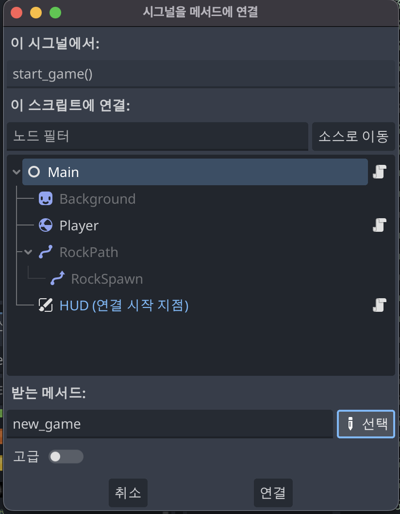
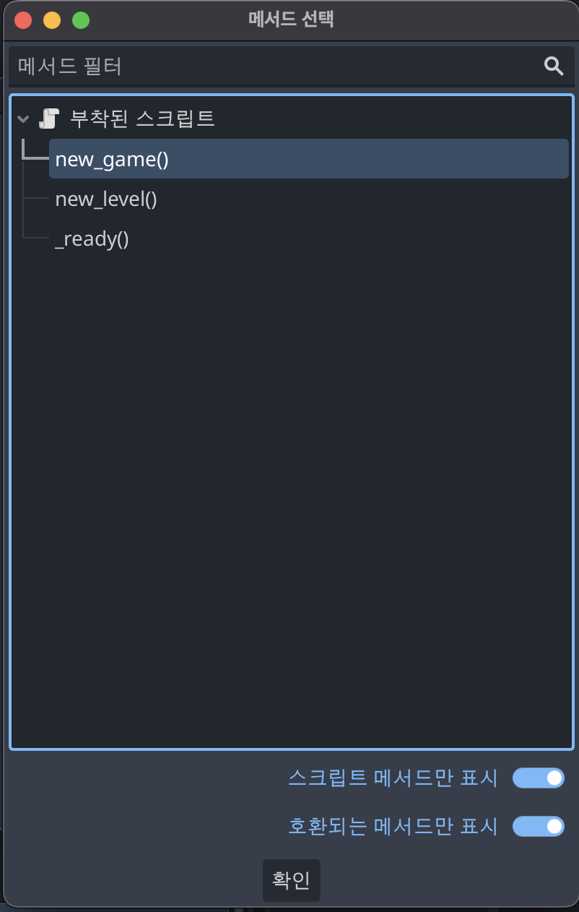
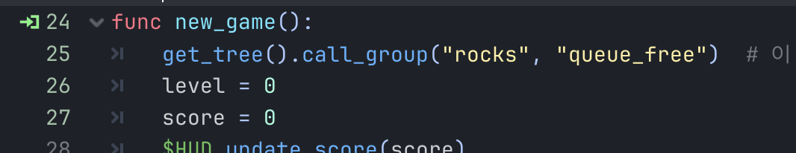
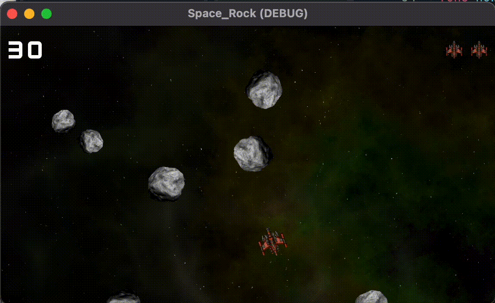

## \[게임 UI\]

시작버튼, 게임 상태, 점수, 목숨을 설정 할 수 있도록 만들 것이다.

다음 단계를 따라 UI 설정을 하자.

1.  **\[새 씬\]** 으로 새로운 씬을 만들고 `CanvasLayer` 루트 노드를 생성한뒤 이름을 HUD로 변경한다.
2.  `HUD` 하위에 `Timer`와 `MarginContainer` 를 추가한다. 1
3.  `Timer` 노드는 **One Shot** 속성에 체크해주고 **Wait Time**을 **2**로 설정한다. 3
4.  `MarginContainer` 에는 점수와 남은 목숨 두가지가 들어갈것이다. 앵커 프리셋 설정을 **'위쪽 넓게'**로 해준다.
5.  그리고 **\[인스펙터\]** 탭의 **Theme Overrides - Constants** 옵션에서 **margin**을 네 부분 모두 **20**으로 설정한다. 2
6.  `MarginContainer` 하위 노드로 `HBoxContainer`를 추가한다. 4
7.  `HBoxContainer` 아래에 `Label` 노드를 추가하고 `ScoreLabel` 로 이름을 변경한다.
8.  `HBoxContainer` 아래에 `HBoxContainer` 노드를 추가하고 `LivesCounter` 로 이름을 변경한다.
9.  `ScoreLabel` 의 **Text**를 **0**으로 설정하고 **Layout - Container Sizing**에서 **Horizontal** 옵션의 **'확장'**에 체크한다. 5
10.  **Label Settings** 옵션에는 **'새 Label Settings'**를 선택해 설정을 새로 열어주고, **font**에 원하는 폰트 파일을 드래그 해 넣는다. **size**는 **64**로 설정한다.
11.  `LivesCounter` 노드를 선택하고 **Theme Overrides - Constant - Separation**을 **20**으로 설정한다.
12.  또, **Layout - Container Sizing - Horizontal**에서 **'끝점에서 수축'** 을 선택하고 **'확장'**에 체크한다. 6
13.  `TextureRect` 를 `LivesCounter` 의 자식 노드로 추가하고 이름을 Life1으로 바꾼다. 목숨으로 표시할 작은 우주선 이미지를 **Texture** 에 드래그 해 넣는다. **Stretch Mode** 를 **Keep Aspect Centered**로 설정해서 이미지 스케일을 유지하면서 가운데로 위치되도록 한다.
14.  `Life1`을 2개 더 복제하여 `Life2`, `Life3`을 생성해준다.
15.  `HUD`의 자식으로 `VBoxContainer` 노드를 추가한다. 8
16.  `VBoxContainer` 아래 `Label` 노드를 추가하여 이름을 Message로 바꾼다.
17.  `VBoxContainer` 아래 `TextureButton` 을 추가하여 StartButton으로 바꾼다.
18.  `VBoxContainer` 의 **Layout**을 **'가로 중앙 넓게'**로 설정하고 **Theme Overrides - Constant - Separation**을 **100**으로 설정한다.
19.  버튼이 normal 상태일때 이미지와 hover시 이미지를 다르게 적용할 것이다. `StartButton` 노드를 선택하고 **Textures**에서 Normal과 Hover에 각각 해당하는 버튼 이미지를 넣어준다.
20.  그리고 **Layout - Container Sizing - Horizontal** 을 '중앙에서 수축'으로 설정한다. 9
21.  `Message` 노드의 **Text** 를 Space Rock!으로 설정하고 ScoreLabel 노드에서 했던 텍스트 설정을 그대로 적용해준다. 10
22.  그리고 **Horizontal Alignment**를 Center로 설정한다.

## \[UI 스크립트\]

변수에 참조할 노드를 저장할건데, 이는 트리에 노드가 추가된 뒤에 수행해야 한다.

저장해둘 노드가 동적으로 생성되는게 아니라 컨테이너 하위에 있으므로 `_ready()`함수가 실행될 때 변수에 저장할 수 있다.

이때 `@onready` 데코레이터를 사용하면 `_ready()`함수 실행과 동시에 변숫값이 설정되게 할 수 있다.

```bash
extends CanvasLayer

signal start_game

@onready var lives_counter = $MarginContainer/HBoxContainer/LivesCounter.get_children()
@onready var score_label = $MarginContainer/HBoxContainer/ScoreLabel
@onready var message = $VBoxContainer/Message
@onready var start_button = $VBoxContainer/Message/StartButton
```

플레이어가 `StartButton` 을 클릭하면 **start\_game** 시그널을 발신할 것이다.

**lives\_counter**는 목숨 현황에 따라 이미지를 숨기거나 표시할 수 있도록 참조를 가지고 있는 것이다.

점수, 목숨이 변경되는 순간 main에서 호출할 함수 작성:

```bash
func show_message(text):
	message.text = text
	message.show()
	$Timer.start()

func update_score(value):
	score_label.text = str(value)

func update_lives(value):
	for life in 3:
		lives_counter[life].visible = value > life
```

게임 종료 함수:

```bash
func game_over():
	show_message("Game Over")
	await $Timer.timeout
	start_button.show()
```

StartButton의 pressed 시그널과 Timer의 timeout 시그널 연결:

```bash
func _on_start_button_pressed():
	start_button.hide()
	start_game.emit()

func _on_timer_timeout():
	message.hide()
	message.text = ''
```

## \[메인 씬과 연결\]

메인 씬에 HUD를 자식 인스턴스로 추가한다.

main.gd에 다음 코드를 추가한다.

```bash
var level = 0
var score = 0
var playing = false
```

게임 시작 처리를 해 줄 아래 함수를 추가한다.

```bash
func new_game():
	get_tree().call_group("rocks", "queue_free")  # 이전 게임의 바위가 남아있을 수 있어 제거
	level = 0
	score = 0
	$HUD.update_score(score)
	$HUD.show_message("Get Ready!")
	await $HUD/Timer.timeout
	playing = true
```

또, 바위가 파괴될 때 점수를 업데이트 해주기 위해 다음 코드를 `_on_rock_exploded()`에 추가한다.

```bash
score += 10 * size
```

플레이어가 모든 바위를 파괴하면 다음 레벨로 넘어가야 하는데, 이때 호출해줄 레벨 업 처리 함수를 작성한다.

레벨 업 함수에서 바위를 스폰해주게 되었으니 `_ready()` 함수에 있던 `spawn_rock()` 부분은 제거한다.

```bash
func new_level():
	level += 1
	$HUD.show_message("Wave %s" % level)
	for i in level:
		spawn_rock(3)
```

모든 바위가 파괴되었는지 계속 확인해주어야 하기 때문에 `_process()` 함수에 해당 부분을 넣을 것이다.

아래 코드를 추가한다.

```bash
func _process(delta):
	if not playing: return
	if get_tree().get_nodes_in_group("rocks").size() == 0:
		new_level()
```

이전단계에서 HUD의 StartButton을 클릭하면 **start\_game**시그널을 발신되도록 해두었는데, 이 시그널이 발신되면 조금 전에 작성한 main.gd의 `start_game()` 함수가 실행되어야 한다.

지금까지는 시그널을 수신하는 함수를 새로 작성했었는데 이번에는 이미 작성한 함수와 시그널을 연결해야한다.

시그널 목록에서 start\_game 를 우클릭 후 '연결'을 눌러 선택 창을 띄우고 '받는 메서드'에서 \[선택\] 버튼을 눌러 어떤 메서드에 연결할지 선택한다.





연결을 성공하면 `new_game()` 함수의 라인 번호 앞에 초록색 연결 아이콘이 생긴다.



마지막으로 게임 오버 함수를 작성한다.

```bash
func game_over():
	playing = false
	$HUD.game_over()
```

## \[플레이어\]

player.gd에 다음과 같이 시그널, 변수, 함수를 새로 추가한다.

```bash
signal lives_changed
signal dead

var reset_pos = false
var lives = 0: set = set_lives

func set_lives(value):
	lives = value
	lives_changed.emit(lives)
	if lives <= 0:
		change_state(DEAD)
	else:
		change_state(INVULERABLE)
```

lives 변수에 setter를 추가했는데, 이는 lives 값이 변경될때마다 set\_lives 함수가 실행되게 한 것이다.

다음으로, 새 게임이 시작되면 현재 상태를 초기화하고 다시 목숨은 3개, 플레이어는 초기 상태로 만들어줘야 한다.

아래 함수를 추가한다.

```bash
func reset():
	reset_pos = true
	$Sprite2D.show()
	lives = 3
	change_state(ALIVE)
```

그리고 이 함수를 호출 하도록 main.gd의 `new_game()` 함수에 아래처럼 reset하는 코드를 추가한다.

```bash
func new_game():
	...
	$Player.reset()  # 추가!
	await $HUD/Timer.timeout
	playing = true
```

플레이어 위치를 가운데로 재조정하기 위해 `_integrate_forces()` 함수에 다음 코드를 추가한다.

```bash
	if reset_pos:
		physics_state.transform.origin = screensize / 2
		reset_pos = false
```

Main 씬으로 돌아가서 Player 인스턴스를 선택한 뒤 \[노드\] 탭에서 **lives\_changed** 시그널을 찾는다.

우클릭으로 '연결'로 들어간 뒤 '이 스크립트에 연결' 목록에서 HUD를 선택하고 '받는 메서드' 인풋에 update\_lives를 입력하여 전에 작성한 `update_lives()` 함수와 연결해준다.

## \[게임 종료\]

플레이어가 바위에 부딪히면 무적 상태로 변경하고, 또 플레이어의 목숨이 다 소멸되면 게임 종료 시킬것이다.

**(1) 플레이어 상태에 따른 설정**

Player 씬에 Explosion 씬을 인스턴스로 추가하고 Visibility 속성을 끈다.

Player에 Timer 노드를 추가하고 InvulnerabilityTimer로 이름을 변경한다. 그리고 Wait Time을 2로 설정하고 One Shot은 체크 해준다.

그리고 스크립트의 change\_state() 함수에 다음과 같이 코드를 추가한다.

```bash
func change_state(new_state):
	match new_state:
		INIT:
			$CollisionShape2D.set_deferred("disabled", true)
			$Sprite2D.modulate.a = 0.5  # 추가
		ALIVE:
			$CollisionShape2D.set_deferred("disabled", false)
			$Sprite2D.modulate.a = 1.0  # 추가
		INVULNERABLE:
			$CollisionShape2D.set_deferred("disabled", true)
			$Sprite2D.modulate.a = 0.5  # 추가
			$InvulnerabilityTimer.start()  # 추가
		DEAD:
			$CollisionShape2D.set_deferred("disabled", true)
			$Sprite2D.hide()  # 추가
			linear_velocity = Vector2.ZERO  # 추가
			dead.emit()  # 추가
	state = new_state
```

Sprite의 modulate.a 는 알파 채널(투명도)를 설정한다.

무적 상태(INVULNERABLE)가 되면 타이머가 시작된다.

타이머가 돌고 난 뒤 다시 normal 상태로 바꿔주어야 한다. timeout 시그널을 연결해서 다음 코드를 작성한다.

```bash
func _on_invulnerability_timer_timeout():
	change_state(ALIVE)
```

**(2) 리지드 바디 사이의 충돌 처리**

우주선이 바위에 부딪히면 튕기는데, 둘 다 리지드 바디 유형이기 때문이다.

두 리지드 바디가 충돌할 때 이벤트를 주고 싶다면, contact monitoring을 사용해야 한다.

Player씬에서 Player 노드를 선택한 뒤 \[인스펙터\]창의 **Solver - Contact Monitoring**을 **'사용'**으로 체크해준다.

그리고 바로 위에 있는 옵션인 **Max Contacts Reported**를 **1**로 변경해준다.

이렇게 해주면 플레이어가 다른 바디와 접촉했을 때 시그널을 발신한다.

\[노드\]탭으로 옮겨가서 **body\_entered** 시그널을 추가해준다.

다음과 같이 코드를 작성한다.

```bash
func explode():
	$Explosion.show()
	$Explosion/AnimationPlayer.play("explosion")
	await $Explosion/AnimationPlayer.animation_finished
	$Explosion.hide()

func _on_body_entered(body):
	if body.is_in_group("rocks"):
		body.explode()
		lives -= 1
		explode()
```

다음으로 Main씬으로 이동하여 Player 인스턴스의 dead 시그널을 `game_over()` 메서드와 연결한다.

테스트하여 다음 조건들을 만족하는지 체크해보자.

-   우주선과 바위가 부딪힐 때 바위와 함께 우주선도 폭발하는가
-   우주선이 폭발 후 2초간 무적상태(반투명)가 되는가
-   폭발할때마다 목숨이 1개씩 줄어드는가
-   세번 바위에 부딪히면 game over 상태가 되는가


