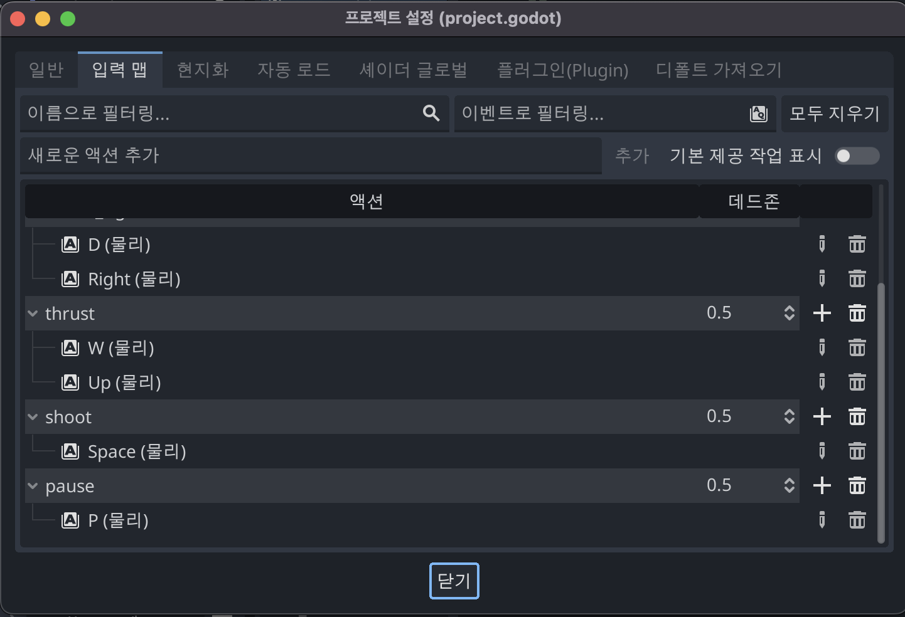
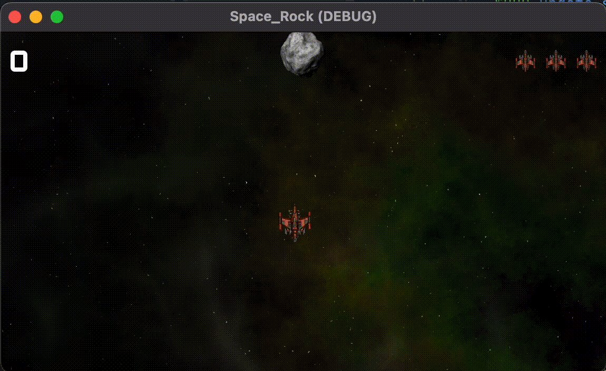
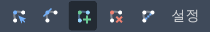
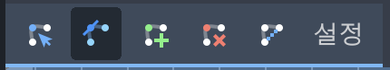
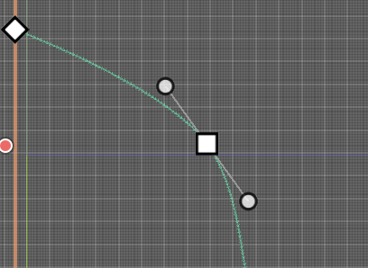
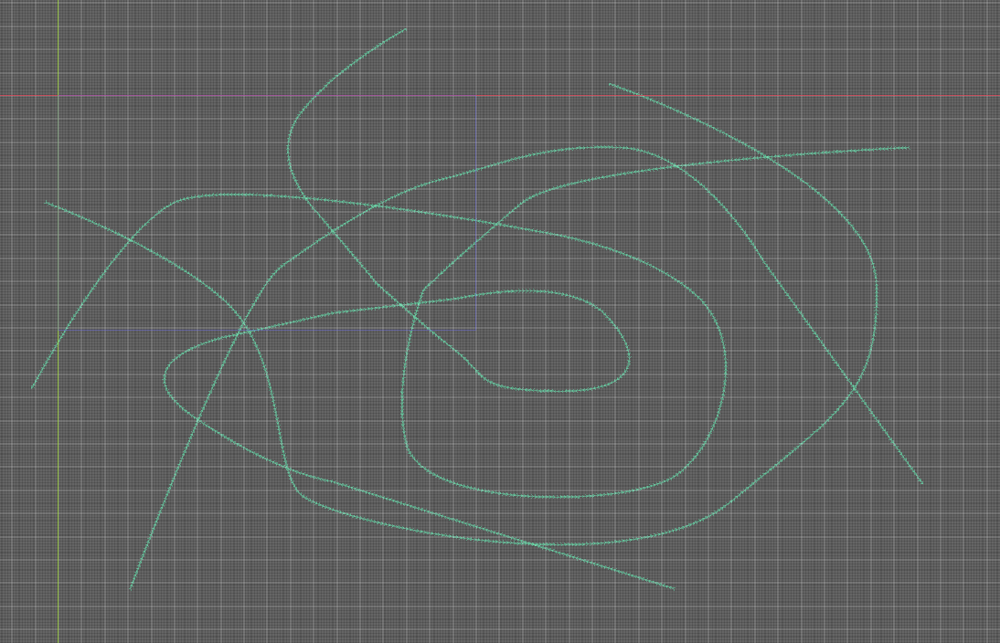
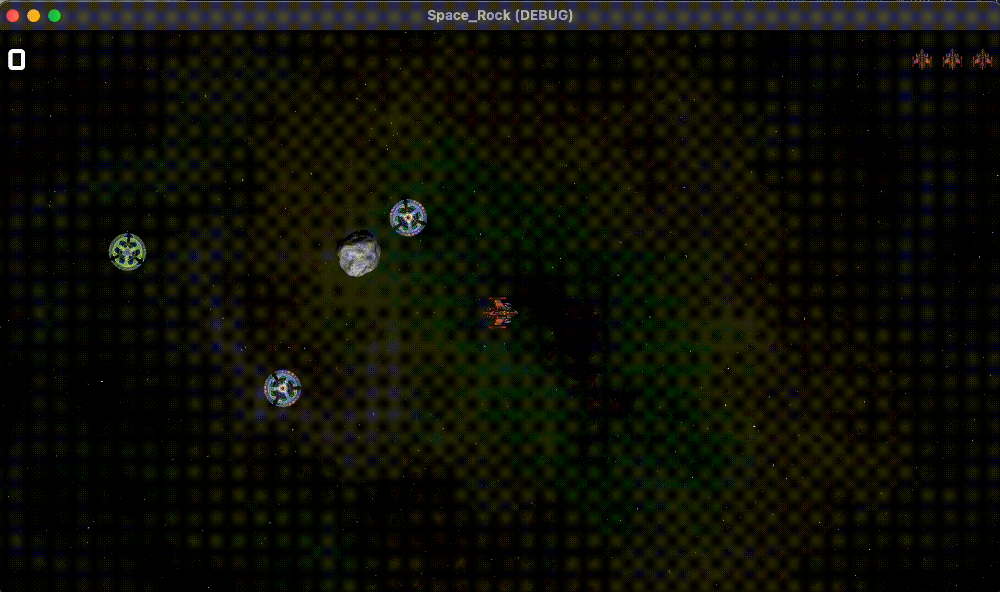
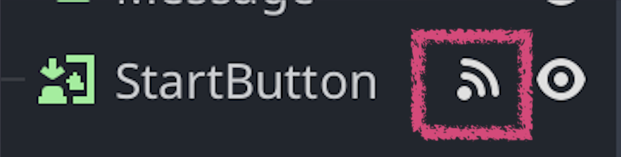
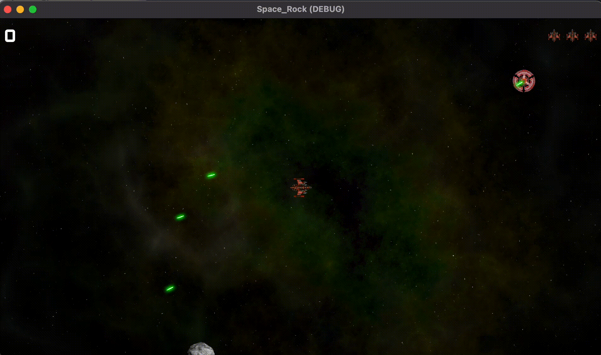
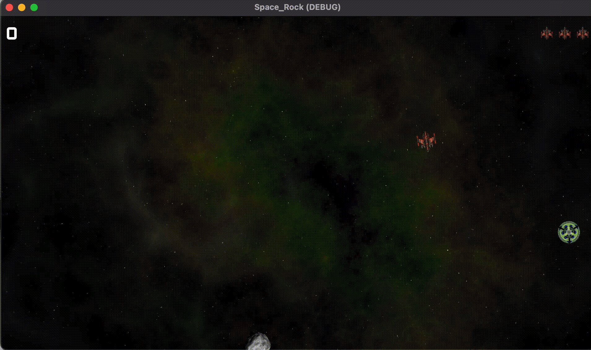

## \[일시 정지\]

적 씬을 만들기에 앞서 **'일시 정지'** 기능을 추가해 보자.

고도에서 일시 정지는 SceneTree의 함수이며, paused 속성을 사용해 설정할 수 있다.

SceneTree 가 일시정지되면 다음 3가지 일이 발생한다.

-   물리 스레드 실행 중지
-   \_process()와 \_physics\_process()가 어떤 노드에서도 호출되지 않음
-   \_input()과 \_input\_event() 메서드가 입력이 있어도 호출되지 않음

일시 정지가 트리거 되면 모든 노드가 개발자가 설정한 대로 반응한다.

이는 **\[인스펙터\] 창의** 하단에 있는 **Process - Mode** 속성을 통해 설정할 수 있다.

선택할 수 있는 옵션은 다음과 같다.

-   Inherit: 해당 노드가 부모와 동일한 모드를 사용
-   Pausable: 씬 트리가 일시 정지되면 해당 노드도 일시 정지
-   When Paused: 해당 노드는 트리가 일시 정지된 경우에만 실행
-   Always: 해당 노드는 항상 실행되며, 트리의 일시 정지 상태는 무시
-   Disabled: 해당 노드는 항상 실행되지 않으며, 트리의 일시 정지 상태는 무시

**프로젝트 - 프로젝트 설정 - 입력 맵** 창을 열어서 pause 라는 새 액션을 만든다. 키는 P로 설정해 보자.



그리고 다음 코드를 `Main.gd` 에 추가한다.

```bash
func _input(event):
	if event.is_action_pressed("pause"):
		if not playing: return
		get_tree().paused = not get_tree().paused
		var message = $HUD/VBoxContainer/Message
		if get_tree().paused:
			message.text = "Paused"
			message.show()
		else:
			message.text = ""
			message.hide()
```

키를 누르는 것을 감지해 트리의 paused 상태를 현재와 반대 상태로 전환시키고, 게임 화면에 "Paused"를 표시하는 코드이다.

"P"키를 눌렀을 때 일시 정지가 되는지 확인해 보면 일시 정지는 잘 된다.

그런데 한 가지 문제점이 있는데, 일시 정지 될 때 `Main` 노드도 함께 일시 정지가 되기 때문에 다시 게임 재개를 할 수 없게 된다.

이를 해결하기 위해 위에서 말했던 것처럼 `Main` 노드의 **Process - Mode** 옵션에서  **Always**를 선택해 주자.

이제 테스트를 해보면 일시 정지/게임 재개가 잘 동작한다.



## \[적\]

**1\. 적의 경로 설정**

새 씬을 생성하고 `Node` 를 추가해 이름을 EnemyPaths로 바꾼다.

적의 경로를 그려 줄 Path2D 노드를 추가한다.

Path2D 노드가 선택된 상태에서는 아래 이미지와 같은 설정 아이콘들이 상단에 생긴다.



이 중 +가 그려져 있는 아이콘을 눌러 경로를 그려준다.

적이 이동할 경로를 점 4~5개를 써서 찍어준 뒤, 경로를 매끄럽게 만들어줄 것이다.



위 아이콘을 클릭하고 방금 그린 경로의 각진 부분을 드래그하면 경로를 곡선으로 만들어 줄 수 있다.

매끄러운 경로로 선을 조정해 주자.



경로를 다 그렸다면 `Path2D`를 몇 개 더 추가해서 여러 가지 경로를 만들어준다.



**2\. 적 씬 생성**

적을 표현하기 위한 새 씬을 만들자.

1.  새 씬 만들기로 씬을 생성한 뒤 루트 노드로 `Area2D` 를 만들어준다.
2.  그 자식으로 Sprite2D 노드를 추가하고 **Texture** 속성에 적 이미지로 설정할 파일을 드래그해 넣어준다.
3.  적을 나타낼 이미지가 1x3의 spriteSheet로 된 이미지기 때문에 **Animation - Hframes** 를 **3**으로 변경한다.
4.  `CollisionShape2D`를 추가하고 Shape 를 이미지에 알맞은 모양으로 선택해 준다.
5.  `EnemyPaths` 씬의 인스턴스를 추가한다.
6.  `AnimationPlayer` 노드를 추가한다. 충돌 효과 애니메이션을 줄 것이다.
7.  flash 라는 이름의 애니메이션을 추가한다. 길이는 **0.25**로, 스냅을 **0.01**로 설정한다.
8.  애니메이션을 적용할 곳은 `Sprite2D`의 **Visibility - Modulate**이다. 키프레임을 추가해 트랙을 만들고, 타임라인 기준선을 **0.04**로 이동해 **Modulate** 색상을 red(#ff0000)으로 변경한다. **0.08**에는 다시 white(#ffffff)로 변경하고, 이 과정을 **0.4**마다 반복해서 빨강-하양이 반복되도록 만든다. 재생해 보면 보이듯이 이를 통해 번쩍이는 효과를 준 것이다.
9.  `Explosion` 씬의 인스턴스를 추가하고 **Visible**을 끈다.
10.  `Timer` 노드를 추가하고 GunCooldown 으로 이름을 변경한다. 이는 적이 사격하는 주기를 구현하기 위한 것이다. **Wait Time**은 **1.5**로, **Autostart**는 **'사용'**으로 체크하자.
11.  적 씬에 스크립트를 붙이고 GunCooldown의 timeout을 연결해 둔다.
12.  `Enemy` 노드에서 enemies 그룹을 추가한다.

**3\. 적 이동**

```bash
@export var bullet_scene : PackedScene
@export var speed = 150
@export var rotation_speed = 120
@export var health = 3

var follow = PathFollow2D.new()  # PathFollow2D는 부모 Path2D를 따라 자동으로 이동함
var target = null

func _ready():
	$Sprite2D.frame = randi() % 3  # 적의 spriteSheet 개수가 3이라 0,1,2중 랜덤 값
	# $EnemyPaths 의 자식 노드들 중 하나 무작위로 선택하기
	var path = $EnemyPaths.get_children()[randi() % $EnemyPaths.get_child_count()]
	path.add_child(follow)  # 위의 path에 자식으로 추가
	follow.loop = false  # 경로 끝에 도달하면 stop

func _physics_process(delta):
	rotation += deg_to_rad(rotation_speed) * delta
	follow.progress += speed * delta  # progress는 경로에서 현재 위치. 경로 따라 이동시키기
	position = follow.global_position
	if follow.progress_ratio >= 1:  # progress_ratio가 1이면 경로의 끝에 도달한 것. (0~1)
		queue_free()
```

코드 내용을 요약하자면 다음과 같다.

-   `_ready()`에서 EnemyPaths의 자식 경로 중 하나를 무작위로 선택하여 PathFollow2D를 추가
-   선택된 경로를 따라 follow 객체가 이동하며, 경로의 끝에 도달하면 멈춤
-   `_physics_process()`에서는 오브젝트가 경로를 따라 움직이고, 경로가 끝나면 제거

**4\. 적 스폰**

`Main` 씬에 Timer 노드를 추가하고 EnemyTimer 로 이름을 변경한다.

**One Shot**은 **'사용'**으로 설정한다.

`main.gd` 에 Enemy 씬을 참조할 수 있게 변수를 추가한다.

```bash
@export var enemy_scene : PackedScene
```

그리고 다음 코드를 `new_level()` 에 추가한다.

```bash
$EmenyTimer.start(randf_range(5, 10))
```

그리고 EnemyTimer에 timeout 시그널을 연결한 후 다음 코드를 작성한다.

```bash
func _on_emeny_timer_timeout() -> void:
	var enemy = enemy_scene.instantiate()
	add_child(enemy)
	enemy.target = $Player
	$EnemyTimer.start(randf_range(20, 40))
```

게임을 시작하면 적이 경로를 따라 날아다니는 걸 볼 수 있다.



**5\. 적의 공격**

적이 쏘는 총알은 플레이어의 총알과는 살짝 다른 디자인을 적용할 것이다.

이미 만들어진 Bullet 씬을 이용하기 위해, Bullet 씬에서 **'씬을 다른 이름으로 저장'** 으로 `enemy_bullet.tscn` 을 만들고 루트 노드의 이름도 맞춰서 바꿔준다.

**\[스크립트 떼기\]** 버튼으로 기존 연결된 스크립트는 끊어주고, 모든 노드를 확인해서 시그널을 **'연결 끊기'** 해준다. 아래 이미지처럼 아이콘이 표시되어 있는 게 시그널이 연결된 노드이다.



여기까지 해주면 기존의 Bullet과 유사한 EnemyBullet 씬 만들기가 완료되었다.

EnemyBullet에 스크립트를 추가한다.

EnemyBullet에서 body\_entered 시그널과 VisibleOnScreenNotifier2D의 screen\_exited 시그널을 연결하고 아래 코드를 작성한다.

```bash
extends Area2D

@export var speed = 1000

func start(_pos, _dir) -> void:
	position = _pos
	rotation = _dir.angle()

func _process(delta: float) -> void:
	position += transform.x * speed * delta

func _on_body_entered(body: Node2D) -> void:
	queue_free()

func _on_visible_on_screen_notifier_2d_screen_exited() -> void:
	queue_free()
```

그 후 `Enemy`로 가서 Bullet Scene 속성에 EnemyBullet 씬을 넣어준다.

`enemy.gd` 에 다음 코드를 추가한다.

```bash
@export var bullet_spread = 0.2

...

func shoot():
	var dir = global_position.direction_to(target.global_position)
	dir = dir.rotated(randf_range(-bullet_spread, bullet_spread))
	var bullet = bullet_scene.instantiate()
	get_tree().root.add_child(bullet)
	bullet.start(global_position, dir)
```

총알이 발사되는 각도에 약간의 다양성을 주기 위해 bullet\_spread 변수를 추가하였다. 총알이 발사될 때 작은 각도로 퍼져서 발사된다.

이렇게 한 후 gunCoolDown 시그널에 `shoot()`을 추가해서 총알을 한 발씩 발사하게 할 수도 있지만, 추가로 총알이 한 번이 아닌 연발되도록 할 것이다.

```bash
func shoot_pulse(n, delay):
	for i in n:
		shoot()
		await get_tree().create_timer(delay).timeout

func _on_gun_cooldown_timeout():
	shoot_pulse(3, 0.15)
```

이와 같이 0.15초 간격으로 3번 연속 발사될 것이다.



**6\. 적 충돌**

다음 코드를 `enemy.gd` 에 작성한다.

마지막은 body\_entered 시그널을 연결해서 작성한 시그널 함수이다.

```bash
func explode():
	speed = 0
	$GunCooldown.stop()
	$CollisionShape2D.set_deferred("disabled", true)
	$Sprite2D.hide()
	$Explosion.show()
	$Explosion/AnimationPlayer.play("explosion")
	await $Explosion/AnimationPlayer.animation_finished
	queue_free()

func _on_body_entered(body: Node2D) -> void:
	if body.is_in_group("rocks"):
		return
	explode()
```

실행해 보면 플레이어와 적이 충돌했을 때 적이 폭발하는 걸 볼 수 있다.

**7\. 적 대미지**

플레이어의 공격으로 적이 대미지를 입다가 체력이 0이 되면 폭발하도록 만들 것이다.

먼저 `enemy.gd` 에 다음 코드를 추가한다.

```bash
func take_damage(amount):
	health -= amount
	$AnimationPlayer.play("flash")
	if health <= 0:
		explode()
```

플레이어의 총알이 적에게 대미지를 주어야 하는데 현재는 플레이어의 총알은 rocks 만 감지한다.

`Enemy`는 Area2D라서 body\_entered 시그널이 트리거 되지 않기 때문이다.

때문에 Bullet 씬에 area\_entered 시그널을 연결하여 다음 코드를 작성한다.

```bash
func _on_area_entered(area: Area2D) -> void:
	if area.is_in_group("enemies"):
		area.take_damage(1)
```

실행해 보면 적이 총알에 맞으면 깜박이는 애니메이션이 재생되고 3번 맞으면 체력이 0이 되어 폭발하는 걸 볼 수 있다.



플레이어가 적에 의해 피해를 입는 부분은 아직 전혀 구현하지 않았는데 이는 다음 글에서 플레이어 보호막을 구현하면서 함께 넣을 로직이기 때문에 함께 추가할 것이다.
