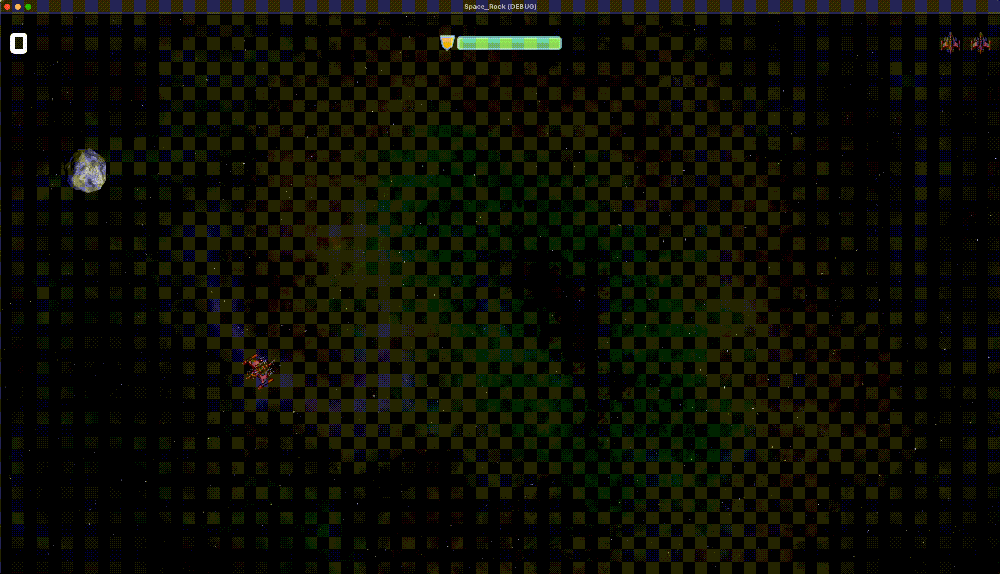

## \[플레이어 보호막\]

적이나 바위에 부딪혔을 때 혹은 적의 총알에 맞을 때 보호막이 작동해서 바로 목숨을 잃지 않도록 하는 기능을 추가할 것이다.

다음 코드를 `player.gd` 에 추가한다.

```bash
signal shield_changed

@export var max_shield = 100.0
@export var shield_regen = 5.0

var shield = 0: set = set_shield

func set_shield(value):
	value = min(value, max_shield)
	shield = value
	shield_changed.emit(shield / max_shield)
	if shield <= 0:
		lives -= 1
		explode()
```

코드에서 **shield\_changed** 시그널을 보낼 때 shield/max\_shield 로 보내는데, HUD에서 표시할 때 백분율로 표시할 것이기 때문이다.

그리고 이제는 바위와 부딪혔을 때 바로 피해를 입는 게 아니기 때문에 **body\_entered** 시그널 함수에 있던 `explode()` 함수 호출을 `set_shield()` 로 옮겼다.

이 때문에 **body\_entered** 시그널 함수도 수정이 필요하다.

```bash
func _on_body_entered(body):
	if body.is_in_group("rocks"):
		shield -= body.size * 25  # 추가
		body.explode()
		#lives -= 1  * 제거
		#explode()  * 제거
```

바위 크기에 따라서 피해를 입도록 rock의 size 에 영향을 받게 했다.

이제 저번 장에서 enemy를 만들면서 남겨두었던 기능인 플레이어가 적에 의해 피해 입는 부분을 구현하자.

**1\. 적의 총알 대미지**

적의 총알에 피해를 입도록 해야 한다.

`enemy_bullet.gd` 에 변수를 추가하고 `_on_body_entered()` 에 대미지 구현 코드를 추가한다.

```bash
@export var damage = 15

...

func _on_body_entered(body: Node2D) -> void:
	if body.name == "Player":
		body.shield -= damage
	queue_free()
```

**2\. 적과 충돌로 입는 대미지**

적이랑 부딪혔을 때에도 shield 수치를 깎아주어야 한다.

`enemy.gd` 의 `_on_body_entered()` 에 다음 코드를 추가한다.

```bash
body.shield -= 50
```

**3\. 보호막 초기화**

보호막이 0이 되어 목숨을 잃으면 다시 보호막은 최대치가 되어야 한다.

`player.gd` 의 `set_lives()` 에 다음 코드를 추가한다.

```bash
shield = max_shield
```

**4\. 보호막 재생**

마지막으로, 보호막을 프레임마다 재생하는 코드가 필요하다. `_process()` 에 다음 코드를 추가한다.

```bash
shield += shield_regen * delta
```

## \[HUD 표시\]

**1\. layout 구성**

HUD 씬에서 HBoxContainer의 자식으로 TextureRect, TextureProgressBar(ShieldBar로 이름 변경)를 추가한다.

TextureRect에는 방패 이미지를 넣어줘서 보호막의 프로그레스 바라는 걸 표시한다.

ShieldBar는 **Texture**에 3가지 속성이 있다. **Under**, **Over**, **Progress** 인데 이 중 **Progress**가 실제 진행률을 나타내는 데 사용되고 다른 두 가지는 이름 그대로 프로그레스 위 혹은 아래에 들어갈 이미지를 설정해서 커스터마이즈 할 수 있다.

**Range** 섹션에서는 **Max Value**이 **100**으로 되어있는데 비율로 값이 들어갈 것이기 때문에 **1**로 수정해 주자.

그리고 **Step** 도 이에 맞춰 **1** -> **0.01**로 수정하자.

**Layout - Container Sizing** 에서는 **'확장'**을 체크하고 **Vertical** 을 **'중앙에서 수축'**으로 변경한다.

**2\. 스크립트**

바의 값에 따라 색상을 다르게 설정하고 싶다.

다음 코드를 `hud.gd` 에 추가한다.

```bash
@onready var shield_bar = $MarginContainer/HBoxContainer/ShieldBar

var bar_textures = {
	"green": preload ("res://assets/bar_green_200.png"),
	"yellow": preload("res://assets/bar_yellow_200.png"),
	"red": preload("res://assets/bar_red_200.png")
}

...

func update_shield(value):
	shield_bar.texture_progress = bar_textures["green"]
	if value < 0.4:
		shield_bar.texture_progress = bar_textures["red"]
	elif value < 0.7:
		shield_bar.texture_progress = bar_textures["yellow"]
	shield_bar.value = value
```

마지막으로 player에서 정의한 **shield\_changed** 시그널을 방금 HUD에 작성한 `update_shield()` 와 연결해 준다.

Main으로 가서 자식 인스턴스로 추가해 둔 Player를 클릭하고 오른쪽 노드 탭에서 **shield\_changed** 시그널을 선택하고 `update_shield()` 를 입력하여 둘을 연결해 준다.

## \[테스트\]

게임을 실행해서 아래 항목이 잘 작동하는지 확인해 보자.

-   적의 총알에 맞으면 보호막 감소
-   적과 충돌하면 보호막 감소
-   바위와 충돌하면 보호막 감소
-   보호막 전부 사라지면 목숨 차감
-   새 목숨 얻으면 보호막 초기화
-   아무 피해도 안 받고 있으면 보호막 재생


