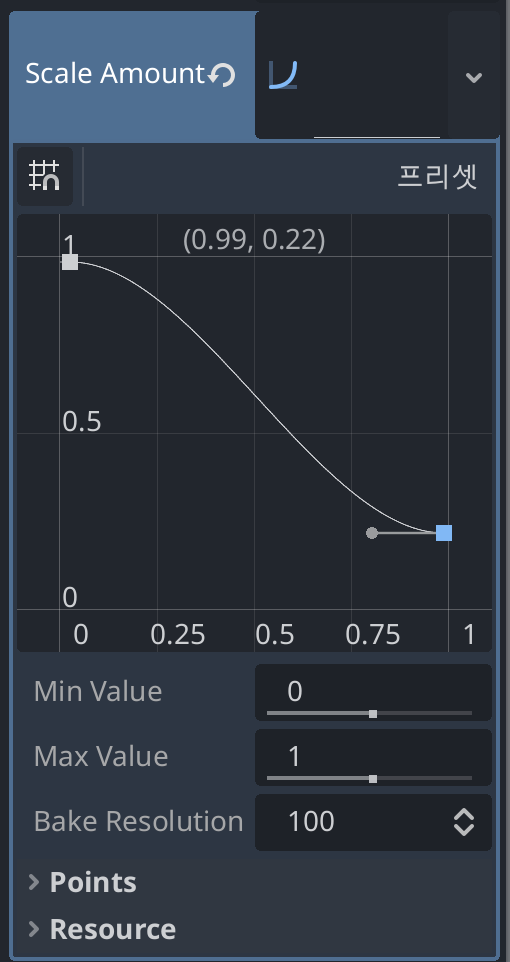
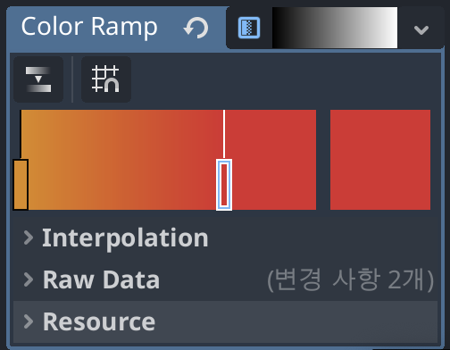
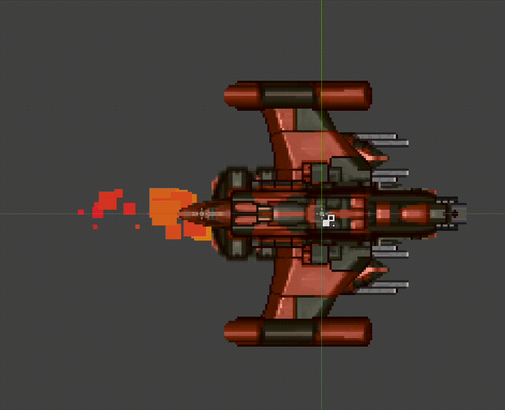
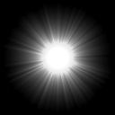
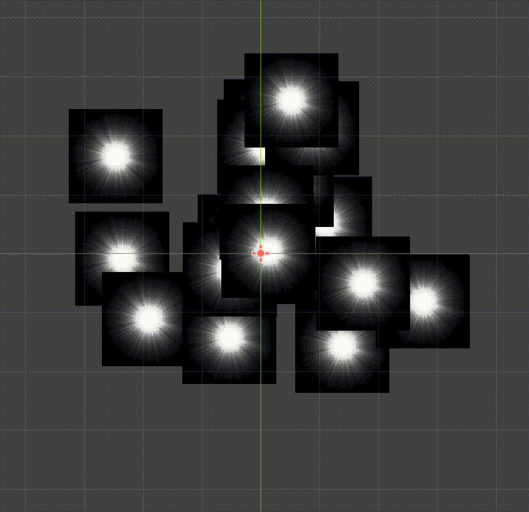
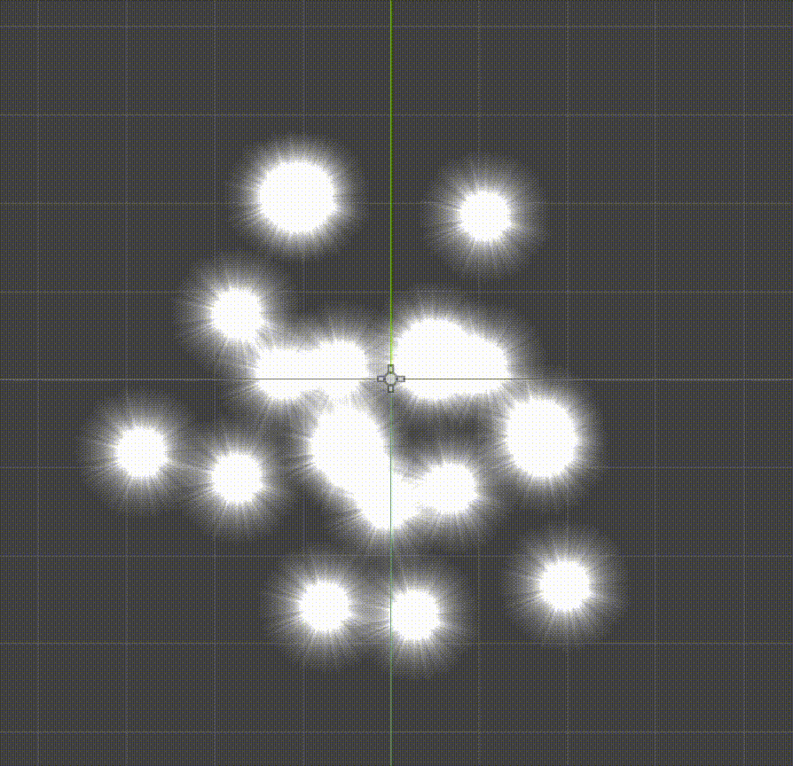
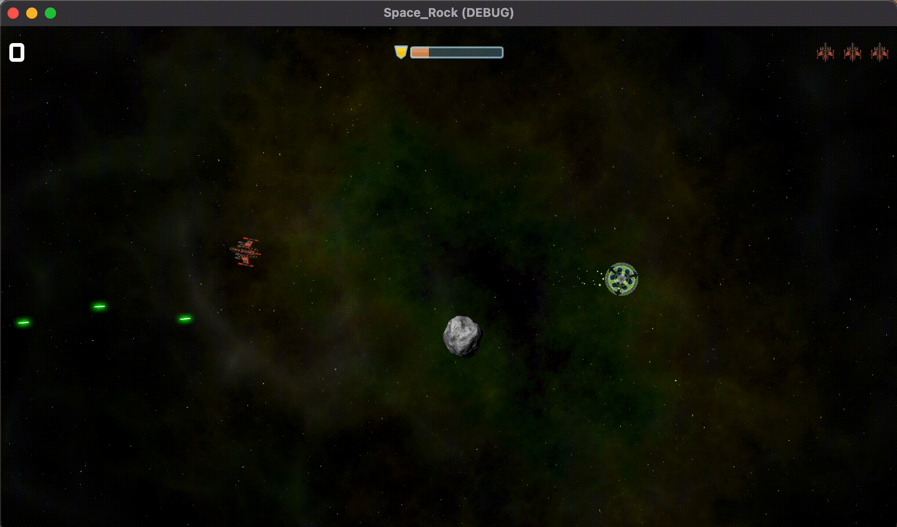

## \[사운드\]

**1\. 사격 & 엔진**

사격과 엔진 사운드를 추가해 보자.

Player에 AudioStreamPlayer 노드를 2개 추가하고 각각 LaserSound, EngineSound로 바꾼다.

먼저 사격 사운드를 위해 `shoot()`에 다음 코드를 추가한다.

```bash
$LaserSound.play()
```

만약 소리가 너무 크거나 작다고 느껴지면 **Volumne dB** 에서 조절할 수 있다.

다음으로 엔진 사운드는 thrust 입력을 받고 있을 때만 재생되어야 하며, 입력을 누르고 있는 동안은 계속 재생되어야 한다.

`get_input()`에 EngineSound를 조건부로 재생하고 멈추는 코드를 추가한다.

```bash
if Input.is_action_pressed("thrust"):
    thrust = transform.x * engine_power
    # 이후 코드를 추가한다.
    if not $EngineSound.playing:
        $EngineSound.play()
else:
    $EngineSound.stop()
```

플레이어 사망 시 엔진 사운드가 재생 중이라면 죽고 나서도 사운드가 계속 재생되고 있다. 때문에 `change_state()`의 DEAD 상태에도 사운드 멈춤을 추가한다.

```bash
DEAD:
    $CollisionShape2D.set_deferred("disabled", true)
    $Sprite2D.hide()
    linear_velocity = Vector2.ZERO
    dead.emit()
    $EngineSound.stop()  # 추가
```

**2\. 폭발, 레벨업, 배경음악**

Main 씬에 AudioStreamPlayer 노드를 3개 추가하고 이름을 각각 ExplosionSound, LevelupSound, Music으로 변경한다.

`_on_rock_exploded()` 에 $ExplosionSound.play(), `new_level()` 에 $LevelupSound.play()를 추가한다.

배경음악 재생/중지를 위해 `new_game()`에 $Music.play()를, `game_over()`에 $Music.stop()을 추가한다.

**3\. 적 폭발, 사격**

enemy씬에도 사운드를 추가하자. AudioStreamPlayer 노드를 2개 생성해 주고 이름을 ExplosionSound, ShootSound로 변경한 뒤 알맞은 위치에 play() 시킨다.

## \[파티클\]

플레이어 우주선 엔진에 불꽃이 뿜어 나오는 효과를 추가해 보자.

CPUParticles2D 노드를 추가하고 Exhaust 로 이름을 바꾸겠다.

> 파티클 노드
> 고도에는 2가지 유형의 파티클 노드가 있다.
> 렌더링에 CPU를 사용하는 것과 하드웨어 가속인 GPU를 사용하는 것이다.
> 모든 플랫폼이 하드웨어 가속을 지원하지 않고(모바일이나 구형 데스크톱은 특히나) 호환성을 고려한다면 CPU를 사용하자.
> 고사양의 시스템에서 실행할 게임을 만든다면 GPU 버전을 사용하는 것이 좋다.

파티클 노드가 추가된 우주선의 2D 화면을 보면 흰 점이 아래로 떨어지는 모습을 볼 수 있다.

이것을 불꽃 효과로 바꾸면 된다.

파티클 설정 옵션은 여러 가지가 있다. 다음과 같이 설정해 보자.

\[파티클 기본 설정\]

1\. **Amount**: 25

2\. **Drawing/Local Coords**: 사용 (\*파티클이 부모 노드의 로컬 좌표를 따름. 부모가 움직이면 같이 이동)

3. **Transform/Position**: (-28, 0)

4\. **Transform/Rotation**: 180

5\. **Visibility/Show Behind Parent**: 사용 (\*파티클이 부모 뒤에 렌더링 되도록 함)

\[파티클 동작\]

6\. **Emission Shape**에서 **Shape** 를 Rectangle로 변경. 그 후 **Rect Extends**를 (1, 5)로 변경 (\*파티클이 흩어져서 생성)

7\. **Direction/Spread**: 0

8\. **Gravity**: (0, 0) (\*위의 옵션과 함께 설정하여 파티클이 특정 방향으로 퍼지지 않음)

9\. **Initial Velocity/Velocity Max**: 400 (\*파티클이 우주선 뒤로 0~400의 랜덤한 속도로 날아감)

10\. **Scale/Scale Amount Max**: 8 (\*1~8 크기의 파티클 랜덤 생성)

11\. **Scale/Scale Amount** 에서 **\[새 Curve\]**로 새로운 옵션을 만들어 준 뒤, 그래프를 아래 그림과 같이 그려준다.

이렇게 하면 우주선에서 나오는 파티클이 생성된 후에 점차 크기가 줄어든다.



12\. **Color/Color Ramp**에서 **\[새 Gradient\]**로 그라디언트 에디터를 추가한다.

아래 이미지처럼 불꽃의 색상을 설정해 준다.



13\. **Time/Lifetime**: 0.1

모든 설정이 완료되면 아래와 같은 모습을 볼 수 있다.



이제 우주선이 thrust 입력을 받았을 때 불꽃을 내뿜게 하면 끝이다.

player.gd 의 `get_input()` 함수에서 다음과 같이 emitting 옵션을 설정해 준다.

```python
func get_input():
	$Exhaust.emitting = false  # 추가
	thrust = Vector2.ZERO
	if state in [DEAD, INIT]:
		return
	if Input.is_action_pressed("thrust"):
		$Exhaust.emitting = true  # 추가
        ...
```

## \[적 파티클\]

Enemy에 CPUParticles2D 노드를 추가하고 다음과 같이 설정하자.

1\. **Amount**: 20

2\. **Visibility/Show Behind Parent:** 사용

3\. **Emission Shape/Shape**: sphere

4\. **Emission Shape/Sphere Radius**: 25

5\. **Gravity**: (0, 0)

파티클이 이미지에 가려져 있어서 잘 안 보인다면 Sprite2D의 '보이기'를 잠시 꺼두자.

파티클은 기본으로 정사각형이지만 커스텀하게 만들 수도 있다.



위 이미지를 파티클 모양으로 대체할 것이다.

**Drawing/Texture**에 해당 이미지를 끌어 놓는다.

이미지 크기를 조절하고 싶다면 **Scale/Scale Amount(Min/Max)** 를 조절해 주자.

위 이미지는 너무 크기 때문에 **Scale Amount Max** 를 0.1로 설정해 주었다.

그러면 아래 같이 보일 것이다.



다음 문제는 이미지가 검은 배경이 있다는 것이다.

Blend Mode를 변경해주어야 하는데, **Meterial** 속성에서 **\[새 CanvasItemMaterial\]** 을 선택한다.

**Blend Mode** 를 **Add** 로 변경해 주자.



그 후, 플레이어 우주선에 한 것처럼 **Scale/Scale Amount Curve**를 설정해서 파티클을 희미해지게 만들어주자.

게임을 실행해 보고 파티클이 잘 보이는지 확인해 보자.



플레이어 불꽃과 적 비행접시의 반짝임이 잘 보인다면 성공이다.
