## \[미리보기\]

이번 편에서 할 것: 플레이어 애니메이션과 움직임 구현

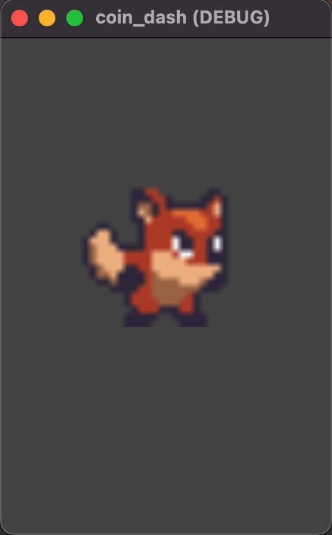

* * *

## \[환경 세팅\]

[https://godotengine.org/](https://godotengine.org/) 에서 최신 버전 고도를 다운로드한다.

\* 스팀에서도 설치가능 (godot 로 검색 후 설치)

## \[프로젝트 생성하기\]

godot 를 실행하고 \[+새로 만들기\] 버튼으로 프로젝트를 생성한다.

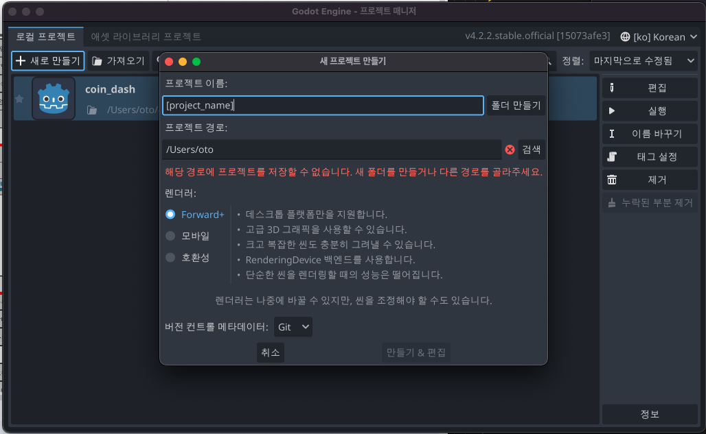

\* 새로 만들 프로젝트 이름을 적어주고 프로젝트 이름 인풋 옆에 \[폴더 만들기\] 로 폴더를 먼저 만들어줘야 한다.

그 후 프로젝트 설정을 하면 되는데 앱용으로 게임을 만들것이기 때문에 세로 뷰로 창을 설정한다.

**세로로 게임화면 설정하기**

1\. \[프로젝트 설정\]으로 들어간다.

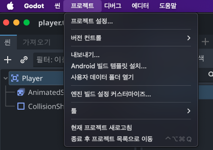

\[창\] 탭을 선택하고 아래 설정을 해준다.

-   뷰포트 너비 480 / 높이 720
-   ‘스트레치' 에서 ‘모드'를 canvas\_items 으로 설정
-   ‘양상' 을 keep 으로 설정 (이렇게 하면 게임창 크기 조절되어도 비율이 유지되어 조정되거나 변형되지 않는다.)

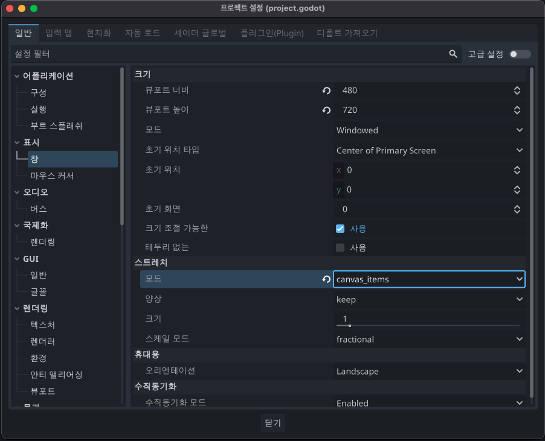

## \[씬 생성\]

왼쪽에 \[씬\] 탭에 + 로 노드를 추가해 줄 것이다.

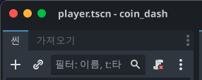

2D 게임을 만들 것이고 다른 노드와의 중첩을 감지할 수 있어야 하기 때문에 Area2D 를 검색해서 생성해 준다.

그리고 이 노드는 Player 관련 설정을 해줄 것이라 이름을 Player 로 변경해 준다.

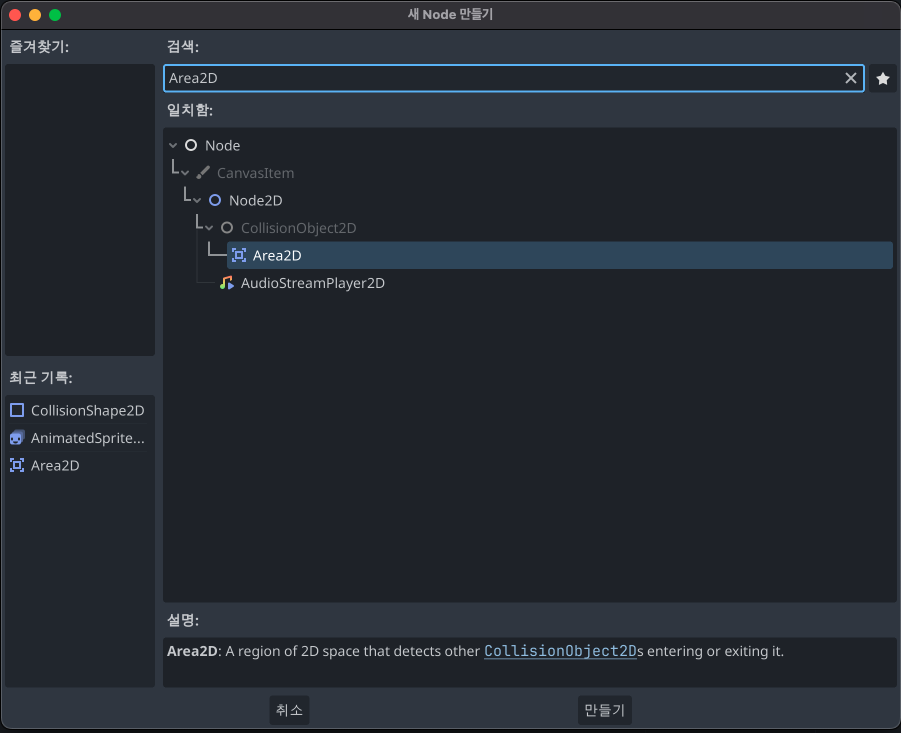

(왼쪽 하단 \[파일 시스템\]을 보면 .tscn 확장자로 생성되었을 텐데,  t 는 텍스트라는 뜻이고 고도의 씬 용 파일형식이다.)

## \[애니메이션\]

Area2D 는 충돌 감지할 수 있지만, 그 자체로는 모양이 없다. 그래서 이미지를 표시하는 노드가 필요하다.

아까 만든 Area2D 노드 아래에 이번에는 AnimatedSprite2D 를 만들어준다.

\----

AnimatedSprite2D에는 SpriteFrames 이라는 리소스가 필요하다.

우측 패널에 \[인스펙터\] 탭에서 Animation/Sprite Frames 속성을 찾고 empty 를 클릭해서 드롭다운을 연 후 ‘새 SpriteFrames’선택한다.

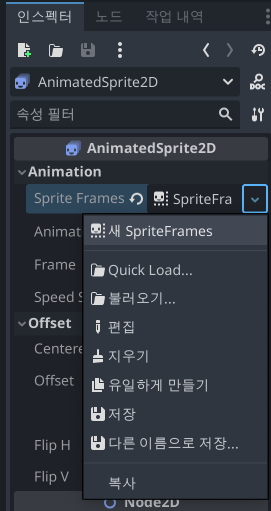

그럼 하단에 애니메이션 창이 생기는데, 여기에 Player의 동작인 run, idle, hurt 를 만들어준다.

그리고 애니메이션으로 만들 이미지를 끌어와서 추가해 주면 애니메이션이 완성된다.

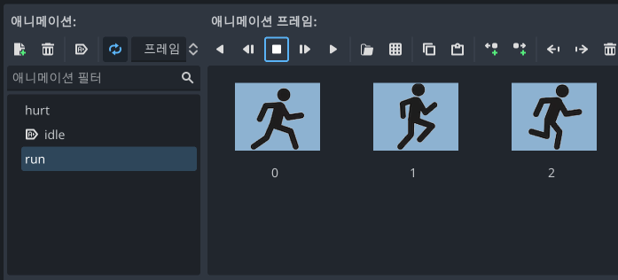

그리고 세 가지 종류의 애니메이션 중에 기본으로 실행될 애니메이션을 설정할 수도 있는데, 휴지통 오른쪽에 있는 아이콘인 '불러오면 자동 재생'을 클릭해서 idle이 기본 애니메이션으로 실행되게 해 주자.

-   애니메이션 속도를 빠르게: 프레임을 증가시키기
-   이미지 크기: 우측 \[인스펙터\] 에서 Scale 키우기
-   이미지의 중앙을 (0,0) 좌표로 조정: Offset 조정

## \[콜리전 모양\]

콜리전 사용할때는 오브젝트의 모양을 고도에 알려줘야 한다. (히트박스)

이번엔 Plyaer 에 CollisionShape2D 를 자식으로 추가한다.

우측 \[인스펙터\]에서 empty로 되어있는 Shape를 ‘새 RectangleShape2D’ 선택하여 상자 모양이 이미지 덮이도록 조정한다.

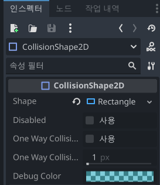

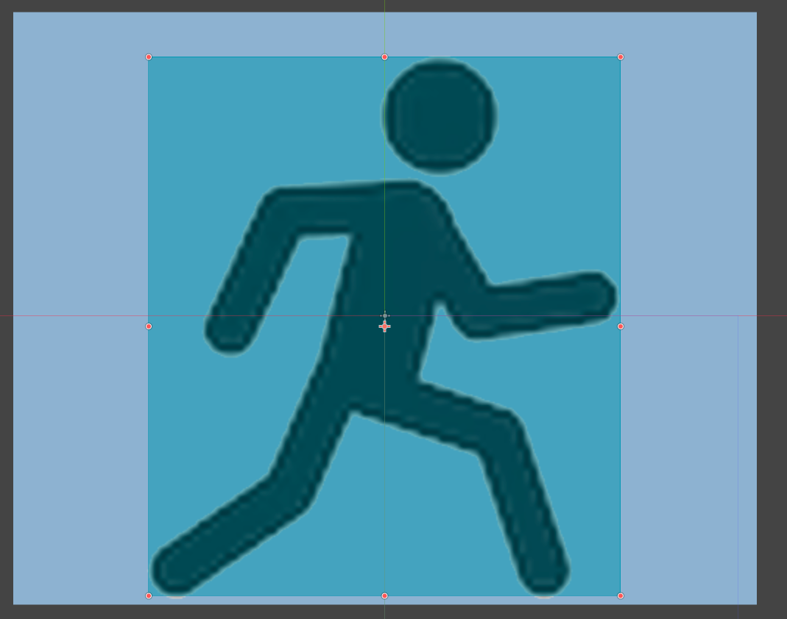

## \[스크립트 작성\]

코드를 추가해 주기 위해 필터 인풋 오른쪽에 있는 ‘새 스크립트’ 아이콘을 클릭해서 스크립트도 추가하자.

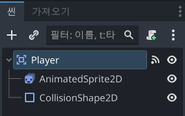

스크립트 파일에서 변수 앞에 @export 어노테이션을 붙이면 \[인스펙터\] 창에 속성이 추가되고 다른 기본 속성처럼 조절할 수 있게 된다.

```bash
extends Area2D

@export var speed = 350
```


*speed 속성이 추가된 모습*

## 플레이어 이동

고도에는 이동 방향을 알아내는 Input.get\_vector() 함수가 있다.

이를 이용해 vector 값을 얻어서 오브젝트의 position을 업데이트할 수 있다.

또 clamp()라는 함수로 플레이어의 위치를 화면 밖으로 벗어나지 못하게 해 줄 수도 있다.

```bash
func _process(delta):
	#1. 키보드 입력, 2. 방향으로 이동. 3. 애니메이션 재생
	velocity = Input.get_vector("ui_left", "ui_right", "ui_up", "ui_down")
	position += velocity * speed * delta

	# 화면 밖으로 벗어나지 못하게 막는
	position.x = clamp(position.x, 0, screensize.x)
	position.y = clamp(position.y, 0, screensize.y)
```

> 게임 개발할 때 많이 쓰이는 delta라는 값이 있다.
> delta는 '이전 프레임 이후 경과된 시간'이다.
> 만약 프레임 당 10 픽셀씩 움직이게 했다면 1초에 600 픽셀을 이동할 것이다.
> 그런데 프레임이 오래 걸리면 1초 50 프레임이 될 수도 있어 오브젝트의 이동이 그만큼 느려질 수가 있다.
> 그래서 이 delta 값을 사용한다. 약 0.016초로, 만약 초당 600 픽셀에 delta 값을 곱하면 10픽셀의 움직임 얻을 수 있는데 delta가 증가하면 오브젝트는 18픽셀을 이동한다. 그래서 결과적으로 이동속도는 프레임 속도과 관계없이 유지될 수 있게 된다.

스크립트를 작성했으면 오른쪽 최상단에 '현재 씬 실행'으로 직접 플레이어를 움직여서 문제가 없는지 확인하기.

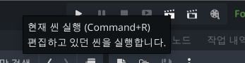

## \[실행될 애니메이션 선택\]

이번엔 입력에 따라 idle 혹은 run 애니메이션을 보여주자.

또, 오른쪽/왼쪽 이동 방향에 따라 애니메이션을 좌우로 뒤집어줘야 한다.

좌우 뒤집기는 \[인스펙터\]의 flip\_h에서 직접 토글 해볼 수도 있다.

```bash
	# 어떤 애니메이션 보여줄 지 결
	if velocity.length() > 0:
		$AnimatedSprite2D.animation = "run"
	else:
		$AnimatedSprite2D.animation = "idle"
	# 방향 이동에 따라 수평 뒤집기
	if velocity.x != 0:
		$AnimatedSprite2D.flip_h = velocity.x < 0
```

flip\_h 는 boolean 속성이라서 위 코드처럼 velocity 값에 따라 true/false 를 할당해줄 수 있다.

> \[$ 표기법\]
> 노드 이름은 스크립트 실행하는 노드에 대해 상대적.
> $Node1/Node2 의 뜻? 스크립트 실행하는 노드 0의 자식노드인 노드 1의 자식노드인 노드 2를 가리킴.

## \[시작 & 종료\]

set\_process() 함수로 고도에 프레임 호출 시작/중지를 알릴 수 있다.

인자로 true/false 를 전달해 시작과 종료를 할 수 있도록 코드를 작성한다.

```bash
func start():
	set_process(true)
	position = screensize / 2
	$AnimatedSprite2D.animation = "idle"

func die():
	$AnimatedSprite2D.animation = "hurt"
	set_process(false)
```

## \[시그널\]

고도에 시그널이라는 기능이 있는데 이는 노드가 다른 노드에 메시지를 보내서 특정 동작을 할 수 있도록 해준다.

플레이어가 아이템에 닿았을 때랑 장애물에 닿았을 때 보낼 커스텀 시그널을 만들자.

스크립트의 윗부분에 시그널을 추가해 준다.

```csharp
signal pickup ## 동전에 닿았을 때 보낼 시그널
signal hurt ## 장애물에 닿았을 때 보낼 시그널
```

이렇게 코드를 추가해 주면 오른쪽 패널 중 \[노드\]에 시그널이 추가된 걸 볼 수 있다.

방금 만든 커스텀 시그널을 아래 이미지처럼 시그널로 확인할 수 있다.

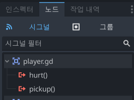

이 다음에 만들게 될 동전 오브젝트도 Area2D 노드가 될 것이라서 플레이어와 동전이 닿았는지에 대한 시그널은 area\_entered 시그널을 이용하는게 좋다.

이 시그널을 우클릭해서 '연결'을 선택하고 연결 설정을 해준다.

이러면 스크립트 하단에 \_on\_area\_entered()가 자동으로 추가된다.

```bash
func _on_area_entered(area):
	if area.is_in_group("coins"):
		area.pickup()
		pickup.emit()
	if area.is_in_group("obstacles"):
		hurt.emit()
		die()
```

다른 오브젝트랑 플레이어가 중첩되면 중첩된 영역은 area 라는 파라미터로 전달될 것이다.

상황에 맞게 해당하는 시그널을 발신해준다.
