## \[미리보기\]

이번 편에서 할 것: 플레이어가 모을 동전 씬과 게임 요소들이 그려질 수 있는 메인 씬 만들기

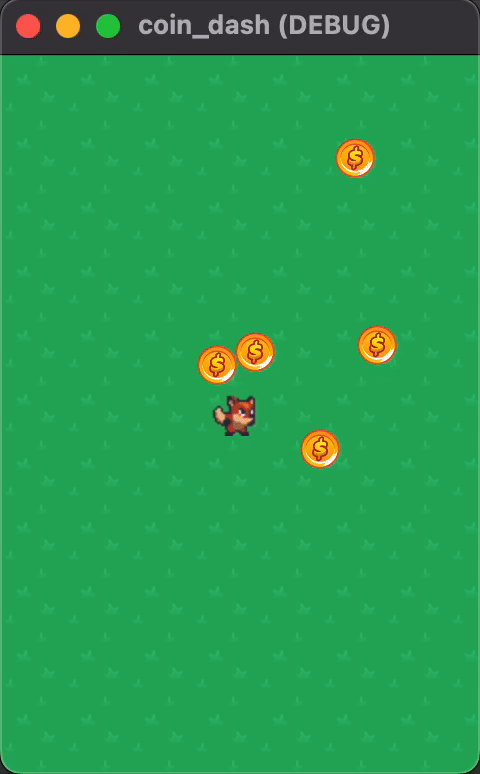

* * *

## \[동전 씬 만들기\]

`Player` 씬을 만들었던 것처럼 `Coin` 씬을 만들어보자.

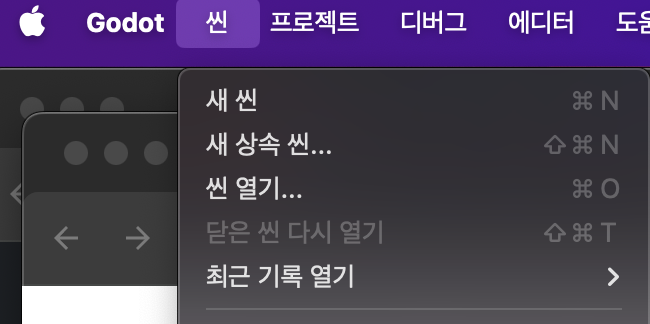

\[씬\] - \[새 씬\] 으로 동전 씬을 만든다.

`Player`와 동일하게 노드를 만들어준다. `Area2D` 노드를 만든 후 자식으로 `AnimatedSprite2D`, `CollisionShape2D` 노드를 만들어준다.

`Area2D` 는 `Coin`으로 이름을 변경해주자.

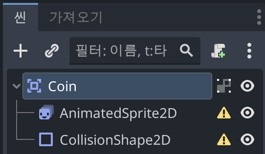

그 후 반드시 저장을 해서 `coin.tscn` 파일로 저장을 해주자.

## \[애니메이션\]

여기까지 완료되면 애니메이션을 추가할 차례다.

플레이어와는 다르게 동전은 한가지 애니메이션만 있으면 된다.

동전을 반짝여 보이게 해 줄 애니메이션용 이미지를 추가해준다.

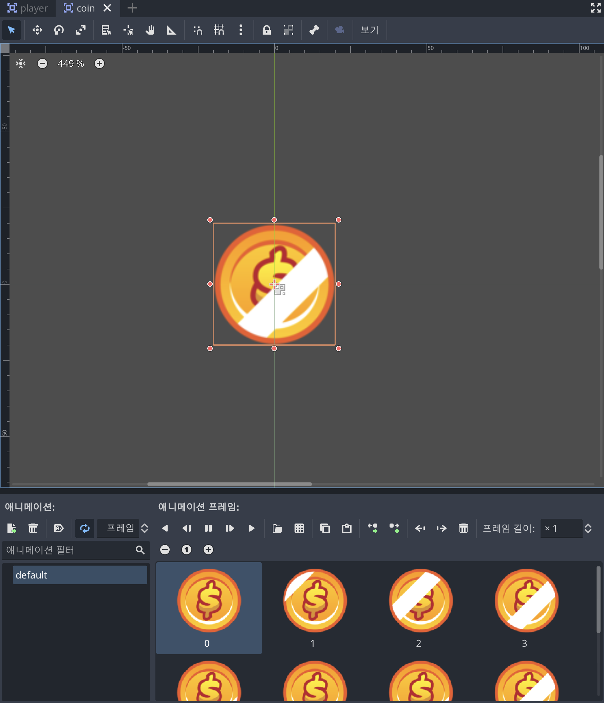

(\[불러오면 자동 재생\]을 빼먹었다가 디버깅 할 때 안 반짝여서 뒤늦게 설정했다.. 꼭 디폴트 애니메이션을 설정해주자)

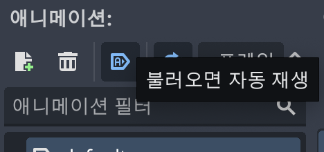

#### **그룹**

게임 화면에는 여러 동전이 생성될 것인데, 모든 동전은 한 그룹으로 묶여있어야 한다.

\* 그룹: 노드에 태그를 달아서 유사한 노드를 묶어줌

`Coin` 노드를 선택한 뒤, \[노드\] 탭으로 들어가서 시그널 옆에 \[그룹\]을 선택한 뒤 `coins` 그룹을 추가해준다.


*coins 그룹이 추가된 모습*

애니메이션까지 완료되면 `CollisionShape2D` 노드로 이동해서 `Player` 와 똑같이 히트박스 설정을 해준다.

이번엔 둥근 물체이니 `CircleShape` 로 해주었다.

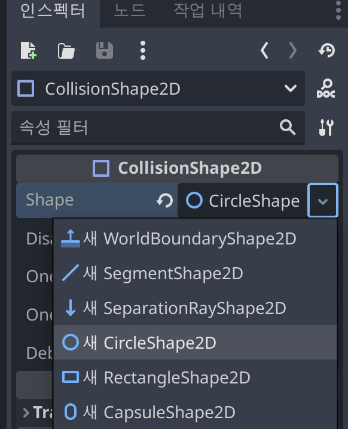

## \[Coin 스크립트\]

1편에서 했던것 처럼 `Coin`노드를 선택하고 \[새 스크립트\] 아이콘을 클릭해서 스크립트 파일을 만든다.

1편에서 마지막에 시그널을 만들면서 플레이어가 동전에 닿았을 때의 시그널을 `pickup`으로 만들었는데, 지금 스크립트에 시그널을 써주자.

```bash
extends Area2D

var screensize = Vector2.ZERO

func pickup():
	queue_free() # 노드를 제거
```

`queue_free()` 는 노드를 제거하는 고도의 메서드이다.

> 이름에 queue가 들어가는건, 삭제 대기열에 추가해두고 현재 프레임이 종료될 때 삭제를 실행하기 때문이다. 이로써 해당 노드에 접근하는 모든 코드가 완료된 뒤 노드를 제거할 수 있다.

나중에는 여기에 동전이 사라지는 효과랑 사운드와 추가할 예정이다.

## \[메인 씬\]

메인 씬은 플레이어, 코인, 타이머 등 모든 게임 요소를 보여주는 씬이다.

**(1) 씬 생성**

\[씬\] - \[새 씬\] 으로 새로운 씬을 생성해 준 뒤, 이번에는 `Node` 유형의 노드를 만들어준다.

`Main`은 아무 기능이 없고 모든 게임 요소의 부모 역할을 해줄 뿐이기 때문에 가장 간단한 유형을 선택해준다.

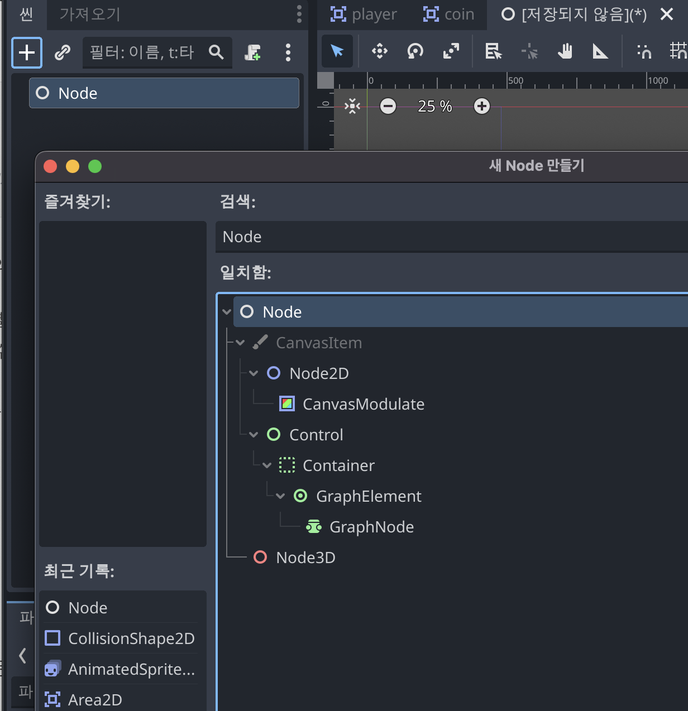

생성된 `Node`의 이름을 `Main`으로 변경해주고 이번에도 꼭 저장을 해주자.

**(2) 자식 노드 생성**

플레이어를 `Main`의 자식 인스턴스로 추가해주기 위해 사슬 모양 아이콘인 \[자식 씬 인스턴스화\]를 클릭해 `player.tscn`을 선택한다.

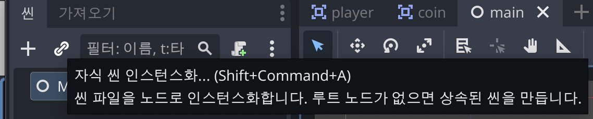

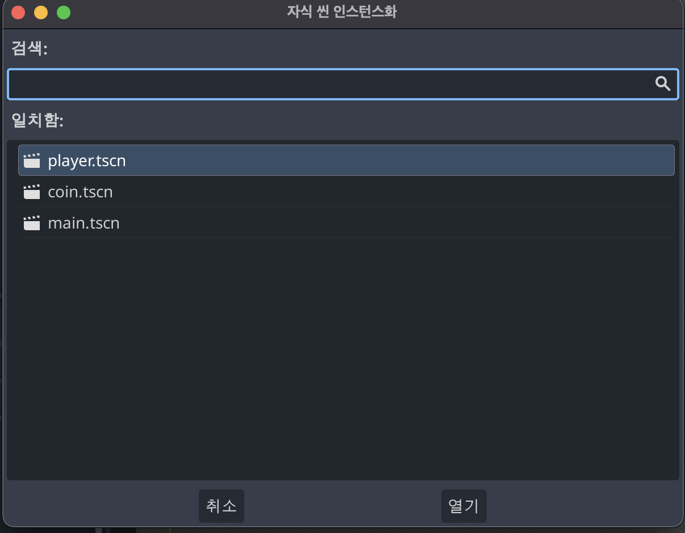

그 후 다음 노드들을 `Main` 노드의 자식으로 추가해준다.

-   TextureRect
-   Timer

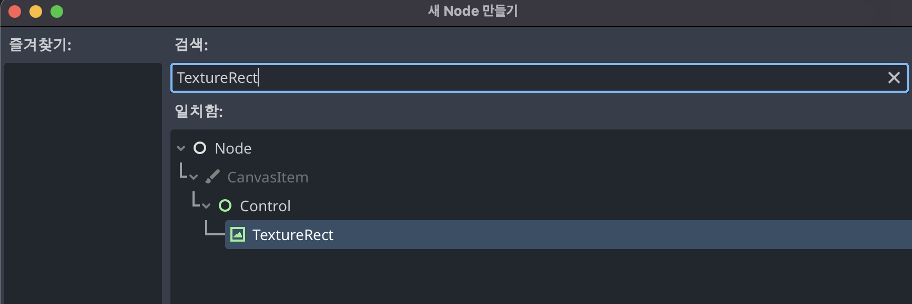

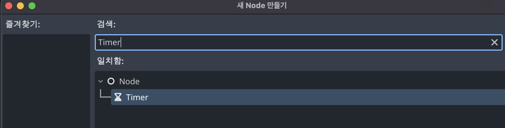

**(3) 트리 구조 세팅**

`TextureRect` 는 `Background` 로, `Timer` 는 `GameTimer` 로 이름을 변경해준다.

또, 노드는 트리에 표시된 순서대로 그려지므로, `Background`를 `Player` 위로 순서를 변경해서 가장 처음으로 그려지도록 해준다.

최종적으로는 다음과 같은 구조가 될 것이다.

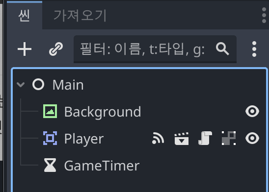

**(4) 노드 설정**

배경으로 설정할 이미지를 `Background` 노드의 `Texture`로 드래그해서 이미지를 설정해준다.

그리고 `Stretch Mode`를 `Scale` 에서 `Tile`로 변경해 이미지가 타일형태로 들어갈 수 있게 해준다. (이건 사용할 배경 이미지에 따라 맞춰 설정하면 된다.)


*Textrue, Stretch Mode가 설정된 모습*

그리고 에디터 창 상단의 \[앵커 프리셋\] 옵션을 '공간 전체'로 설정되도록 한다.

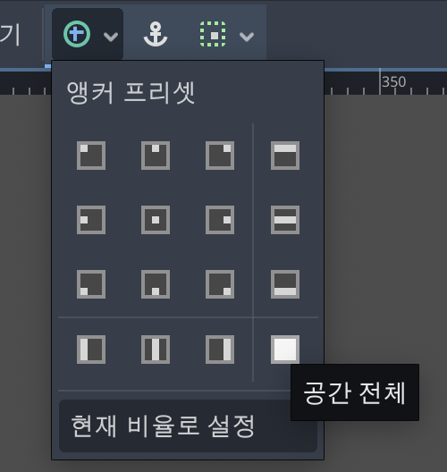

## \[Main 스크립트\]

**(1) 기본 변수 정의**

`Main` 노드에 \[새 스크립트\]로 스크립트를 추가해 다음과 같이 코드를 작성한다.

```bash
extends Node

@export var coin_scene : PackedScene
@export var playtime = 30

var level = 1
var score = 0
var time_left = 0
var screensize = Vector2.ZERO
var playing = false
```

저장을 하면 우측 인스펙터 패널에 스크립트에서 `@export` 로 정의한 변수들이 추가된걸 볼 수 있다.

왼쪽 아래의 \[파일 시스템\] 패널에서 `coin.tscn` 파일을 `Coin Scene` 에 드래그해 넣어준다.


*coin.tscn 파일이 Coin Scene 에 설정되었다.*

**(2) 초기화 코드**

고도는 노드가 추가될 때 `_ready()` 를 자동으로 호출하기 때문에 노드 최초 시작 시 실행될 코드를 넣을 수 있는 곳이다.

다음과 같은 코드를 스크립트에 이어서 작성해준다.

```bash
func _ready():
	screensize = get_viewport().get_visible_rect().size
	$Player.screensize = screensize
	$Player.hide()  # 게임 시작 전에는 플레이어 숨김
```

**(3) 새 게임 시작 코드**

새 게임을 시작할 수 있게 모든 변수를 초기화 해주는 `new_game()` 함수를 작성한다.

```bash
func new_game():
	playing = true
	level = 1
	score = 0
	time_left = playtime
	$Player.start()
	$Player.show()
	$GameTimer.start()
	spawn_coins() # 작성필요
```

`Player` 스크립트에서 작성했던 `start()` 함수를 여기서 써준다.

또, 위에 `_ready()` 에서 `hide()` 시켜줬던 플레이어를 보이도록 `show()` 해준다.

**(4) 코인 생성**

이번엔 (3)의 `new_game()` 마지막에 추가한 `spawn_coins()` 함수를 작성해주자.

```bash
func spawn_coins():
	for i in level + 4:
		var coin = coin_scene.instantiate()
		add_child(coin)
		coin.screensize = screensize
		coin.position = Vector2(randi_range(0, screensize.x),
			randi_range(0, screensize.y))
```

`Coin`을 `Main` 노드의 자식으로 추가해야 하는데, 이는 랜덤하게 동적으로 생성되어야 하기 때문에 스크립트로 작성한다.

`add_child()` 로 새 노드를 씬 트리에 추가한다.

동전의 위치를 랜덤으로 생성해줄 때 화면 밖으로 나가지 않게 `screensize` 를 전달해준다.

> instantiate()는 Godot에서 객체(인스턴스)를 동적으로 생성하는 함수입니다.
> by. chatGPT

> randi\_range()는 Godot 스크립트에서 랜덤한 정수(int) 값을 반환하는 함수입니다. 이 함수는 주어진 범위 내에서 임의의 정수를 생성합니다.
> by. chatGPT

**(5) 테스트**

게임의 최종 형태는 `[게임 시작]`을 클릭했을때 `new_game()`이 호출되야하지만, 지금은 구현되어 있지 않기 때문에 테스트를 위해 `new_game()`을 `_ready()` 함수에 추가해두자.

그리고 에디터 상단 시작 아이콘을 클릭해서 프로젝트를 실행해준다.

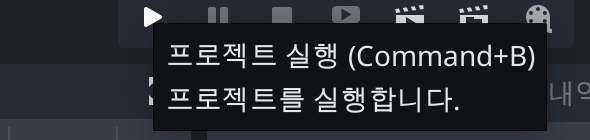

실행하려하면 메인씬을 선택하라는 창이 뜰텐데, `main.tscn`을 선택해주면 된다.


*테스트 중...*

아래 항목이 정상적인지 확인해보자

-   맨 처음에 동전이 5개 생성됨
-   플레이어와 닿은 동전이 사라짐

**(6) 다음 레벨로 이동**

필드에 있는 동전을 다 모으면 다음 레벨로 이동해야 한다.

이를 확인하려면 함수가 계속 실행되어야 하므로 `_process()`를 사용해서 `coins` 그룹에 몇개가 남았는지 확인한다.

남은 코인이 없다면 다음 레벨로 올라간다.

```bash
func _process(delta):
	if playing and get_tree().get_nodes_in_group("coins").size() == 0:
		level += 1
		time_left += 5
		spawn_coins()
```
