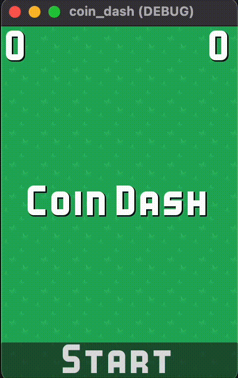
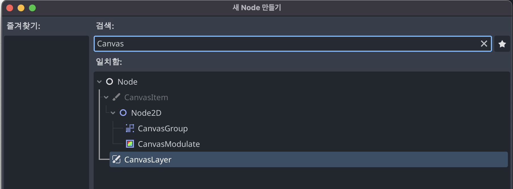
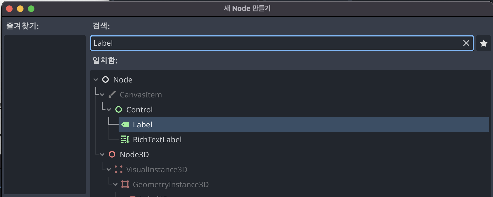
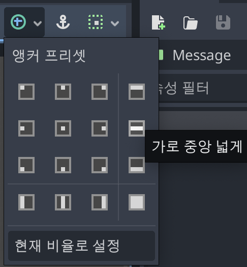
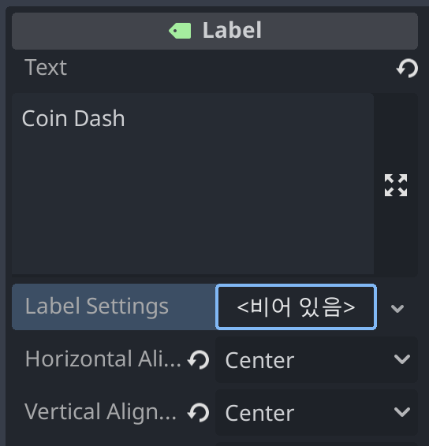
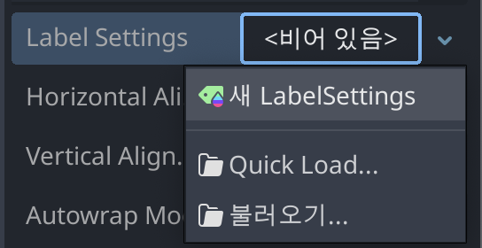
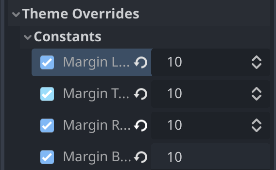
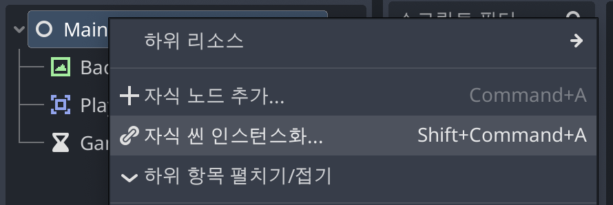
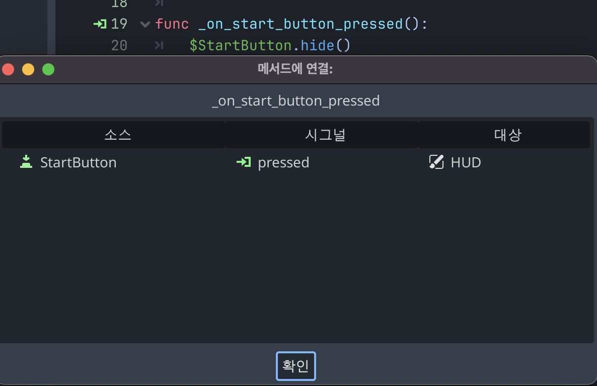

## \[미리보기\]

이번 편에서는 시간이나 점수 같은 유저 인터페이스를 업데이트 해서 보여주고, Game Start & Game Over 를 구현할 것이다.



## \[사용자 인터페이스\]

이번에는 사용자 인터페이스를 만들 차례다.

점수, 시간, 게임 오버 메시지, 시작 버튼 등이 그려질 것이다.

\[새 씬\]으로 새로운 씬을 생성한 뒤 `CanvasLayer` 노드를 추가해 주자.

`CanvasLayer` 에 그리는 UI 요소는 다른 요소들의 위에 위치해서 다른 게임 오브젝트로 가려지지 않는다.



만든 노드의 이름은 `HUD` (Heads-Up Display)로 변경한다.

**(1) 게임 타이틀**

`Label` 노드를 추가한다.



이 노드는 게임 제목이 될 것이기 때문에 화면 중앙에 위치할 것이다.

직접 조정해도 되지만 \[앵커 프리셋\] 에서 '가로 중앙 넓게' 옵션으로 간단하게 조정하자.



그럼 노드의 위치가 가운데로 넓게 배치된다.

다음으로 `Text` 속성에서 게임의 제목을 입력해 주고 `Horizontal` 과 `Vertical` 정렬을 `center` 로 설정해 준다.



다음은 폰트 관련 세팅을 해주기 위해 `Label Settings` 옵션에서 `[새 Label Settings]` 를 클릭해 새로운 옵션을 만들어준다.



우클릭으로 편집으로 들어가서 폰트, 사이즈, 그림자 등등 원하는 텍스트 설정을 해준다.

\* 폰트 설정을 할 때는 \[파일 시스템\]에 있는 폰트 파일을 `Font` 옵션으로 드래그해 주면 된다.


*Font, size, Shadow 설정을 한 텍스트*

**(2) 점수 & 시간**

`HUD` 아래에 `MarginContainer` 노드를 추가한다.

\[앵커 프리셋\] 메뉴에서 '위쪽 넓게' 옵션을 선택해 준 뒤, 우측 인스펙터 창에서 `Theme Overrides` -> `Constants` 에서 네 개의 Margin 값을 10씩 설정한다.



점수와 시간은 (1)에서 만든 타이틀과 비슷한 폰트 설정을 사용할 것이기 때문에 아까 만든 `Message` 를 `Ctrl + D` 로 2개의 복제 노드를 만든 뒤, 위치를 `MarginContainer` 하위로 이동해 준다.

하나는 `Score`, 하나는 `Time`로 노드 이름을 변경하고 `Text` 속성은 둘 다 초기값인 0으로 설정한다.

`Score`의 `Horizontal Alignment` 는 `Right` 로, `Time` 은 `Left` 로 변경해서 위치를 잡아준다.

**(3) UI 업데이트**

동전을 모을 때마다 `Score` 는 증가, `Time`은 줄어드는 등의 업데이트가 필요하다.

`HUD`에 스크립트를 생성해 준 뒤 다음과 같이 작성한다.

```bash
extends CanvasLayer

func update_score(value):
	$MarginContainer/Score.text = str(value)

func update_timer(value):
	$MarginContainer/Time.text = str(value)
```

그리고 `Timer` 노드를 `HUD`의 자식으로 추가하고 `Wait Time: 2`, `One Shot: true` 로 설정한다.

\* One Shot: true 면 타이머를 한 번만 체크함

그리고 표시한 메시지를 설정했던 2초 뒤 숨기기 위해 `Timer`의 `timeout` 시그널을 연결하여 `_on_timer_timeout()` 함수를 자동 생성해 코드를 아래 코드를 작성한다.

\* 우측 \[노드\] 창 - \[시그널\] 탭 - timeout() 우클릭 후 연결하여 시그널 함수 자동 생성

```bash
func _on_timer_timeout():
	$Message.hide()
```

**(4) 시작 버튼**

`HUD` 에 `Button` 노드를 추가하고 `StartButton`으로 이름을 변경하자.

이 버튼의 역할은 게임 시작 시 나타나며 클릭하면 사라지고 `Main` 씬에 게임 시작 시그널은 보내는 것이다.

인스펙터 창에서 `Text` 속성은 START로 적어준 뒤, 다른 설정들을 해주자.

아래로 스크롤을 내리면 `Theme Overrides` 옵션이 있다. 여기에서 폰트, 사이즈 등 설정을 해준다.

위치는 \[앵커 프리셋\]으로 '아래쪽 넓게'를 적용해 주었다.


*지금까지 만들어진 모습*

그리고 `StartButton`에서 버튼이 눌렸을 때를 위해 `pressed` 시그널을 연결하여 자동으로 `_on_start_button_pressed()` 함수를 생성한 뒤 아래 코드를 작성해 준다.

```bash
func _on_start_button_pressed():
	$StartButton.hide()
	$Message.hide()
	start_game.emit()
```

## \[게임 오버\]

게임 종료 시의 스크립트를 작성한다.

```bash
func show_message(text):
	$Message.text = text
	$Message.show()
	$Timer.start()

func show_game_over():
	show_message("Game Over")
	await $Timer.timeout
	$StartButton.show()
	$Message.text = "Coin Dash"
	$Message.show()
```

`show_message()` 함수는 메시지를 표시하고 타이머를 시작한다.

`show_game_over()` 함수의 역할은 게임 오버 메시지를 `Timer`에 설정해 줬던 2초 동안 표시한 뒤 사라지게 만드는 것이다.

그런데 게임 오버 메시지가 사라진 뒤 다시 시작버튼과 게임 타이틀이 표시되어야 한다.

이 때문에 `await` 명령으로 지정된 노드인 `Timer`가 `timeout` 시그널을 발신할 때까지 함수 실행을 일시 정지시켜 준다.

시그널이 수신되면 함수는 계속 실행되고 아래 적힌 코드대로 쭉 실행되어 초기 상태로 돌아가게 된다.

## \[Main에 HUD 추가\]

Main &lt;-> HUD 사이의 이벤트를 설정할 것이다.

저번 파트에서 플레이어를 Main의 자식 인스턴스로 추가했던 것처럼, HUD를 Main 에 추가해 준다.



**(1) GameOver 함수**

GameOver 시 실행될 함수를 만들어보자.

```bash
func game_over():
	playing = false
	$GameTimer.stop()
	get_tree().call_group("coins", "queue_free")
	$HUD.show_game_over()
	$Player.die()
```

게임 오버되면 플래그값을 변경하고, 타이머 중지, coins 큐 제거, 플레이어 애니메이션을 hurt 로 변경 등을 수행해야 한다.

**(2) 시그널 연결**

이번엔 시그널을 연결할 차례이다.

`Main` 하위에 만들어두었던 `GameTimer` 노드를 선택하고 `timeout` 시그널을 연결한다.

```bash
func _on_game_timer_timeout():
	time_left -= 1
	$HUD.update_timer(time_left)
	if time_left <= 0:
		game_over()
```

시간이 지날 때마다 남은 시간을 -1 씩 해준다.

이번엔 `Player` 에서 `pickup`과 `hurt` 시그널을 연결한다.

```bash
func _on_player_pickup():
	score += 1
	$HUD.update_score(score)

func _on_player_hurt():
	game_over()
```

**(3) 게임 시작 연결**

마지막으로 지금은 테스트를 위해 게임 시작 함수인 `new_game()`를 `_ready()`에 추가해 두었는데, 이젠 Start 버튼을 눌렀을 때 `new_game()` 함수가 호출되어야 한다.

테스트용 코드는 지우고 `HUD` 인스턴스에서 `start_game` 시그널은 연결한다.

```bash
func _on_hud_start_game():
	new_game()
```

`new_game()` 에는 다음 두줄을 추가해 준다.

```bash
	$HUD.update_score(score)
	$HUD.update_timer(time_left)
```

\*\* 디버깅 하는데 START 버튼을 눌러도 아무 반응이 없어서 조금 헤맸다.

원인은 Start 버튼에 시그널이 제대로 연결 안되어있어서였다.

시그널을 연결하고 테스트한다고 뭔가 만졌는데 시그널이 해제된 것 같다.

코드 라인 번호 옆에 초록 아이콘이 잘 떠있는지 확인해보기..!


