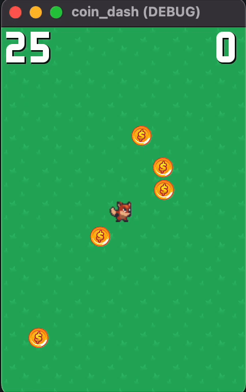
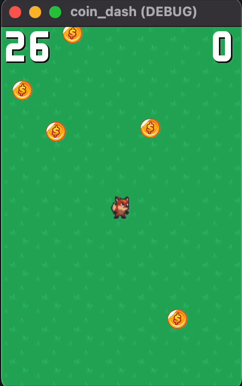
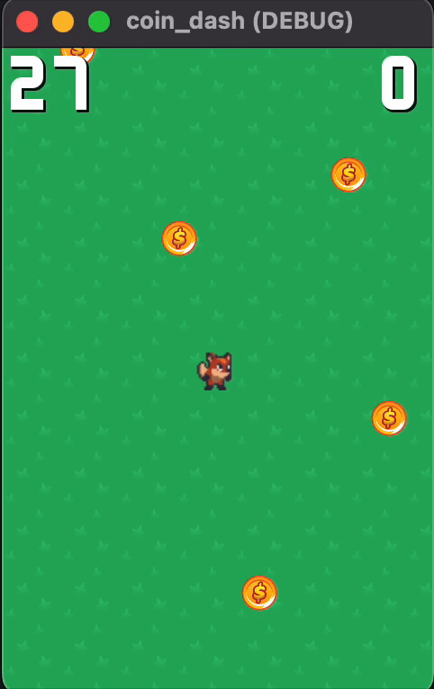
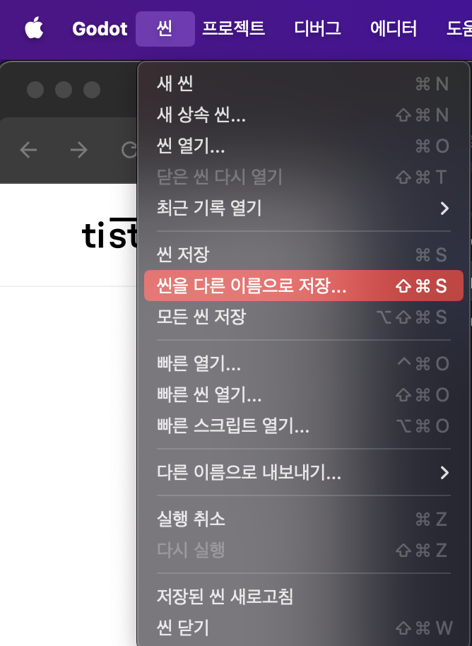
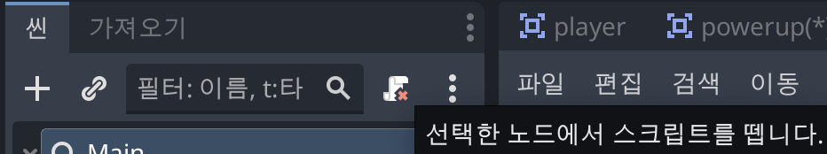
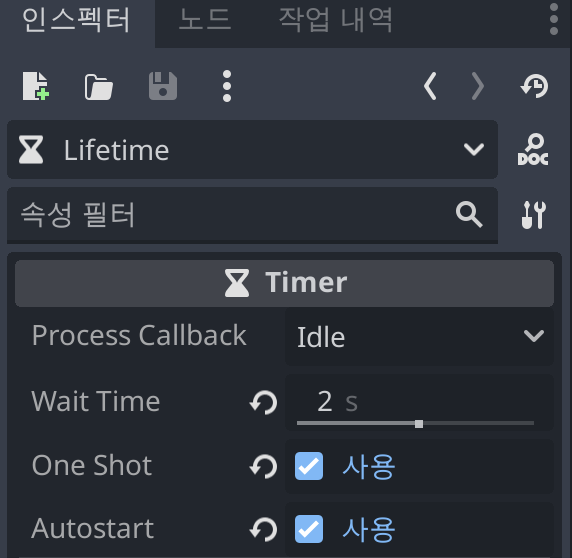
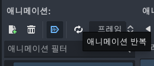

**이번 편에서 할 것**

게임 기능과는 무관하지만 있으면 게임을 풍성하게 만들어줄 juice 요소들 추가하기

그리고 마지막으로 배포하기

* * *

## \[이펙트\]

동전을 주울때 크기가 커졌다가 사라지는 효과를 줄 것이다.

트위닝(=이징) 예제는 다음 링크를 참고하면 여러가지 예제를 볼 수 있다.

[https://easings.net/](https://easings.net/)

그런데 플레이어가 동전에 닿은 순간 동전이 바로 제거되지 않으면 곧바로 `area_entered` 시그널이 다시 트리거되어 점수가 중복으로 증가 되어버린다.

이때문에 `collision shape` 를 비활성화해서 동전이 충돌이 트리거되지 못하게 해야한다.

coin 의 pickup 함수에 코드를 추가해보자.

```bash
func pickup():
	$CollisionShape2D.set_deferred("disabled", true)  # disabled 처리
	var tween = create_tween().set_parallel().set_trans(Tween.TRANS_QUAD)  # 트윈 오브젝트 생성

	# 트위닝 설정. (대상 오브젝트, 변경할 속성, 종료값, 지속시)
	tween.tween_property(self, "scale", scale * 3, 0.3)
	tween.tween_property(self, "modulate:a", 0.0, 0.3)

	await tween.finished
	queue_free() # 노드를 제거
```

함수의 첫줄부터 보면 disabled 처리를 해주는데, 충돌이 처리되고 있는 중이라 속성을 변경할 수 없어 현재 프레임이 끝날때까지 기다려야 한다. 이 역할을 `set_deferred()` 가 해준다.

다음으로 트윈 오브젝트를 생성하는데 `set_parallel()` 는 여러 트윈을 동시에 발생시키며 `set_trans()`은 어떤 함수를 사용할 지 적어주면 된다. 코드에는 `TRANS_QUAD` 를 줬는데, 다양한 옵션이 있으니 직접 해보면서 어떤 효과를 줄 지 결정하면 된다.



*TRANS_QUAD*



*TRANS_SPRING*



*TRANS_BOUNCE*

## \[사운드\]

`Main`에 `AudioStreamPlayer` 노드를 3개 추가하고 각각 이름을 CoinSound, LevelSound, EndSound 로 변경한다.

재생하고 싶은 사운드 이펙트 파일을 각 노드의 `Stream 속성에 드래그해서 넣어준다.`

그리고 해당하는 함수에 사운드가 재생되도록 play() 코드를 넣어준다.

-   \_on\_player\_pickup() 에 $CoinSound.play() 추가
-   game\_over() 에 $EndSound.play() 추가
-   spawn\_coins() 에 $LevelSound.play() 추가

## \[아이템\]

남은 시간을 늘려주는 아이템을 추가해보자.

이 아이템은 필드에 랜덤으로 잠깐 생성되었다가 금방 사라지도록 만들 것이다.

**(1) 씬 생성**

이미 만든 `Coin`과 유사한 씬이 될것이므로 `Coin`씬에서 \[씬\] - \[씬을 다른 이름으로 저장\] 하여 만들면 편하다.



씬의 이름은 `powerup.tscn`으로 저장하고, 루트 노드의 이름을 `Powerup`으로 변경한다.

그룹탭에 추가한 coins 그룹은 삭제하고 powerups그룹을 새로 생성한다.

또 애니메이션 이미지도 다른 이미지로 교체해준다.

스크립트도 작성해야 하는데, 이름이 `coin.gd`로 되어있을것이므로 간편하게 '스크립트 떼기'를 했다가 다시 새로 스크립트를 만들어주자.



**(2) 타이머**

오브젝트가 화면에 나타났다가 사라지게 만들기 위해 `Timer` 노드를 추가하고 이름은 `Lifetime`으로 바꿔주자.

그리고 다음과 같이 설정해준다.



timeout 시그널을 연결해서 시간이 종료되면 화면에서 사라지게 만들어준다.

동전이 pickup 되었을 때 queue\_free()를 해주던것과 동일하다.

```bash
func _on_lifetime_timeout():
	queue_free()
```

**(3) Main에 연결**

이번엔 `Main` 씬에 연결해줄 차례다.

`Main`하위에 `Timer` 노드를 추가하고 PowerupTimer로, `AudioStreamPlayer` 노드를 추가하고 PowerupSound로 각각 변경해준다.

`Coin`씬을 연결할때와 마찬가지로 `main.gd` 상단에 파워업씬 변수를 추가해준다.

```bash
@export var powerup_scene : PackedScene
```

그러면 이번에도 우측 \[인스펙터\] 창에 `Powerup Scene` 항목이 추가된걸 볼 수 있다.

여기에 `powerup.tscn` 을 드래그해 넣어준다.

다음으로 `timeout` 시그널을 연결하고 코드를 작성한다.

```bash
func _on_powerup_timer_timeout():
	var powerup = powerup_scene.instantiate()
	add_child(powerup)
	powerup.screensize = screensize
	powerup.position = Vector2(randi_range(0, screensize.x),
		randi_range(0, screensize.y))
```

**(4) 오브젝트 노출**

이제 파워업 아이템이 나타나게 하기 위한 코드를 작성해준다.

`_process()` 함수에서 새 동전이 생성될 때에 같이 나타날 수 있도록 추가해준다.

(다음 레벨로 넘어가는 코드에 포함시켰으므로 아이템은 2레벨부터 나타난다.)

```bash
func _process(delta):
	if playing and get_tree().get_nodes_in_group("coins").size() == 0:
		level += 1
		time_left += 5
		spawn_coins()

		# 추가
		$PowerupTimer.wait_time = randf_range(2, 5)
		$PowerupTimer.start()
```

여기까지 하면 화면에 아이템이 나타나고 잠시 뒤 사라지는것까지 확인할 수 있다.

이젠 플레이어가 아이템을 집을 수 있어야 한다.

`player.gd` 에서 `_on_area_entered()` 함수를 다음과 같이 수정한다.

```bash
func _on_area_entered(area):
	if area.is_in_group("coins"):
		area.pickup()
		# pickup.emit()
		pickup.emit("coin")  # 변경
	# 추가
	if area.is_in_group("powerups"):
		area.pickup()
		pickup.emit("powerup")

	if area.is_in_group("obstacles"):
		hurt.emit()
		die()
```

pickup의 경우의 수가 coin, powerup 두가지로 변경되었기 때문에 구분을 위해 `pickup.emit()` 호출시에 넘기는 값을 추가해주었다.

이에 맞춰 `main.gd` 파일도 수정해준다.

\[기존 코드\]

```bash
func _on_player_pickup():
	$CoinSound.play()
	score += 1
	$HUD.update_score(score)
```

\[수정 코드\]

```bash
func _on_player_pickup(type):
	match type:
		"coin":
			$CoinSound.play()
			score += 1
			$HUD.update_score(score)
		"powerup":
			$PowerupSound.play()
			time_left += 5
			$HUD.update_timer(time_left)
```


*아이템이 나타났다가 2초뒤 사라진다.*

## \[동전 애니메이션 디테일\]

모든 동전이 동시에 반짝이는 효과를 보여주고 있고 반짝임이 계속 반복된다.

이를 간헐적으로 랜덤한 때에 각각의 동전이 독립적으로 반짝이도록 수정해보자.

먼저 동전의 애니메이션 창으로 가서 '애니메이션 반복'을 해제한다.



`Coin` 씬에 `Timer` 노드를 추가하고 타이머가 랜덤한 시각에 시작되도록 코드를 작성한다.

그리고 timeout 시그널을 연결하고 동전 애니메이션이 프레임 0부터 시작되도록 코드를 추가해준다.

```bash
func _ready():
	$Timer.start(randf_range(3, 8))

func _on_timer_timeout():
	$AnimatedSprite2D.frame = 0
	$AnimatedSprite2D.play()
```

## \[장애물\]

플레이어가 닿으면 game over 되는 장애물을 생성해보자.

새 `Area2D` 씬을 만들고 Cactus로 이름을 변경한다.

이번엔 애니메이션이 따로 없기 때문에 `Sprite2D`와 `CollisionShape2D` 를 자식으로 추가한다.

파일 시스템에서 선인장 이미지를 `Sprite2D` 의 `Texture` 속성으로 드래그해 넣어준다.

`Collision Shape` 에는 `RectangleShape2D`를 추가해서 히트박스 크기를 조정해준다.

\[노드\] 탭에서 `Cactus` 를 obstacles 그룹으로 추가한다.

이번엔 `Main`씬으로 가서 \[자식 씬 인스턴스화\]로 Cactus 를 추가해준다.

게임을 실행해보면 선인장이 나타나있다.

동전은 랜덤한 위치에 생성되기 때문에 선인장 위에도 생성될 수 있다.

이런 경우 동전의 위치를 다시 설정해줘야 한다.

충돌을 감지해서 위치를 바꾸는 코드를 추가하자.

`Coin` 씬에 `area_entered` 시그널을 연결하고 다음 코드를 작성한다.

```bash
func _on_area_entered(area):
	if area.is_in_group("obstacles"):
		position = Vector2(randi_range(0, screensize.x), randi_range(0, screensize.y))
```

powerup 아이템도 추가해줬기 때문에 해당 씬에도 동일한 작업을 해준다.

이제 `Main`에 장애물을 각 레벨마다 +1개씩 랜덤한 위치에 등장시킬 것이다.

```bash
@export var cactus_scene : PackedScene
```

`main.gd` 의 상단에 위 코드를 추가하고 \[인스펙터\] 창에 나타난 `Cactus Scene`에 `cactus.tscn` 을 드래그해 넣어준다.

그리고 `_process()` 함수 안에 `spawn_coins()` 다음에 장애물을 생성하는 함수가 실행되도록 하자.

```bash
func spawn_cactus():
	var cactus = cactus_scene.instantiate()
	add_child(cactus)
	cactus.position = Vector2(randi_range(0, screensize.x),
		randi_range(0, screensize.y))
```

생성과 마찬가지로 게임 오버 되었을 때 그룹에서 전부 제거해주는 작업도 필요하다.

`game_over()` 함수에서 다음 코드를 추가하자.

```bash
func game_over():
	...
	get_tree().call_group("obstacles", "queue_free") # 추가
	...
```

## \[결과\]

빌드는 아주아주 간단하다.

운영체제에 해당하는 파일을 다운받아서 exe 파일을 실행하면 된다!

\[macOS\]

[https://github.com/yellyB/godot/blob/main/macOS/coin\_dash.dmg](https://github.com/yellyB/godot/blob/main/macOS/coin_dash.dmg)

\[window\]

[https://github.com/yellyB/godot/blob/main/window/coin\_dash.zip](https://github.com/yellyB/godot/blob/main/window/coin_dash.zip)
