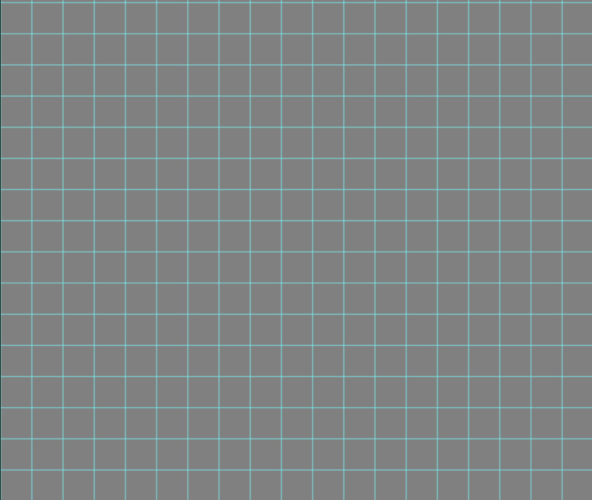
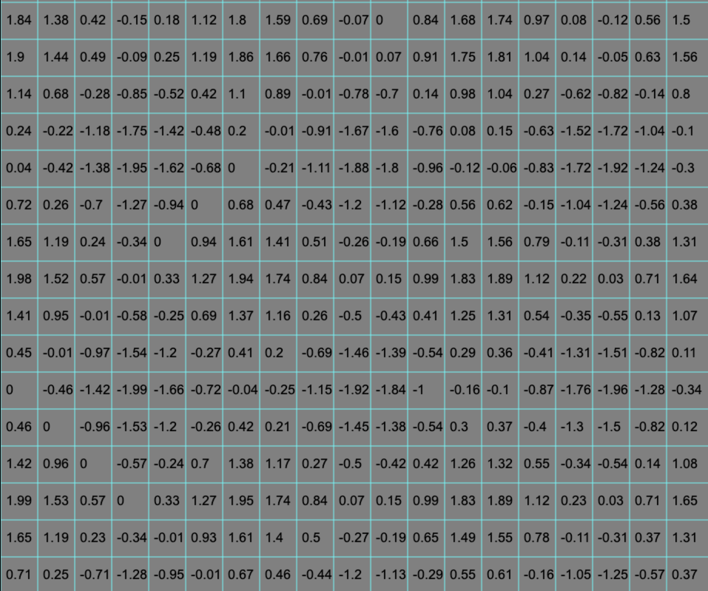
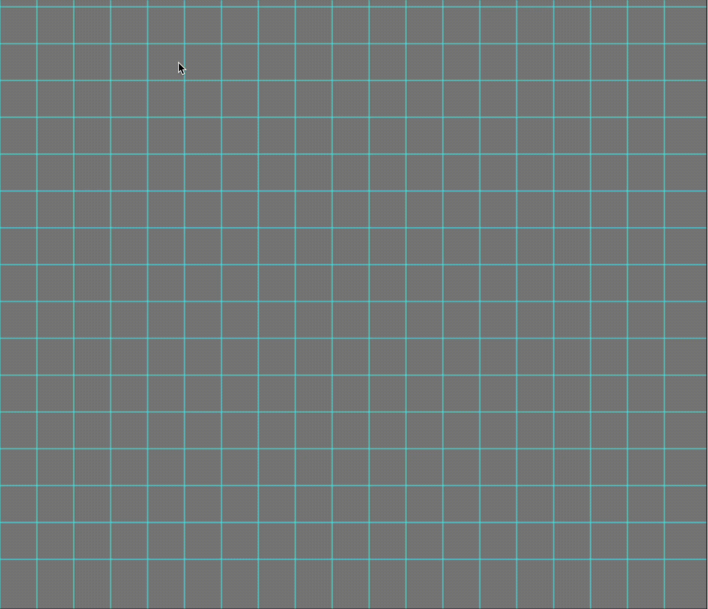
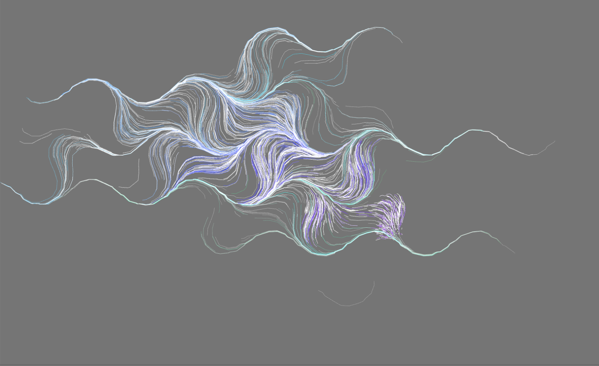

## Flow Field

Flow Field 는 시뮬레이션에 사용되는 그래픽 기술로, 각 지점에 대한 특정 방향으로의 흐름을 나타내는 표현 방법이다. (feat. chat GPT)

예시를 찾아보면 초등학생 때 철가루와 자석을 이용해 자기장을 표시하는 듯한 비주얼이다.

generative art 결과물들을 보면 여기에서도 많이 쓰이는듯한데 p5.js 라는 라이브러리를 이용하면 좀 더 편하게 구현할 수 있는 모양이다.

하지만 간단한 건 직접 구현하기 그다지 어렵지 않으니 HTML canvas + JavaScript 로 직접 구현해 보자.

## 결과물


위처럼 마우스 드래그 할 때마다 Flow Field가 그려지도록 만들 것이다.

## Flow Field 구현

세세한 코드를 전부 올리진 않고(어차피 GitHub에 있으니..) 기본 컨셉만 기록하겠다.

#### 1\. Flow Field 만들기

일단 canvas를 설정한 cellSize를 기준으로 그리드를 그린다.

cellSize가 20이면 가로세로 20픽셀인 정사각형의 그리드가 그려진다.



각각의 cell에 선들이 움직일 경로 값을 정해준다.

가로 세로로 변화로운 움직임을 위해 row와 col에 sin, cos함수를 이용해서 flowField에 angle이라는 값을 하나하나 넣어준다.

```javascript
// FlowField의 그리드 설정
  generateFlowField() {
    this.rows = Math.floor(this.canvas.height / this.cellSize);
    this.cols = Math.floor(this.canvas.width / this.cellSize);

    for (let row = 0; row < this.rows; row++) {
      this.flowField.push([]);
      for (let col = 0; col < this.cols; col++) {
        const angle = Math.sin(row) + Math.cos(col);  // 경로 값
        this.flowField[row].push(angle);
      }
    }
  }
```

이 값들을 각 셀에 나타내보면 아래와 같다.



이런 식으로 angle값을 가진 셀들이 생성된다.

#### 2\. 선 궤적 구하기

이 정도까지 하면 이 값에 따라 선을 그려주기만 하면 된다.

선을 그리는 방법은 trajectories라는 궤적이란 변수에 배열로 x, y좌표를 담아두고 draw() 메서드에서 이 좌표 정보를 이용해 그려줄 것이다.

지나갈 궤적의위치는 아래 과정으로 결정한다.

1.  드래그 이벤트 리스너 등록하고 드래그 중인 현재 좌표 알아내기
2.  현재 커서가 Flow Field 의 어느 셀에 위치하는지 계산하여 flowField에 미리 넣어놓은 angle값을 가져오기
3.  angle값을 가지고 sin, cos 함수를 이용해 다음번에 이동할 x, y 좌표를 계산, trajectories에 추가

1~3 과정을 반복한다. 그럼 선이 그려질 궤적 값이 결정된다.

```javascript
    let currRowIndex = Math.floor(this.pos.y / this.cellSize);
    let currColIndex = Math.floor(this.pos.x / this.cellSize);

    this.angle = this.flowField[currRowIndex][currColIndex];  // 현재 커서 위치의 angle 값

    this.pos.x += Math.cos(this.angle);
    this.pos.y += Math.sin(this.angle);

    this.trajectories.push(this.pos);
```

#### 3\. 그리기

draw() 메서드로 궤적 정보 대로 선을 그려준다.

```javascript
  draw(ctx) {
    ctx.beginPath();
    ctx.moveTo(this.trajectories[0].x, this.trajectories[0].y);
    this.trajectories.forEach((trajectory) =>
      ctx.lineTo(trajectory.x, trajectory.y)
    );
    ctx.stroke();
  }
```

여기까지 하면 아래 같은 화면을 그릴 수 있다.



## 4\. 발전시키기

여기서 더 발전시키려면 선의 방향, 속도, 궤적의 길이, 색상,... 등을 다양하게 설정하면 된다.

혹은 마우스 움직임에 따라 그리지 않고 canvas 내에 궤적을 랜덤 발생시킬 수도 있다.

그리고 sin, cos 함수에 다양하게 값을 곱하거나 더하면 새로운 흐름의 Flow Field 를 그릴 수 있기 때문에 이것저것 변경해 가며 해보면 좋다.

직접 해보기(select brush에서 FlowFieldBrush 선택): [https://yellyb.github.io/painted-world/](https://yellyb.github.io/painted-world/)

코드: [https://github.com/yellyB/painted-world](https://github.com/yellyB/painted-world)


