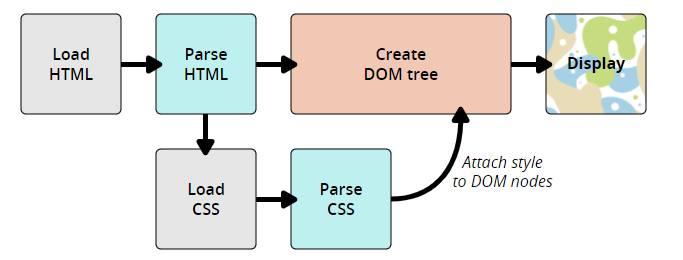

**브라우저 렌더링 과정**



1\. 브라우저가 HTML을 로드

2\. HTML 문서를 파싱 -> 트리구조의 DOM노드 생성

2\. CSS파일로 CSSOM 트리 생성

3\. DOM + CSSOM => 렌더 트리 생성

4\. 뷰포트에서 위치 결정(레이아웃)

5\. 화면에 표시(페인팅)

리플로우: 렌더링 중 4의 과정을 다시 수행. (position, width, height, padding, margin, border, ...)

리페인팅: 5번 페인팅 과정을 다시 수행. 레이아웃에 영향을 미치지 않는 작업은 바로 리페인팅됨 (color, background, ...)

**script태그를 body 최하단에 사용하는 이유**

브라우저는 위에서 본 순서대로 렌더링을 수행하기 때문에 HTML중간에 script태그를 만나면 HTML파싱을 중단하고 스크립트를 다운로드 후 실행한다.

이 것은 두 가지 문제를 야기시키는데

1\. 스크립트 아래에 있어서 아직 생성되지 않은 DOM요소에 접근할 수 없다.

2\. 중간에 실행된 스크립트의 양이 많다면 페이지 로딩에 딜레이가 생긴다.

이 때문에 body의 최하단에 script태그를 사용하는 것이다.

**script태그를 위에서 사용하고 싶다면?**

body의 하단에 스크립트를 사용하는 것은 완벽한 해결책은 아니다.

만약 script태그를 body의 최하단이 아닌 곳에서 사용하고 싶다면  defer나 async속성을 사용하면 된다.

```html
<script defer src="functions.js"></script>  // defer
<script async src="functions.js"></script>  // async
```

위 두 방식을 사용해서 script의 실행 순서를 조절할 수 있는데 HTML을 파싱 하는 중간에 script를 만났을 때 파싱을 중단하지 않고 백그라운드에서 스크립트의 다운을 실행한다.

하지만 두 속성이 스크립트를 실행하는 순서는 다르다.

1\. defer

defer는 HTML파싱을 막지 않고 스크립트를 다운로드 한 뒤 콘텐츠가 전부 출력된 후 스크립트가 실행된다.

이때 defer는 외부 스크립트일 경우에만 유효해서 src가 없으면 defer는 무시된다.

또 스크립트들은 문서에 작성된 순서대로 차례대로 실행된다.

2\. async

HTML파싱을 막지 않고 스크립트를 다운로드한다는 점은 defer 속성과 비슷하지만 스크립트의 실행은 HTML파싱 중간에 실행된다는 점이 다르다.

그리고 스크립트들은 서로를 기다리지 않아서 앞에 긴 스크립트가 있어도 뒤에 짧은 스크립트가 있다면 짧은 스크립트가 먼저 실행된다.
