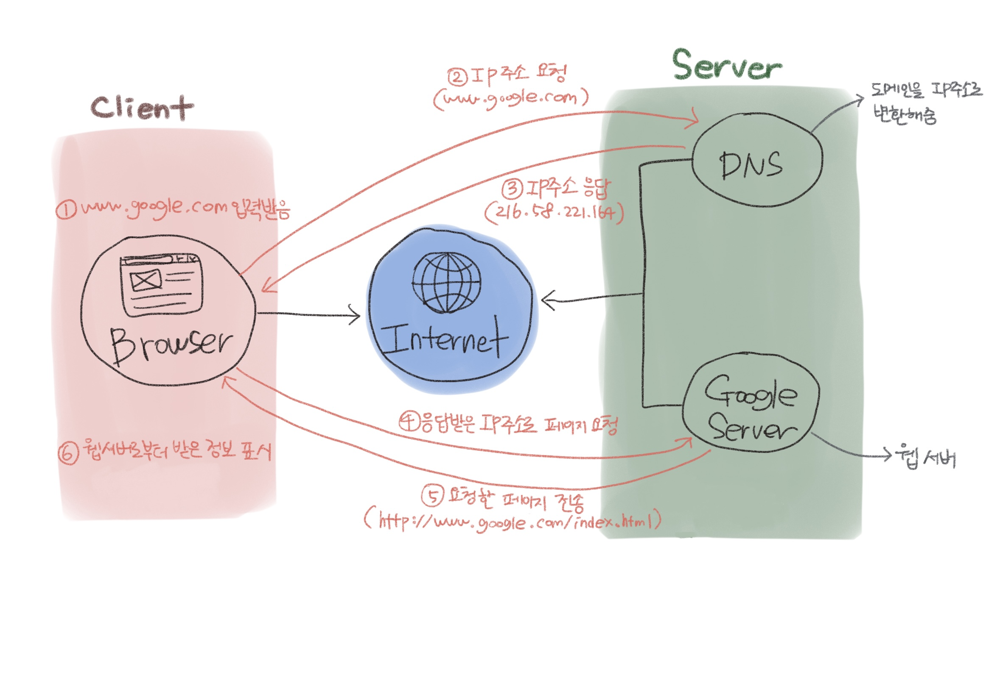

www.google.com 을 주소창에 치면?

서버에서 컨텐츠를 가져오려면 저장되어있는 주소가 필요하다.

그런데 이 IP주소는 숫자로 되어있어서 사람들은 기억하기 쉬운 문자 주소를 사용한다.

1\. 브라우저가 캐시에서 주소를 찾음 => 그 사이트를 이전에 방문한 적 있는지? + IP주소를 알고있는지? 확인

1-1. 캐시에서 찾는 순서: 브라우저 캐시→OS캐시→router캐시→ISP캐시

1-2. URL에 해당하는 IP못찾으면 운영체제에게 웹사이트를 찾도록 요청

OS는 URL의 주소를 system32에 있는 hosts파일에서 찾는다.

거기서도 못찾으면? => DNS 서버에서 IP주소 요청
2\. 이제 OS가 IP주소를 알게되었고 이걸 브라우저에 전달함

3\. Browser가 TCP와 연결함(3-way-handshake)

4\. 브라우저는 IP주소에 대해 HTTP요청함. (google.com은 get요청)

5\. 브라우저는 TCP프로토콜로 요청을 하고 그걸 IP주소로 보낸다.(이 과정에서 OS와 서버의 방화벽이 보안 검사를 함)

6\. 마침내 선택된 서버에서 요청을 처리하고 response를 생성하여 보낸다. HTML, CSS, JS파일을 OS로 응답하고 거기서 브라우저로 보냄

7\. 원하는 화면이 띄워짐
