파이어베이스 인증 기능 설정

1\. 아래 링크로 접속한다.

[https://console.firebase.google.com/](https://console.firebase.google.com/)

2\. 인증 기능을 추가할 프로젝트를 선택

3\. 인증 설정 화면으로 이동

4\. 로그인으로 사용할 방법을 선택해준다.

나는 이메일, 구글, 깃허브를 사용할 것이기 때문에 차례로 하나씩 설정해보도록 하겠다.

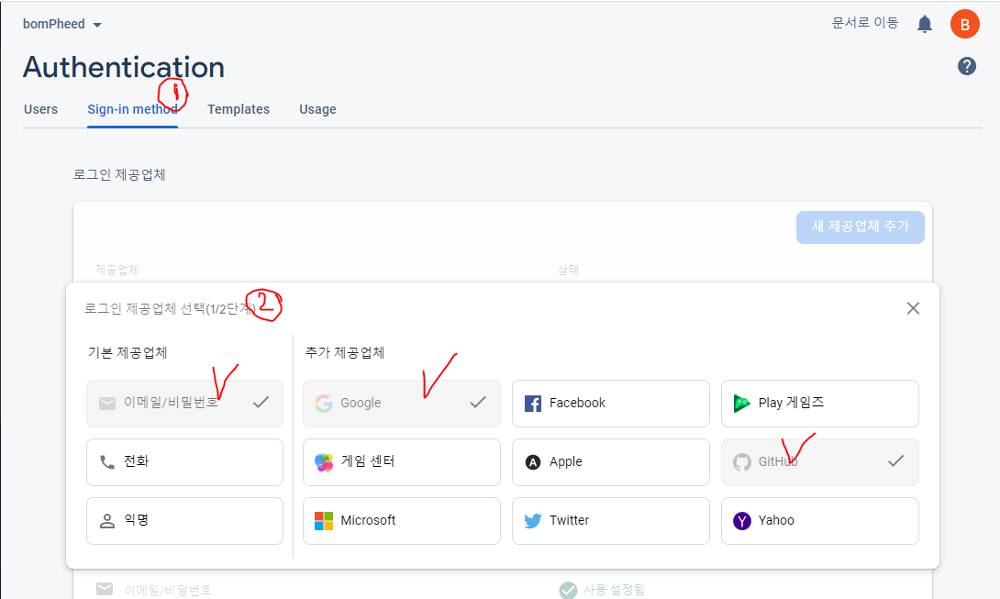

5-1. 이메일 인증

이메일/비밀번호 토글을 **"사용 설정"** 해준다.

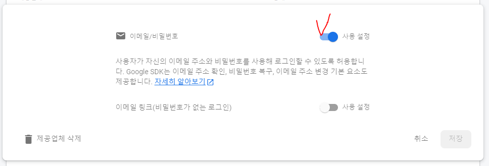

5-2. 구글 인증

마찬가지로 **"사용 설정"** 해준 뒤 \[프로젝트 지원 이메일\] 셀렉트 박스에 뜨는 나의 이메일을 선택해준다.

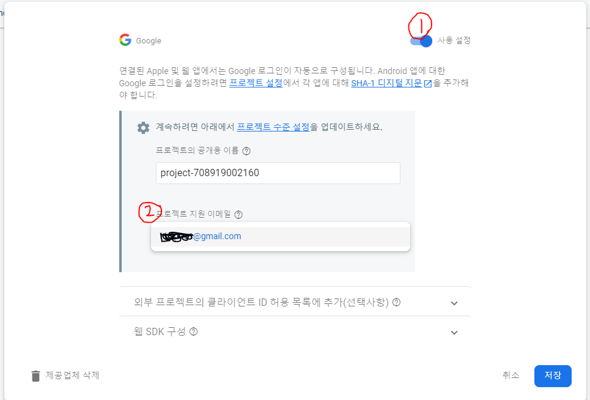

5-3. 깃허브

깃허브는 단계가 살짝 많은데, 우선 클라이언트 ID와 보안 비밀번호를 입력하기 위해 깃허브에 접속한다.

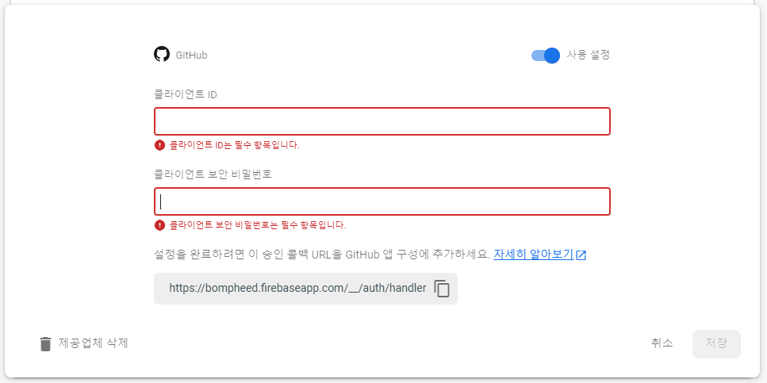

5-3-1.

[https://github.com/settings/profile](https://github.com/settings/profile)

깃허브에 로그인한 뒤 settings 메뉴에 들어간다.

5-3-2.

화면 왼쪽에 보이는 메뉴 중 가장 아래에 있는 Developer settings를 클릭한다.

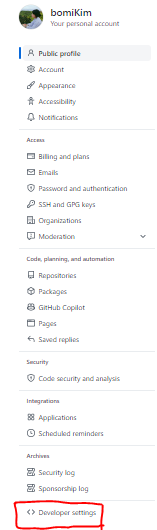

5-3-3.

그 후 OAuth Apps를 클릭하면 아래화 같이 나온다.

나는 이미 하나 생성했기 때문에 화면이 아래와 같은데 아직 아무 앱도 연결하지 않았다면 **Register a new application** 버튼을 클릭하면 된다.

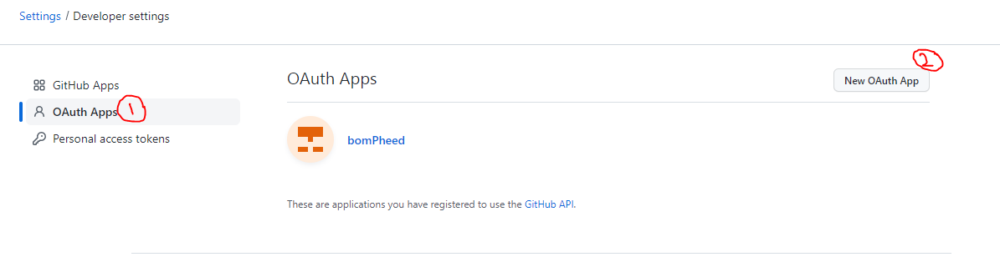

5-3-4.

여기서 1, 2, 3번 칸을 채워주면 된다.

1번 인풋은 내가 설정하고 싶은 프로젝트 이름을 적어준다.

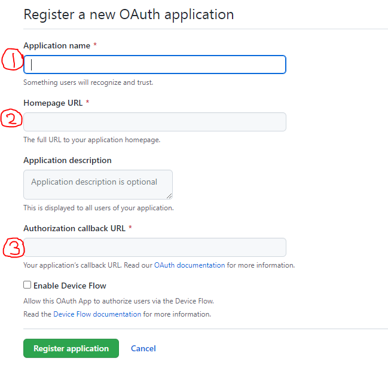

2번 인풋에는 다시 파이어베이스로 돌아와서 두 번째 단락에 있는 승인된 도메인 중 아래에 표시된 주소를 https://를 붙여서 입력해준다.

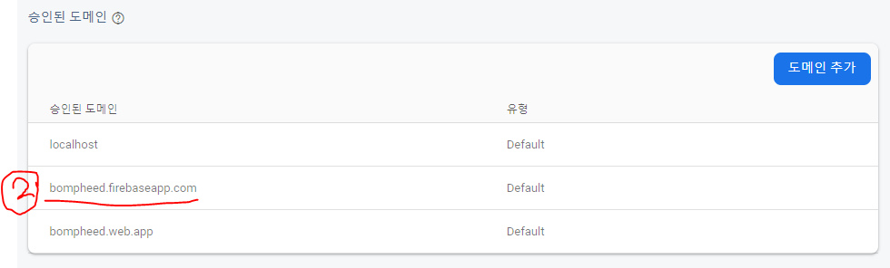

3번 인풋에는 파이어베이스 깃허브 연동 창에 나오는 아래 표시된 주소를 복사해서 입력해준다.

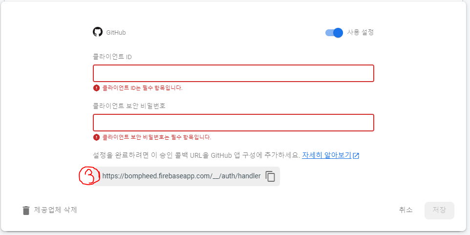

5-3-5.

이 과정을 마치면 깃허브에서 등록을 할 수 있게 된다.

등록을 마치고 **Generate a new client secret** 버튼을 클릭하면 보안 비밀번호가 생성된다.

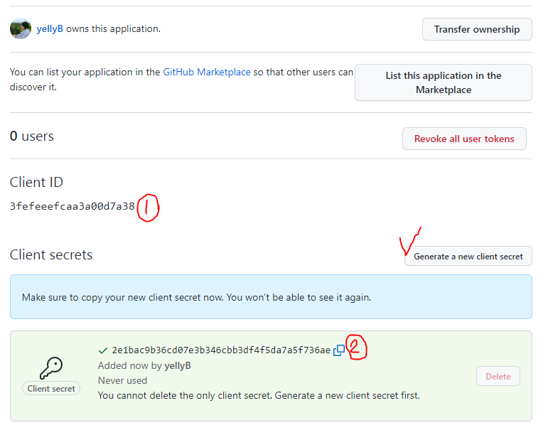

1번과 2번 항목을 각각 파이어베이스의 클라이언트 ID와 클라이언트 보안 비밀번호에 입력해주면 끝이 난다.

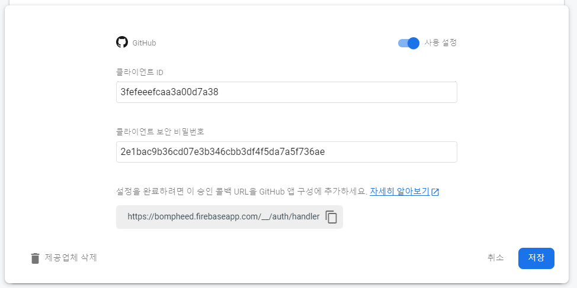
